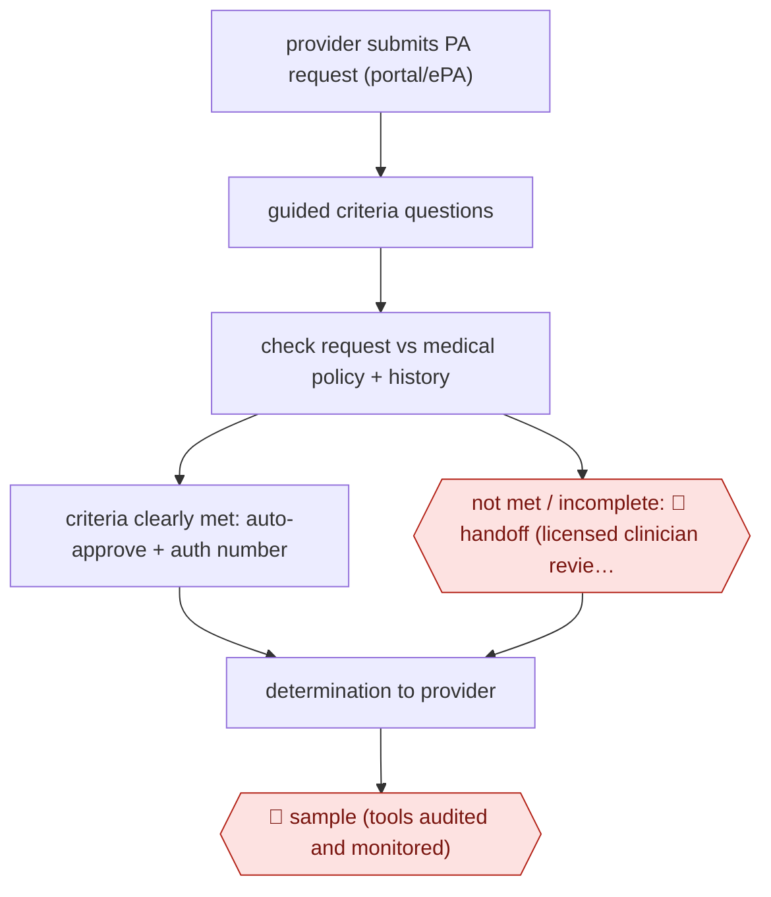

# Approve-only payer auto-auth

`PRO › HLT › RCM` · sampled · evidence A · **draft: needs a reference example** ([how to add one](../../../../../CONTRIBUTING.md#1-add-an-example-run))

**Shape:** `provider submits PA request (portal/ePA) → guided criteria questions → check request vs medical policy + history → criteria clearly met: auto-approve + auth number | not met / incomplete: 🛑 handoff (licensed clinician reviews; only humans deny) → determination to provider → 🛑 sample (tools audited and monitored)`
**Variants:** `premera-clara` · `hcsc-blueapprovr` · `cohere-health` · `florida-blue-in-house`

<!-- shape diagram: generated by scripts/build_diagrams.py from `shape`; don't edit -->

<!-- end shape diagram -->

## Background

In the United States, a health insurer (the payer) often requires a doctor's office or hospital (the provider) to ask permission before a costly treatment, test or drug: this is prior authorization. The insurer checks the request against its written medical policy to see whether the care meets its clinical criteria, then approves, partly approves or denies it. Done by hand this is slow, and providers wait days for an answer. Here the agent checks each request as it arrives and approves at once those that clearly meet the criteria, which removes the wait for the plain cases. It never denies. Anything it cannot approve goes to a licensed clinician, because a denial decides whether a patient gets care and must come from a qualified person, and the insurer is accountable for it. People also audit the tool regularly.

**Terms:**
- **Prior authorization (PA)**: the insurer's advance approval for a treatment, test or drug before it is given.
- **Payer, provider**: the insurer that pays for care; the doctor's office or hospital that delivers it.
- **ePA (electronic prior authorization)**: submitting the request through an online portal or the provider's records system rather than by fax or phone.
- **Medical policy, clinical criteria**: the insurer's written rules for when it will cover a service.
- **Authorization number**: the reference the insurer returns for an approved request.
- **Determination**: the insurer's decision: approved, partially approved or denied.
- **Licensed clinician (plan medical management)**: the insurer's own nurses and physicians who review requests that are not auto-approved.
- **Auto-approve**: approving without a person looking at the request.
- **EHR**: electronic health record, the provider's patient-records system.

## Build it with an agent

**Form:** `service`. Requests arrive at any hour from a portal and no one is at a keyboard when one is checked; people see only the requests that are not approved, and an audit sample.

**You need:** the insurer's medical policy and clinical criteria as reference files the agent reads, one file per service or procedure code covered; read access to the request, the guided-question answers and, for the codes that use it, the member's earlier authorizations and claims; an approval tool that records an approval and returns an authorization number; a queue for clinician review; a queue for audit samples; a setup your organisation has approved for health information about identifiable patients. Give the agent no tool that records a denial.

| Step | Built as |
|---|---|
| provider submits PA request (portal/ePA) → guided criteria questions | Outside the agent. The portal asks the provider the questions each service requires. Each completed request lands on a queue. |
| check request vs medical policy + history | An Agent SDK program, or `claude -p` started by the queue, takes one request. A skill holds the checking procedure: read the criteria file for the code, compare the answers and, for the codes that use it, the member's history, then return met, not met or incomplete, with the criteria it relied on. |
| criteria clearly met: auto-approve + auth number | The approval tool is the only tool that writes a decision. A `PreToolUse` hook lets it run only when a script confirms that every required field is present and that every criterion in the file is met. |
| not met / incomplete: 🛑 handoff | The request goes to a clinician queue with the criteria checked, the answers given and what is missing. |
| determination to provider | The program writes the result to the portal. Approvals come from the approval tool; any other determination is written by the clinician in the insurer's own system. |
| 🛑 sample (tools audited and monitored) | See Checkpoints. |

**Checkpoints:** `handoff`: the agent has no tool that denies or partly approves, so every request that is not clearly met can only go to the clinician queue; the hook on the approval tool blocks an approval when any criterion is unmet or any field is empty. `sample`: a fixed share of auto-approvals is copied, with the evidence, to an audit queue that clinicians or quality staff review; the reviewers' findings and any overturned approval are logged and used to tighten the criteria files and the hook's script.

**Since the sources:** Sources date from 2023-03 to 2026-04. The newest is within 12 months of this check, so no search for newer accounts was made. The sources describe insurers' own or bought tools, such as Premera's CLARA, HCSC's tool and Cohere's portal; they give the outcome (approve, or pass to a clinician) and say little about how the tools decide. The checking step here, a skill comparing answers against criteria files, is therefore a design, not a description of those tools. Two sources could not be read in full: the Becker's Payer page refused access and the Geisinger bulletin is a PDF that did not come through as text, so the entry's claims from them are as already written. Rules on automated decisions in prior authorization vary by state and payer; the build above keeps denials with people and says nothing further about them.

*A design based on this entry's steps and the tool documentation as of 2026-11, not a reported run.*

## Steps

*As reported by the sources.*

1. The provider submits the prior-authorization (PA) request electronically; the tool asks 'the precise number of questions required to evaluate' the request (about six minutes on average to submit) [[2]](#sources)[[4]](#sources).
2. The insurer's engine checks the request against medical policy/clinical criteria and, for some codes, historical authorizations and claims; it 'helps identify requests that clearly meet medical criteria' [[1]](#sources)[[2]](#sources).
3. When the criteria are met and the information is complete, the request is auto-approved in real time and the authorization number is returned to the portal [[1]](#sources)[[4]](#sources).
4. 🛑 **Handoff**: anything not auto-approved goes to licensed clinicians (plan medical management / nurse and physician reviewers); the tool never denies: requests are 'only approved or advanced to a hands-on review by an HCSC clinician' [[1]](#sources)[[2]](#sources)[[3]](#sources)[[4]](#sources).
5. The insurer sends the final determination (approved, partially approved, or denied) to the submitter [[4]](#sources).
6. 🛑 **Sample**: 'Automated tools are regularly audited and monitored to ensure accuracy, fairness, and accountability' [[1]](#sources).

**Output:** Real-time approval (auth number) or a clinician-made determination returned to the provider's portal/EHR.
**Failure modes → guards:** Automation drifting into denials → approve-only design, every non-approval routed to a licensed clinician. Incomplete submissions auto-pended → guided questions collect required data up front. Model drift/bias → periodic audit and monitoring.
**How it differs:** AWF-0032 Criteria-gated prior auth is the provider side (assist): staff prepare and submit a request. This is the payer side and sampled: the agent issues approvals without per-item human approval, and humans handle only the non-approved remainder plus audits. Deliverable is the determination, not the submission packet.

## Public runs

Coverage as of 2026-11-13: **Strong**: a first-hand, detailed run that matches most of the shape. Collected and re-checked in [Third collection pass](../../../../../research/2026-11-third-pass.md).

- [Premera Blue Cross, Making prior authorization easier](https://healthsource.premera.com/your-premera-plan/prior-authorization-easier/) (2026-04-07). In-house CLARA tool approves clear-criteria requests; clinicians review all others; tools audited. "about 85 percent of electronic prior authorization requests are now approved in real time". *First-hand: yes; confidence: high.*
- [HCSC, Transforms Prior Authorization Process](https://www.hcsc.com/newsroom/news-releases/2023/artificial-intelligence-prior-authorization-process-helps-members-providers) (2023-07-13). Pilot then expansion across inpatient/outpatient categories; approve-or-advance design, no tool denials. "speed approvals were granted 80% of the time for behavioral health decisions and 66% for specialty pharmacy decisions". *First-hand: yes; confidence: high.*
- [GuideWell/Florida Blue, AI in action](https://www.beckerspayer.com/leadership/ai-in-action-how-guidewell-is-improving-the-healthcare-experience/) (2025-07-31). Plan VP describes AI approvals since 2022, never denials, with human oversight. "processed nearly 3 million prior authorizations, with a remarkable 78% of cases receiving approval in under 90 seconds". *First-hand: yes; confidence: high.*
- [Geisinger Health Plan, Ops Bulletin](https://www.geisinger.org/-/media/onegeisinger/files/pdfs/provider/navinet/opsbulletins/2023_03_15_ops_cohere_full_launch_v2.pdf?hash=6F68D56F947DACC613BBEF8E8EBE2A04&sc_lang=en) (2023-03-15). Cohere portal auto-approves; non-auto-approved requests go to plan Medical Management. "Over 82% of those requests have been auto-approved". *First-hand: yes; confidence: med.*

## Sources

1. Premera Blue Cross (Healthsource Staff), Making prior authorization easier for the communities we serve, 2026-04-07. https://healthsource.premera.com/your-premera-plan/prior-authorization-easier/
2. Health Care Service Corporation, HCSC Transforms Prior Authorization Process, 2023-07-13. https://www.hcsc.com/newsroom/news-releases/2023/artificial-intelligence-prior-authorization-process-helps-members-providers
3. Svetlana Bender (GuideWell/Florida Blue), AI in action: How GuideWell is improving the healthcare experience, Becker's Payer Issues, 2025-07-31. https://www.beckerspayer.com/leadership/ai-in-action-how-guidewell-is-improving-the-healthcare-experience/
4. Geisinger Health Plan, Operations Bulletin (Cohere full launch), 2023-03-15. https://www.geisinger.org/-/media/onegeisinger/files/pdfs/provider/navinet/opsbulletins/2023_03_15_ops_cohere_full_launch_v2.pdf?hash=6F68D56F947DACC613BBEF8E8EBE2A04&sc_lang=en
