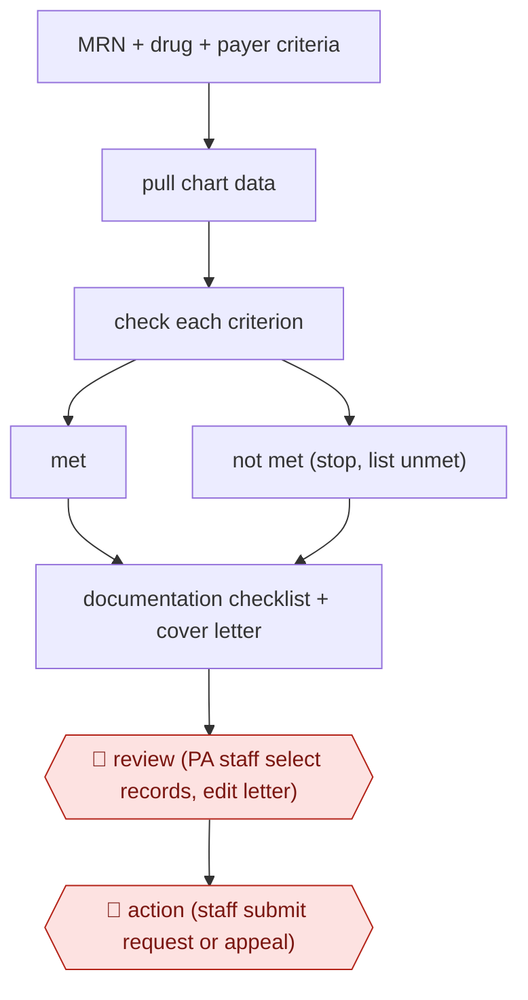

# Criteria-gated prior auth

`PRO › HLT › RCM` · assist · evidence A · **draft: needs a reference example** ([how to add one](../../../../../CONTRIBUTING.md#1-add-an-example-run))

**Shape:** `MRN + drug + payer criteria → pull chart data → check each criterion → met | not met (stop, list unmet) → documentation checklist + cover letter → 🛑 review (PA staff select records, edit letter) → 🛑 action (staff submit request or appeal)`
**How it differs:** AWF-0026 Ambient scribe (CLINDOC) produces a visit note from a conversation. This produces a payer submission, can stop when criteria are unmet, and is submitted by a human.
**Variants:** `epic-maestro-care-llm` · `nds-appeals-ai` · `notable-sidekick` · `latent-health`

<!-- shape diagram: generated by scripts/build_diagrams.py from `shape`; don't edit -->

<!-- end shape diagram -->

## Steps
1. Setup per medication: build ground-truth files from retrospective approvals and denials. Compare the LLM's per-criterion output against them. Refine the prompt and source data and retest until outputs match [[1]](#sources).
2. A staff member enters the patient's MRN, the medication and the date. Changing the date switches the tool from a new authorization to a denial appeal [[1]](#sources).
3. The tool pulls provider notes, flowsheets, labs, orders, medications and ICD codes from the EHR in real time. It combines them with the payer's prior-auth and medical-necessity criteria [[1]](#sources).
4. The LLM evaluates each criterion. If any criterion is unmet, the tool tells the user to stop and lists which criteria were met and which were not [[1]](#sources).
5. When all criteria are met, the tool produces a documentation checklist and drafts a cover letter that cites the supporting clinical information [[1]](#sources).
6. 🛑 **Review**: Staff on the Medical Necessity & Denials team follow the checklist to select records in the release-of-information workflow and edit the letter [[1]](#sources). In the appeals variant, staff read and edit each AI-drafted appeal and approve or reject it. Physicians review the clinical argument on medical-necessity cases [[2]](#sources).
7. 🛑 **Action**: Staff submit the packet or appeal to the payer. Complex, high-dollar medical-necessity denials stay with the human team [[2]](#sources).

**Output:** A payer-ready prior-auth or appeal packet (cover letter plus selected records), submitted by staff. Classified denial data goes back to the front-end authorization team.
**Failure modes → guards:** Supporting-documentation mismatches (7 errors in 970 criteria assessed at Duke) → per-drug ground-truth validation before go-live, and staff pick the records themselves [[1]](#sources). Out-of-scope complex denials → scope them out and route them to humans and physicians [[2]](#sources).

**Recent practice (2026):**
- Exception step: automation errors (missing allergies, packet-generation failure) create a staff task with clear instructions rather than a silent gap (Notable/MIT Health). [[3]](#sources)

## Public runs

Coverage as of 2026-11-06: **Strong**: a first-hand, detailed run that matches most of the shape. Collected and re-checked in [New workflows for empty categories](../../../../../research/2026-11-new-workflows.md). More runs added in [Third collection pass](../../../../../research/2026-11-third-pass.md).

- [Duke DIHI, Medical Prior Authorization Assistant](https://dihi.org/project/using-ai-to-reduce-the-burden-of-prior-authorizations-2/) (2026-04-01). Per-drug LLM criteria check validated on retrospective cases, then live with denials team. "the LLM correctly assessed the authorization status for all 83 cases across the three medications". *First-hand: yes; confidence: high.*
- [NDS InfoServ, AI-generated appeals case study](https://www.ndsinfo.com/case-studies/appeals) (n.d.). Appeal letters drafted from 835 files and EHR, staff edit and approve before submission. "Reviewing and approving an AI-generated appeal took 8–12 minutes". *First-hand: vendor; confidence: med.*
- [Northwestern Medicine, AI Helps Improve Access to Specialty Medication](https://nmventures.org/en/latent) (n.d.; pilot early 2025). Specialty pharmacy pilot: tool pulls chart evidence from Epic to support PA submission by staff. "the average time to complete a PA decreased by 67%, from 17 minutes to 5 minutes and 20 seconds". *First-hand: yes; confidence: med.*
- [Notable, MIT Health cut prior auth time in half](https://www.notablehealth.com/customer-stories/mit-health-cut-prior-auth-time-in-half-with-ai) (2026-11-10). Agent pre-assembles clinical packets and answers payer questionnaire; failures create human tasks. "completed in an average of 6 minutes, an estimated 45% reduction from the previous average ~11-minute handling time". *First-hand: vendor; confidence: med.*

## Sources

1. Duke Institute for Health Innovation, Using AI to Reduce the Burden of Prior Authorizations, 2024 (updated Apr 2026). https://dihi.org/project/using-ai-to-reduce-the-burden-of-prior-authorizations-2/
2. NDS InfoServ, How a 350-Bed Community Hospital Turned 1,400 Unworked Denials Into $2.1M in Recovered Revenue, n.d. https://www.ndsinfo.com/case-studies/appeals
3. Notable, MIT Health cut prior auth time in half with AI, 2026-11-10. https://www.notablehealth.com/customer-stories/mit-health-cut-prior-auth-time-in-half-with-ai
