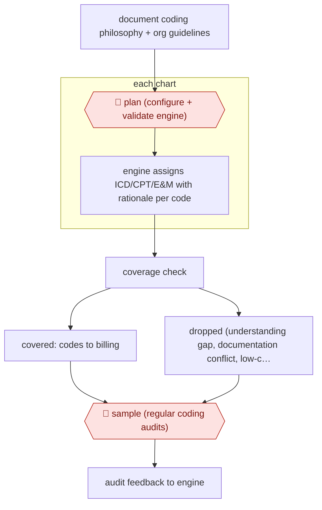

# Exception-routed autonomous coding

`PRO › HLT › RCM` · sampled · evidence B · **draft: needs a reference example** ([how to add one](../../../../../CONTRIBUTING.md#1-add-an-example-run))

**Shape:** `document coding philosophy + org guidelines → 🛑 plan (configure + validate engine) → each chart: engine assigns ICD/CPT/E&M with rationale per code → coverage check → covered: codes to billing | dropped (understanding gap, documentation conflict, low-confidence code, missing documentation): 🛑 handoff (coder) → 🛑 sample (regular coding audits) → audit feedback to engine`
**How it differs:** AWF-0032 Criteria-gated prior auth is the nearest. It is assist-level: staff review every letter and submit every request. Here codes on covered charts reach billing with no human review, and people only take exceptions and audit samples.
**Variants:** `nym-autonomous-coding`

<!-- shape diagram: generated by scripts/build_diagrams.py from `shape`; don't edit -->

<!-- end shape diagram -->

## Steps
1. Document the organization's coding philosophy and guidelines and configure the engine with them [[1]](#sources).
2. 🛑 **Plan**: validate the engine's results before relying on them. Train human coders to validate its output and give feedback [[1]](#sources).
3. The EHR sends charts to the engine. It codes them in seconds and gives a rationale for each code [[1]](#sources).
4. Codes on covered charts go straight to billing, with no per-chart review [[1]](#sources).
5. 🛑 **Handoff**: dropped charts go to human coders. The four drop reasons are engine understanding gaps, documentation conflicts, low confidence in one code, and missing documentation such as a missing ED note or provider signature [[1]](#sources).
6. 🛑 **Sample**: run regular audits and QA checks on autonomously coded charts. Audit findings feed the engine's knowledge base [[1]](#sources).

**Output:** Coded claims sent to billing, plus a queue of exception charts for coders.
**Failure modes → guards:** Charts with gaps or conflicts get coded wrongly → each type is routed out as a dropped chart. Coverage is partial (mainly outpatient specialties) → keep coder staffing for the dropped share.

## Public runs

Coverage as of 2026-11-06: **Weak**: only anonymous, vendor-linked or journalist-told accounts. Collected and re-checked in [Second collection pass](../../../../../research/2026-11-second-pass.md).

- [Geretz/Nym Health, Autonomous Medical Coding (OHIMA)](https://ohima.memberclicks.net/assets/docs/blog/RevCycle_AutonomousMedicalCoding_KacieGeretz.pdf) (n.d.). Vendor deck describing routing of dropped charts to coders and the audit loop. "~ 5 - 10% of charts cannot be coded due to engine understanding gaps". *First-hand: vendor; confidence: med.*

## Sources

1. Kacie Geretz (RCM Solutions Lead, Nym Health), Autonomous Medical Coding (OHIMA presentation), undated. https://ohima.memberclicks.net/assets/docs/blog/RevCycle_AutonomousMedicalCoding_KacieGeretz.pdf
