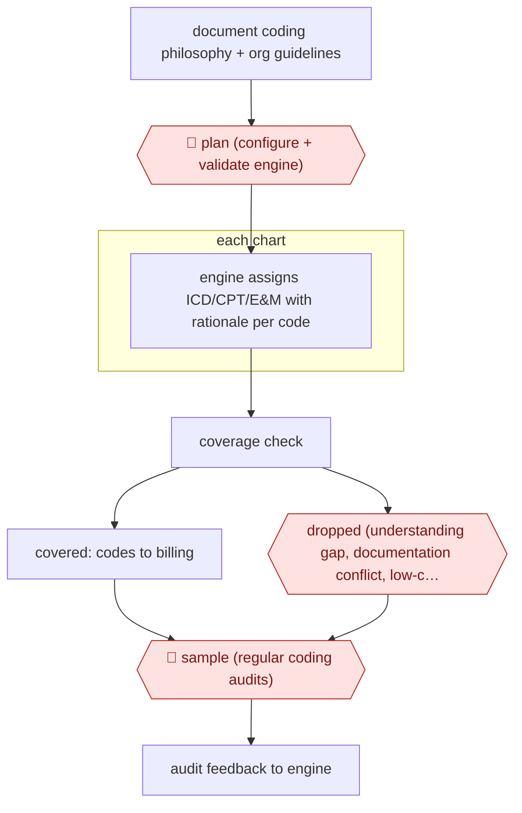

# Exception-routed autonomous coding

`PRO › HLT › RCM` · sampled · evidence B · **draft: needs a reference example** ([how to add one](../../../../../CONTRIBUTING.md#1-add-an-example-run))

**Shape:** `document coding philosophy + org guidelines → 🛑 plan (configure + validate engine) → each chart: engine assigns ICD/CPT/E&M with rationale per code → coverage check → covered: codes to billing | dropped (understanding gap, documentation conflict, low-confidence code, missing documentation): 🛑 handoff (coder) → 🛑 sample (regular coding audits) → audit feedback to engine`
**How it differs:** AWF-0032 Criteria-gated prior auth is the nearest. It is assist-level: staff review every letter and submit every request. Here codes on covered charts reach billing with no human review, and people only take exceptions and audit samples.
**Variants:** `nym-autonomous-coding`

<!-- shape diagram: generated by scripts/build_diagrams.py from `shape`; don't edit -->

<!-- end shape diagram -->

## Background

Every patient encounter has to leave the building as a claim with codes on it: what was wrong, what was done, where. Certified coders read the chart and assign them, and the work is slow, specialist and permanently short-staffed — a hospital that cannot hire coders holds claims, and held claims are cash it has already spent. Coding is also unusually well suited to automation, because the question is narrow and the evidence is in the document: a passage either supports a diagnosis or it does not. An engine that reads every chart and assigns codes with a citation for each one can therefore do the bulk of the work, but only where the documentation actually supports it. The design that makes this safe is not better accuracy; it is a routing decision made per chart. Charts the engine understands go to billing untouched. Charts it does not — a documentation conflict, a missing note, a signature that is not there, a code it is not confident about — go to a person, with the reason attached. Then a sample of everything, autonomous or not, is audited and the findings go back into the engine's knowledge base. What stays human is the part that always was: deciding what the organisation's coding philosophy is, and defending a claim when a payer asks why a code was assigned.

**Terms:**
- **ICD / CPT / E&M**: the code sets for diagnoses, procedures, and visit complexity.
- **chart**: the clinical record of one encounter, the unit coded here.
- **coding philosophy**: the organisation's written position on how ambiguous documentation should be coded.
- **coverage**: the share of charts the engine codes without a person.
- **dropped chart**: one routed to a coder, with a reason.
- **confidence threshold**: the score above which the engine sends codes to billing without review.
- **HCC / risk adjustment**: the diagnosis capture that sets payment for value-based and Medicare Advantage contracts.
- **audit trail**: the per-code link from an assigned code back to the documentation and rule that support it.
- **upcoding**: assigning codes more severe than the documentation supports, the thing a payer audit looks for.

## Build it with an agent

**Form:** `service`. Charts arrive from the EHR continuously, nobody starts a run, most are coded and sent to billing without a person, and the exceptions queue to coders — with a periodic audit sampling the whole stream. That is a service by construction: unattended, queue-driven, and measured on coverage rather than on any single output.

**You need:** the charts as structured text with their metadata, including whether the missing signature or note is genuinely missing; the organisation's coding philosophy written down before configuration, because the engine has to resolve ambiguity the same way the compliance team would; a validation set drawn from the organisation's own historical charts, coded by its own auditors, since a vendor's accuracy figure was measured on somebody else's population; the routing rules and their drop reasons, explicit enough that a coder receiving a chart knows what to check; an audit process with a sampling rate and a named owner; and access to the audit trail at claim level, because the first payer challenge will ask for it. The agent must not resolve a documentation conflict by inference and must not raise a code's severity to improve payment: both are the failure modes that turn an efficiency programme into a recovery demand.

| Step | Built as |
|---|---|
| document coding philosophy + org guidelines | A written rule set, versioned, that the engine's configuration is derived from and the audit is measured against — without it, every disagreement becomes an argument about the model. |
| 🛑 plan (configure + validate engine) | Validation on the organisation's own historical charts against its own auditors, with a stated accuracy bar and a stated coverage bar; coders are trained to check the engine's reasoning rather than to re-code from scratch. |
| each chart: engine assigns ICD/CPT/E&M with rationale per code | Per code, the supporting passage and the rule applied are stored, not just the code — the rationale is what makes both the coder's check and the payer defence possible. |
| coverage check | A routing decision per chart against explicit conditions, not a global confidence score: the four drop reasons are the specification. |
| covered: codes to billing | Straight through, no per-chart review, which is the entire economic case and also the reason the audit sample has to be real. |
| 🛑 handoff (coder) | Dropped charts arrive with their reason attached; the coder's correction is captured as training signal rather than as a one-off fix. |
| 🛑 sample (regular coding audits) | A standing sample drawn across specialties and service lines, scored by auditors against the documentation, with findings fed back into the knowledge base. |

**Checkpoints:** `plan`: the engine is configured from the organisation's own coding philosophy and validated on its own charts against its own auditors before any chart goes to billing unreviewed — the sources are explicit that coders must be trained to validate the output, not replaced by it. `handoff`: the four drop reasons are the safety valve; a chart the engine half-understands must leave the autonomous path, and the reason has to travel with it. `sample`: regular audits are what make straight-through billing defensible, and they are also the only mechanism by which the engine learns about the cases it got wrong confidently.

**Since the sources:** The source is an undated vendor conference deck, and it was not re-opened on this pass. What has changed since: the category moved from pilot to procurement, and the numbers are now published by name. A secondary write-up of KLAS's April 2026 market report ranks autonomous coding the top healthcare AI use case, with hands-free rates of 62% to 87% by specialty and accuracy of 92.5% to 96.4% against a blinded human panel whose own reliability sits at about 92.5% (the KLAS report is subscriber-only; treat the write-up as secondary). Vendors now publish named deployments: Your Health went live on Fathom in 2025-10 with [95.5% of encounters coded on day one, accuracy rising from 96.3% to 98.3%](https://fathomhealth.com/insights/your-health-deploys-fathom-autonomous-medical-coding-to-achieve-95-5-automation-rate-at-98-3-accuracy-rate-across-all-service-lines), and Nym's go-live bar is 95% accuracy on a review of the customer's own historical charts before launch, routing to billing above a stated confidence threshold. Two cautions belong with those figures. The first is what the same Your Health release also reports: average risk-adjustment factors rising from 1.12 to 1.78 in a year, with revenue benchmarking moving from $35M to $70M. That is either HCC capture the coders were missing or it is upcoding, and a payer audit will treat it as the second until the audit trail proves the first — so the per-code citation is not a nice feature, it is the defence. The second is that independence is still thin: an outside capability review of the two leading vendors found that Nym does not document human oversight and guardrails in full, and neither vendor publishes an independent accuracy validation. The entry's evidence grade stays B for that reason.

*A design based on this entry's steps and the tool documentation as of 2026-11, not a reported run.*

## Steps

*As reported by the sources.*

1. Document the organization's coding philosophy and guidelines and configure the engine with them [[1]](#sources).
2. 🛑 **Plan**: validate the engine's results before relying on them. Train human coders to validate its output and give feedback [[1]](#sources).
3. The EHR sends charts to the engine. It codes them in seconds and gives a rationale for each code [[1]](#sources).
4. Codes on covered charts go straight to billing, with no per-chart review [[1]](#sources).
5. 🛑 **Handoff**: dropped charts go to human coders. The four drop reasons are engine understanding gaps, documentation conflicts, low confidence in one code, and missing documentation such as a missing ED note or provider signature [[1]](#sources).
6. 🛑 **Sample**: run regular audits and QA checks on autonomously coded charts. Audit findings feed the engine's knowledge base [[1]](#sources).

**Output:** Coded claims sent to billing, plus a queue of exception charts for coders.
**Failure modes → guards:** Charts with gaps or conflicts get coded wrongly → each type is routed out as a dropped chart. Coverage is partial (mainly outpatient specialties) → keep coder staffing for the dropped share.

## Public runs

Coverage as of 2026-11-06: **Weak**: only anonymous, vendor-linked or journalist-told accounts. Collected and re-checked in [Second collection pass](../../../../../research/2026-11-second-pass.md).

- [Geretz/Nym Health, Autonomous Medical Coding (OHIMA)](https://ohima.memberclicks.net/assets/docs/blog/RevCycle_AutonomousMedicalCoding_KacieGeretz.pdf) (n.d.). Vendor deck describing routing of dropped charts to coders and the audit loop. "~ 5 - 10% of charts cannot be coded due to engine understanding gaps". *First-hand: vendor; confidence: med.*

## Sources

1. Kacie Geretz (RCM Solutions Lead, Nym Health), Autonomous Medical Coding (OHIMA presentation), undated. https://ohima.memberclicks.net/assets/docs/blog/RevCycle_AutonomousMedicalCoding_KacieGeretz.pdf
2. Fathom, Your Health deploys Fathom autonomous medical coding to achieve 95.5% automation rate at 98.3% accuracy rate across all service lines, 2026-03-19. https://fathomhealth.com/insights/your-health-deploys-fathom-autonomous-medical-coding-to-achieve-95-5-automation-rate-at-98-3-accuracy-rate-across-all-service-lines
3. Agentic Index, Fathom vs Nym (2026), covering go-live accuracy bars and documented oversight. https://agenticindex.io/compare/fathom-health-vs-nym
