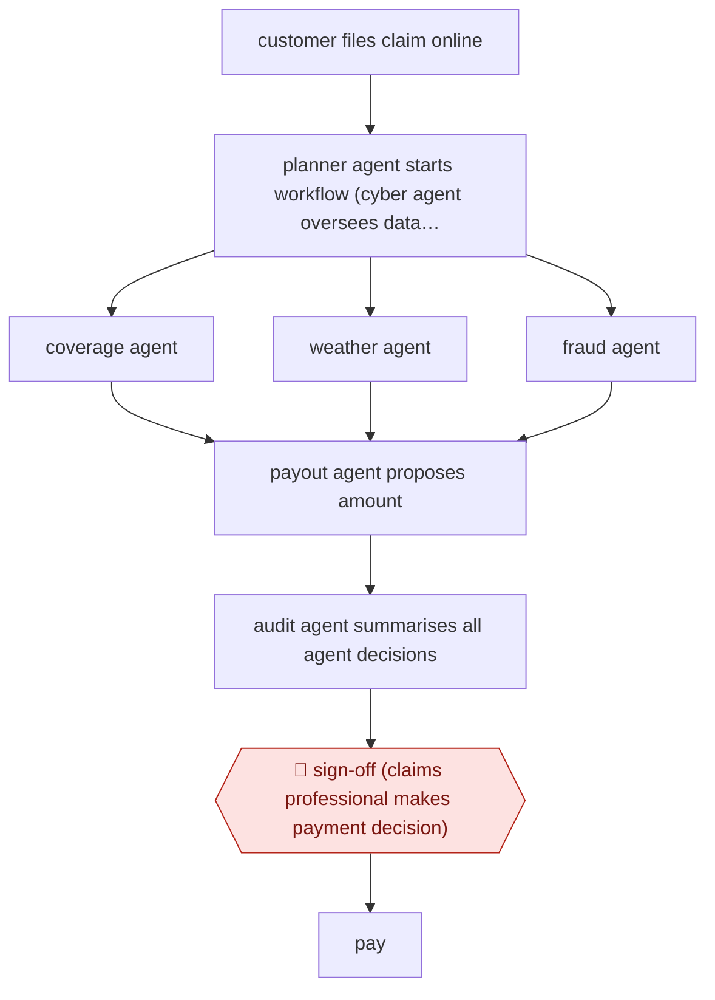

# Agent-crew claim file

`PRO › INS › CLAIMS` · checkpointed · evidence A · **draft: needs a reference example** ([how to add one](../../../../../CONTRIBUTING.md#1-add-an-example-run))

**Shape:** `customer files claim online → planner agent starts workflow (cyber agent oversees data security) → coverage agent | weather agent | fraud agent → payout agent proposes amount → audit agent summarises all agent decisions → 🛑 sign-off (claims professional makes payment decision) → pay`

<!-- shape diagram: generated by scripts/build_diagrams.py from `shape`; don't edit -->

<!-- end shape diagram -->

## Background

When a home is hit by a storm, the occupant can claim on their home contents insurance for goods that were lost, such as food that spoiled during a long power cut. A claims handler at the insurer checks that the policy covers the loss, that the weather event really happened, and that nothing looks fraudulent, then decides what to pay. After a big storm thousands of small claims arrive at once, and each takes the same few checks, so simple claims wait behind complex ones. Here a set of specialist agents does the checks and proposes an amount, and a summary of every check is passed on. A claims professional still decides whether to pay, because paying out is the insurer's financial and legal commitment to the customer.

**Terms:**
- **Claim**: a customer's request to be paid for a loss under their insurance policy.
- **Coverage**: whether the policy actually includes this kind of loss, in these circumstances.
- **Food-spoilage claim**: a claim for food that went bad when a power cut stopped the fridge or freezer.
- **Payout**: the amount the insurer pays on an approved claim.
- **Audit summary**: a written account of what each check found and decided, so the person approving can see the whole file at once.

## Build it with an agent

**Form:** `service`. A claim arrives online with nobody at a keyboard, and a person sees only the finished file with its audit summary.

**You need:** read access to the policy records and to a weather-event source, through MCP connectors or one small script each; the claim as submitted; a queue, ticket system or claims screen where the decision-ready file lands. Give the agent no payment tool and no access to the payment system. Keep personal data to what the claim needs and log every record the run reads.

| Step | Built as |
|---|---|
| customer files claim online | An event from the claims system starts a run: a cloud scheduled task triggered by an API call, or your own program starting `claude -p` or an Agent SDK program. |
| planner agent starts workflow (cyber agent oversees data security) | A skill that holds the procedure and calls the three checks. Data security is held by permission rules that limit the run to the named connectors, and a `PreToolUse` hook that logs each record read. |
| coverage agent \| weather agent \| fraud agent | Three built-in subagents run in parallel, each with its own reference file (coverage rules, weather lookup, fraud signals) and each returning a short finding with its evidence. |
| payout agent proposes amount | The skill computes a proposed amount from the policy terms and the coverage finding, and states how. |
| audit agent summarises all agent decisions | A last subagent, which sees only the findings and the proposal, writes the audit summary. |
| 🛑 sign-off (claims professional makes payment decision) → pay | See Checkpoints. |

**Checkpoints:** `sign-off`: the run ends by posting the claim file and audit summary to the claims queue. The agent has no tool that pays, approves or declines a claim, so the claims professional decides and pays in the claims system. Withholding the payment tool is what enforces the stop, and the skill's text does not.

**Since the sources:** The source and the public run date from 2025-11. Allianz reports seven named agents on its own platform; this build does the same checks with one skill and three parallel subagents, and a separate cyber agent has no counterpart beyond permission rules and a logging hook. The source reports a scope of food-spoilage claims under AUD$500 after severe-weather outages; a wider scope needs its own coverage and fraud rules, which the source does not describe. The source gives no detail of the agents' prompts, models or rules, so this design is the catalog's, not Allianz's.

*A design based on this entry's steps and the tool documentation as of 2026-11, not a reported run.*

## Steps

*As reported by the sources.*

1. The insurer limits the scope to food-spoilage claims after severe-weather power outages, under AUD$500 [[1]](#sources).
2. A planner agent starts the workflow and coordinates specialist agents; a cyber agent oversees data security throughout [[1]](#sources).
3. A coverage agent checks the policy covers the loss, a weather agent confirms a matching weather event, and a fraud agent checks for fraud signals [[1]](#sources).
4. A payout agent determines the amount and reports it to the planner [[1]](#sources).
5. An audit agent reviews the process, summarises every agent's decision and passes the file to a person [[1]](#sources).
6. 🛑 **Sign-off**: a human claims professional makes the payment decision. Per Allianz, 'payout decisions are never automated' [[1]](#sources).

**Output:** Decision-ready claim file with an audit summary; payment is released only after human sign-off.
**Failure modes → guards:** Agents could pay out wrongly or fraudulently → no agent can pay, and the audit agent summarises every agent's decision for the human approver.
**How it differs:** AWF-0022 Invoice extract-match-route (AP): that workflow pays matched invoices automatically and hands off only exceptions. Here every claim goes to a human payment sign-off, the deliverable is a claim decision rather than a payable, and specialist agents (coverage, weather, fraud) replace three-way matching.

## Public runs

Coverage as of 2026-11-06: **Strong**: a first-hand, detailed run that matches most of the shape. Collected and re-checked in [Second collection pass](../../../../../research/2026-11-second-pass.md).

- [Allianz, When the storm clears, so should the claim queue](https://www.allianz.com/en/mediacenter/news/articles/251103-when-the-storm-clears-so-should-the-claim-queue.html) (2025-11-03). Project Nemo live in Australia since July 2025; seven agents; human makes every payout decision. "less than five minutes". *First-hand: yes; confidence: high.*

## Sources

1. Allianz SE, When the storm clears, so should the claim queue, 2025-11-03. https://www.allianz.com/en/mediacenter/news/articles/251103-when-the-storm-clears-so-should-the-claim-queue.html
