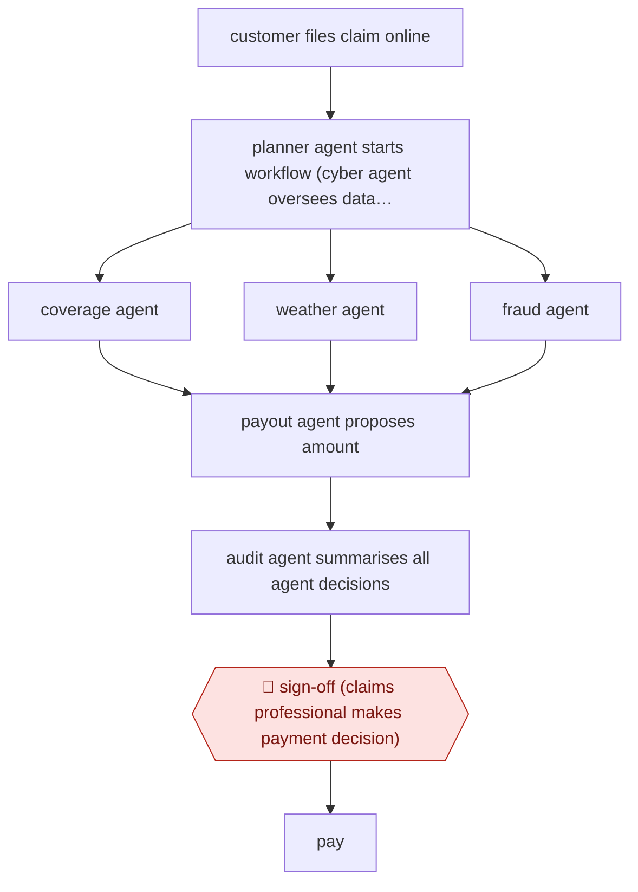

# Agent-crew claim file

`PRO › INS › CLAIMS` · checkpointed · evidence A · **draft: needs a reference example** ([how to add one](../../../../../CONTRIBUTING.md#1-add-an-example-run))

**Shape:** `customer files claim online → planner agent starts workflow (cyber agent oversees data security) → coverage agent | weather agent | fraud agent → payout agent proposes amount → audit agent summarises all agent decisions → 🛑 sign-off (claims professional makes payment decision) → pay`
**How it differs:** AWF-0022 Invoice extract-match-route (AP): that workflow pays matched invoices automatically and hands off only exceptions. Here every claim goes to a human payment sign-off, the deliverable is a claim decision rather than a payable, and specialist agents (coverage, weather, fraud) replace three-way matching.

<!-- shape diagram: generated by scripts/build_diagrams.py from `shape`; don't edit -->

<!-- end shape diagram -->

## Steps
1. Scope: food-spoilage claims after severe-weather power outages, under AUD$500 [[1]](#sources).
2. A planner agent starts the workflow and coordinates specialist agents; a cyber agent oversees data security throughout [[1]](#sources).
3. A coverage agent checks the policy covers the loss, a weather agent confirms a matching weather event, and a fraud agent checks for fraud signals [[1]](#sources).
4. A payout agent determines the amount and reports it to the planner [[1]](#sources).
5. An audit agent reviews the process, summarises every agent's decision and passes the file to a person [[1]](#sources).
6. 🛑 **Sign-off**: a human claims professional makes the payment decision. Per Allianz, 'payout decisions are never automated' [[1]](#sources).

**Output:** Decision-ready claim file with an audit summary; payment is released only after human sign-off.
**Failure modes → guards:** Agents could pay out wrongly or fraudulently → no agent can pay, and the audit agent summarises every agent's decision for the human approver.

## Public runs

Coverage as of 2026-11-06: **Strong**: a first-hand, detailed run that matches most of the shape. Collected and re-checked in [Second collection pass](../../../../../research/2026-11-second-pass.md).

- [Allianz, When the storm clears, so should the claim queue](https://www.allianz.com/en/mediacenter/news/articles/251103-when-the-storm-clears-so-should-the-claim-queue.html) (2025-11-03). Project Nemo live in Australia since July 2025; seven agents; human makes every payout decision. "less than five minutes". *First-hand: yes; confidence: high.*

## Sources

1. Allianz SE, When the storm clears, so should the claim queue, 2025-11-03. https://www.allianz.com/en/mediacenter/news/articles/251103-when-the-storm-clears-so-should-the-claim-queue.html
