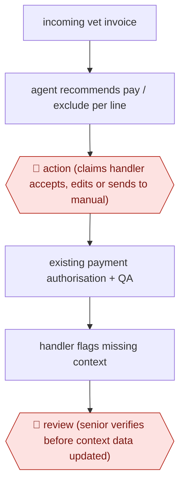

# Handler-accepted invoice recommendation

`PRO › INS › CLAIMS` · assist · evidence A · **draft: needs a reference example** ([how to add one](../../../../../CONTRIBUTING.md#1-add-an-example-run))

**Shape:** `incoming vet invoice → agent recommends pay / exclude per line → 🛑 action (claims handler accepts, edits or sends to manual) → existing payment authorisation + QA → handler flags missing context → 🛑 review (senior verifies before context data updated)`
**How it differs:** AWF-0085 Policy-checked expense audit auto-approves clean items and sends only violations to a specialist. Here the handler approves every recommendation (assist), and the knowledge base has its own senior-review gate.
**Variants:** `uipath-action-center`

<!-- shape diagram: generated by scripts/build_diagrams.py from `shape`; don't edit -->

<!-- end shape diagram -->

## Steps
1. Scope: pet and equine claims at NFU Mutual, built on UiPath agents [[1]](#sources).
2. An agent reviews each incoming invoice and recommends what to pay and what to exclude [[1]](#sources).
3. 🛑 **Action**: the recommendation appears to the claims handler in Action Center; the handler accepts it, edits it, or pushes it to manual processing [[1]](#sources).
4. The existing payment authorisation, quality assurance and audit trails stay in place [[1]](#sources).
5. Handlers flag information the agent's context lacks (for example a new drug). 🛑 **Review**: a senior team member verifies each addition before the context is updated; nothing updates automatically [[1]](#sources).

**Output:** Per-invoice pay/exclude recommendation accepted by a handler, then the normal payment run.
**Failure modes → guards:** Overpayment leakage missed by handlers → in the pilot the agent caught an exclusion the handler had missed. Stale drug/treatment knowledge → handler flags it and a senior gates the update.

## Public runs

Coverage as of 2026-11-06: **Partial**: first-hand runs that cover part of the shape or put checkpoints elsewhere. Collected and re-checked in [Second collection pass](../../../../../research/2026-11-second-pass.md).

- [diginomica, NFU Mutual's agentic AI pilot](https://diginomica.com/uipath-fusion-2026-nfu-mutuals-agentic-ai-pilot-delivers-results-so-why-ai-governance-still-harder) (2026-03-17). Pilot Sep–Nov; accurate recommendations; agent caught a missed overpayment; production planned for second half of 2026. "the equivalent of 30 people's time each year" (the size of the payments workstream, not a measured saving). *First-hand: interview; confidence: med.*

## Sources

1. Alyx MacQueen, diginomica, UiPath Fusion 2026 - NFU Mutual's agentic AI pilot delivers results..., 2026-03-17. https://diginomica.com/uipath-fusion-2026-nfu-mutuals-agentic-ai-pilot-delivers-results-so-why-ai-governance-still-harder
