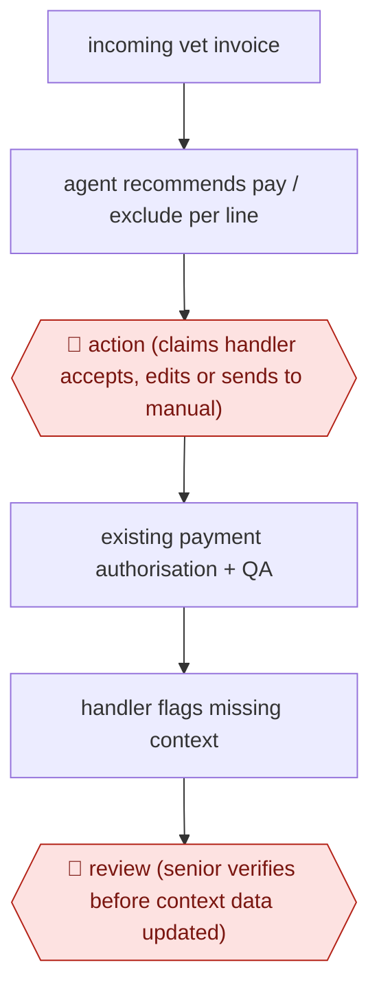

# Handler-accepted invoice recommendation

`PRO › INS › CLAIMS` · assist · evidence A · **draft: needs a reference example** ([how to add one](../../../../../CONTRIBUTING.md#1-add-an-example-run))

**Shape:** `incoming vet invoice → agent recommends pay / exclude per line → 🛑 action (claims handler accepts, edits or sends to manual) → existing payment authorisation + QA → handler flags missing context → 🛑 review (senior verifies before context data updated)`
**Variants:** `uipath-action-center`

<!-- shape diagram: generated by scripts/build_diagrams.py from `shape`; don't edit -->

<!-- end shape diagram -->

## Background

Pet and horse insurers pay claims from vets' invoices. After the first claim on an illness or injury is opened, further invoices keep arriving for the same condition, and a claims handler reads each one line by line to decide what the policy pays for and what it does not. The work is repetitive, and a line that should have been excluded can slip through and be overpaid. Here an agent reads each incoming invoice and recommends, line by line, what to pay and what to exclude. The claims handler stays in charge of every invoice: they accept the recommendation, edit it, or send the invoice to manual handling, because the insurer's payment authorisation and quality checks are built around a person deciding. Changes to what the agent knows, such as a new drug, are also approved by a senior person first.

**Terms:**
- **Claims handler**: the insurer's employee who decides what a claim pays.
- **Continuation payment**: a payment on a further invoice for a condition that already has an open claim.
- **Exclude**: refuse to pay a line, for example a treatment the policy does not cover.
- **Overpayment leakage**: money paid out that the policy did not require, because a line was missed.
- **Context data**: the reference knowledge the agent reads, such as which drugs and treatments exist and how the policy treats them.
- **Payment authorisation and QA**: the insurer's existing approval and quality-assurance steps before money leaves.
- **Audit trail**: the record of who or what decided each step.

## Build it with an agent

**Form:** `service`. Invoices arrive on a queue and the recommendation is waiting when the handler opens the case; weighed against `skill`, since the handler reviews each item, but nobody starts the run.

**You need:** read access to the policy terms and the claim record; the invoice as a file or extracted text; the context data as reference files the agent can read and cannot change; a case screen or queue where the handler sees each recommendation beside the invoice; a separate file or ticket queue where proposed additions to the context data are collected. Give the agent no tool for payment authorisation.

| Step | Built as |
|---|---|
| incoming vet invoice | A queue or event starts a run per invoice: a cloud scheduled task triggered by an API call, or your own program starting `claude -p` or an Agent SDK program. |
| agent recommends pay / exclude per line | A skill that reads the invoice, the policy terms and the context data and writes a table: invoice line, pay or exclude, and the reason. |
| 🛑 action (claims handler accepts, edits or sends to manual) → existing payment authorisation + QA | See Checkpoints. The existing authorisation and QA are left as they are. |
| handler flags missing context → 🛑 review (senior verifies before context data updated) | The handler's flag is stored as a proposed addition. See Checkpoints. |

**Checkpoints:** `action`: the run ends by writing the recommendation table to the handler's queue. The agent has no tool that authorises or sends a payment, so the handler's accept, edit or manual choice is the only way an invoice reaches the existing authorisation step. `review`: the context data is read-only to the agent (a permission rule denies edits to those files) and the agent can only append to the proposed-additions file; a senior team member edits the context data after checking each addition, so nothing updates automatically.

**Since the sources:** The source and the public run date from 2026-03. NFU Mutual built this on UiPath agents and its Action Center screen, and the source also shows a UiPath orchestration layer with several agents; this build covers only the recommendation step and replaces that screen with whatever case queue the handler already uses. The source reports no prompts, model or rules, so the table above is a design by the catalog. The pilot's accuracy and the overpayment it found are reported in Public runs and are not claims about this build.

*A design based on this entry's steps and the tool documentation as of 2026-11, not a reported run.*

## Steps

*As reported by the sources.*

1. NFU Mutual scopes the workflow to pet and equine claims, built on UiPath agents [[1]](#sources).
2. An agent reviews each incoming invoice and recommends what to pay and what to exclude [[1]](#sources).
3. 🛑 **Action**: the recommendation appears to the claims handler in Action Center; the handler accepts it, edits it, or pushes it to manual processing [[1]](#sources).
4. The existing payment authorisation, quality assurance and audit trails stay in place [[1]](#sources).
5. Handlers flag information the agent's context lacks (for example a new drug). 🛑 **Review**: a senior team member verifies each addition before the context is updated; nothing updates automatically [[1]](#sources).

**Output:** Per-invoice pay/exclude recommendation accepted by a handler, then the normal payment run.
**Failure modes → guards:** Overpayment leakage missed by handlers → in the pilot the agent caught an exclusion the handler had missed. Stale drug/treatment knowledge → handler flags it and a senior gates the update.
**How it differs:** AWF-0085 Policy-checked expense audit auto-approves clean items and sends only violations to a specialist. Here the handler approves every recommendation (assist), and the knowledge base has its own senior-review gate.

## Public runs

Coverage as of 2026-11-06: **Partial**: first-hand runs that cover part of the shape or put checkpoints elsewhere. Collected and re-checked in [Second collection pass](../../../../../research/2026-11-second-pass.md).

- [diginomica, NFU Mutual's agentic AI pilot](https://diginomica.com/uipath-fusion-2026-nfu-mutuals-agentic-ai-pilot-delivers-results-so-why-ai-governance-still-harder) (2026-03-17). Pilot Sep–Nov; accurate recommendations; agent caught a missed overpayment; production planned for second half of 2026. "the equivalent of 30 people's time each year" (the size of the payments workstream, not a measured saving). *First-hand: interview; confidence: med.*

## Sources

1. Alyx MacQueen, diginomica, UiPath Fusion 2026 - NFU Mutual's agentic AI pilot delivers results..., 2026-03-17. https://diginomica.com/uipath-fusion-2026-nfu-mutuals-agentic-ai-pilot-delivers-results-so-why-ai-governance-still-harder
