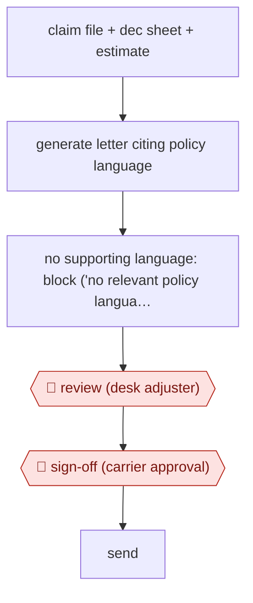

# Policy-grounded claim letters

`PRO › INS › CLAIMS` · assist · evidence B · **draft: needs a reference example** ([how to add one](../../../../../CONTRIBUTING.md#1-add-an-example-run))

**Shape:** `claim file + dec sheet + estimate → generate letter citing policy language → no supporting language: block ('no relevant policy language found') → 🛑 review (desk adjuster) → 🛑 sign-off (carrier approval) → send`
**Variants:** `voltaire`

<!-- shape diagram: generated by scripts/build_diagrams.py from `shape`; don't edit -->

<!-- end shape diagram -->

## Background

When someone makes a property insurance claim, the insurer must tell them in writing what it will pay and, if it refuses all or part of the claim, which wording in the policy it relies on. A desk adjuster, who handles claims from a desk instead of visiting the damaged property, writes these letters from the claim file and the policy. The policy is long: base terms, state-specific amendments and endorsements that change definitions on other pages, so it is easy to cite the wrong version. A wrong letter can be sent back by the carrier or end in a dispute. Here the agent drafts the letter from the claim documents and quotes the policy wording it relies on, and refuses to write a denial it cannot support. The desk adjuster edits the letter, and the carrier approves it before it goes out, because the carrier is the party making the coverage decision.

**Terms:**
- **Desk adjuster**: an adjuster who works claims remotely from the file, often a temporary hire during a disaster.
- **Carrier**: the insurance company that issued the policy and carries the risk.
- **Dec sheet (declarations sheet)**: the page of the policy that states who is insured, for what, and the limits and deductible.
- **Endorsement**: an addition to the policy that changes its standard wording.
- **Estimate**: the repair cost estimate for the loss.
- **Denial, partial denial**: a letter refusing the whole claim, or part of it.
- **Catastrophe (cat) event**: a hurricane or similar disaster that produces a surge of claims.

## Build it with an agent

**Form:** `skill`. One adjuster works one claim at a time and stays in the conversation, so a skill holding the letter procedure and the carrier's letter formats is enough.

**You need:** the claim file, the dec sheet, the estimate and the full policy text with its endorsements, as files for the agent to read; the carrier's letter formats as reference files beside the skill; a small script that checks that every policy sentence quoted in the draft appears word for word in the policy text; a setup your organisation has approved for policyholders' personal data. Do not connect a mail tool.

| Step | Built as |
|---|---|
| claim file + dec sheet + estimate → generate letter citing policy language | The skill reads the documents and the policy, picks the matching letter format, and drafts the letter with each statement tied to a quoted policy passage and its page. |
| no supporting language: block ('no relevant policy language found') | The skill runs the quote-check script. If a denial or partial denial has no quoted passage that the script finds in the policy, the skill stops and prints "no relevant policy language found" instead of writing the letter. |
| 🛑 review (desk adjuster) → 🛑 sign-off (carrier approval) → send | See Checkpoints. |

**Checkpoints:** `review`: the skill ends by presenting the draft with its quoted passages beside it and stops; the desk adjuster edits it. `sign-off`: the skill has no sending step and the agent has no mail tool, so the adjuster sends the letter to the carrier for approval and the carrier approves it in its own process.

**Since the sources:** The source and the public run date from 2025-11 and come from the vendor's recap of a webcast. Voltaire's tool generates letters inside its own product, with carrier-specific formats built in; this build uses a general agent with the formats as reference files and a quote-check script, and does not reproduce the product's behaviour. The source does not describe how the tool finds supporting language, so the quote check is the catalog's design. Carrier approval is a person's step outside the agent's tools.

*A design based on this entry's steps and the tool documentation as of 2026-11, not a reported run.*

## Steps

*As reported by the sources.*

1. The generator tool analyses the claim file, declarations sheet and estimate, then generates a denial, partial-denial or payment letter from scratch [[1]](#sources).
2. If a desk adjuster tries to deny coverage without valid policy language, the tool returns 'no relevant policy language found' [[1]](#sources).
3. 🛑 **Review**: the desk adjuster edits the letter [[1]](#sources).
4. 🛑 **Sign-off**: the carrier approves the letter; before the tool, letters were often 'kicked back' for wrong policy language or grammar [[1]](#sources).

**Output:** Carrier-approved coverage letter to the policyholder.
**Failure modes → guards:** Citing the wrong policy wording → the generator refuses denials it cannot ground. Catastrophe surge with new desk adjusters → carrier-specific formats are built in.
**How it differs:** AWF-0024 Playbook contract review marks up a contract against a playbook. Here the deliverable is an outbound coverage letter grounded in the policy, with carrier approval as the checkpoint.

## Public runs

Coverage as of 2026-11-06: **Weak**: only anonymous, vendor-linked or journalist-told accounts. Collected and re-checked in [Second collection pass](../../../../../research/2026-11-second-pass.md).

- [Voltaire, PC360 webcast with TSI Adjusters](https://voltaire.claims/blog/actionable-ai-that-adjusters-actually-adopt-about-voltaires-recent-pc360-webcast-with-tsi-adjusters/) (2025-11-18). TSI used it across Hurricanes Helene and Milton for a carrier, onboarding 60+ desk adjusters. "One adjuster reported saving two hours daily.". *First-hand: vendor (Voltaire's recap of its webcast; adjuster not named); confidence: med.*

## Sources

1. Yo Sub Kwon (Voltaire), Actionable AI that Adjusters Actually Adopt: PC360 webcast with TSI Adjusters, 2025-11-18. https://voltaire.claims/blog/actionable-ai-that-adjusters-actually-adopt-about-voltaires-recent-pc360-webcast-with-tsi-adjusters/
