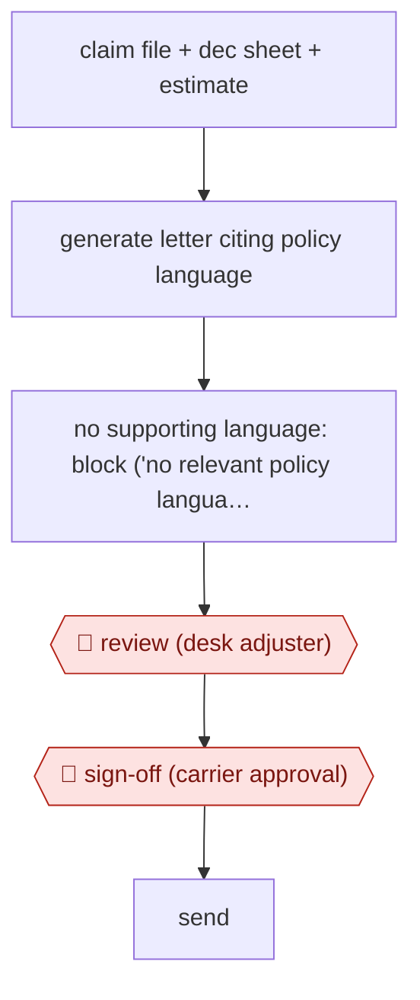

# Policy-grounded claim letters

`PRO › INS › CLAIMS` · assist · evidence B · **draft: needs a reference example** ([how to add one](../../../../../CONTRIBUTING.md#1-add-an-example-run))

**Shape:** `claim file + dec sheet + estimate → generate letter citing policy language → no supporting language: block ('no relevant policy language found') → 🛑 review (desk adjuster) → 🛑 sign-off (carrier approval) → send`
**How it differs:** AWF-0024 Playbook contract review marks up a contract against a playbook. Here the deliverable is an outbound coverage letter grounded in the policy, with carrier approval as the checkpoint.
**Variants:** `voltaire`

<!-- shape diagram: generated by scripts/build_diagrams.py from `shape`; don't edit -->

<!-- end shape diagram -->

## Steps
1. The system analyses the claim file, declarations sheet and estimate, then generates a denial, partial-denial or payment letter from scratch [[1]](#sources).
2. If an adjuster tries to deny coverage without valid policy language, the tool returns 'no relevant policy language found' [[1]](#sources).
3. 🛑 **Review**: the desk adjuster edits the letter [[1]](#sources).
4. 🛑 **Sign-off**: the letter goes to the carrier for approval; before the tool, letters were often 'kicked back' for wrong policy language or grammar [[1]](#sources).

**Output:** Carrier-approved coverage letter to the policyholder.
**Failure modes → guards:** Citing the wrong policy wording → the generator refuses denials it cannot ground. Catastrophe surge with new desk adjusters → carrier-specific formats are built in.

## Public runs

Coverage as of 2026-11-06: **Weak**: only anonymous, vendor-linked or journalist-told accounts. Collected and re-checked in [Second collection pass](../../../../../research/2026-11-second-pass.md).

- [Voltaire, PC360 webcast with TSI Adjusters](https://voltaire.claims/blog/actionable-ai-that-adjusters-actually-adopt-about-voltaires-recent-pc360-webcast-with-tsi-adjusters/) (2025-11-18). TSI used it across Hurricanes Helene and Milton for a carrier, onboarding 60+ desk adjusters. "One adjuster reported saving two hours daily.". *First-hand: vendor (Voltaire's recap of its webcast; adjuster not named); confidence: med.*

## Sources

1. Yo Sub Kwon (Voltaire), Actionable AI that Adjusters Actually Adopt: PC360 webcast with TSI Adjusters, 2025-11-18. https://voltaire.claims/blog/actionable-ai-that-adjusters-actually-adopt-about-voltaires-recent-pc360-webcast-with-tsi-adjusters/
