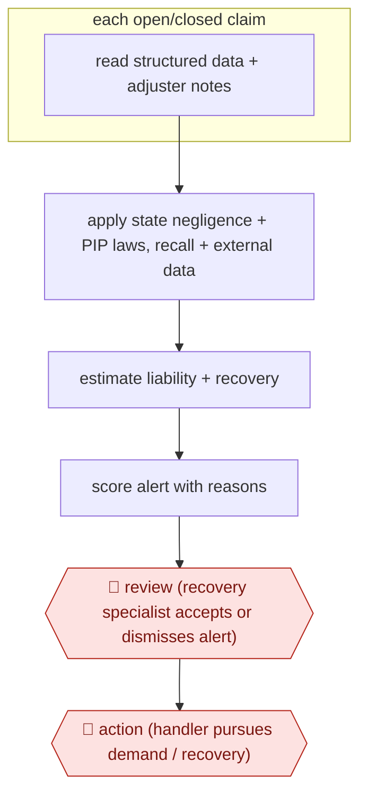

# Subrogation alert triage

`PRO › INS › CLAIMS` · sampled · evidence B · **draft: needs a reference example** ([how to add one](../../../../../CONTRIBUTING.md#1-add-an-example-run))

**Shape:** `each open/closed claim: read structured data + adjuster notes → apply state negligence + PIP laws, recall + external data → estimate liability + recovery → score alert with reasons → 🛑 review (recovery specialist accepts or dismisses alert) → 🛑 action (handler pursues demand / recovery)`
**Variants:** `shift-subrogation` · `megaputer-subrocheck`

<!-- shape diagram: generated by scripts/build_diagrams.py from `shape`; don't edit -->

<!-- end shape diagram -->

## Background

When an insurer pays a claim and another party was partly or wholly at fault, it can try to recover that money from them or their insurer. This is called subrogation. For example, if a driver is paid for a crash caused by another driver, the insurer may bill the other driver's insurer. Finding these cases means reading each claim's data and the handler's free-text notes, then applying the law of the state where it happened, and handlers often forget to refer a claim, or a recovery deadline passes unnoticed. Here an agent scans every claim in the background, open or closed, and gives each one a score and the reasons for it. A recovery specialist decides which alerts are worth pursuing, and a claims handler makes the demand on the other party, because that is a legal claim made in the insurer's name.

**Terms:**
- **Subrogation**: the insurer's right, after paying its own customer, to recover the amount from the party at fault.
- **Claims handler**: the insurer's employee who manages a claim.
- **Recovery specialist**: a person who works the subrogation referrals.
- **Comparative negligence**: a state rule that divides fault between the parties and reduces what can be recovered by the injured party's own share.
- **PIP (personal injury protection) and MedPay**: auto cover that pays the policyholder's medical costs whoever caused the crash. Whether the insurer can recover them depends on the state.
- **Statute of limitations**: the deadline after which a claim can no longer be brought.
- **Recall list**: published list of products withdrawn as defective, which can point to a manufacturer's fault.
- **Livery / rideshare vehicle**: a vehicle used for hire. In New York it is one of the conditions for recovering PIP.
- **Demand**: the written request to the other party or its insurer to pay.
- **Alert**: a claim the system flags as having recovery potential.

## Build it with an agent

**Form:** `service`. The scan covers every claim on a schedule with nobody present, and people see only the scored alerts.

**You need:** read-only access to the claims system's structured fields and handlers' notes; reference files of the state rules the team uses (comparative negligence, PIP and MedPay, limitation periods), kept up to date by the recovery team; connectors or scripts for the external data (recall lists, vehicle registration data); a store outside the conversation that records which claims were scored and the result; a queue where alerts land for the recovery specialist. Give the agent no tool that contacts a third party or writes to the claim. Claims can hold medical details, so use a setup approved for personal health data.

| Step | Built as |
|---|---|
| each open/closed claim: read structured data + adjuster notes | A cloud scheduled task, or your own scheduler starting `claude -p` or an Agent SDK program, picks the claims not yet scored or changed since the last run from the state store. A dynamic workflow fans out one subagent per claim, which reads the fields and notes. |
| apply state negligence + PIP laws, recall + external data | Each subagent reads the state-rules reference files and calls the external-data connectors or scripts. |
| estimate liability + recovery → score alert with reasons | The subagent returns a score, the estimated liability and recovery, and the reasons that drove the score, citing the rule or record behind each. Scripts check that every limitation date is computed from the claim's dates. |
| 🛑 review (recovery specialist accepts or dismisses alert) | See Checkpoints. |
| 🛑 action (handler pursues demand / recovery) | See Checkpoints. |

**Checkpoints:** `review`: the run ends by writing alerts, with their reasons, to the recovery specialist's queue; accepted and dismissed alerts are written to the state store so later runs do not repeat them. A fixed share of claims scored low is copied to the queue too, and the specialist's verdicts feed back into the score threshold. `action`: the agent has no tool that sends a demand, contacts the other party or opens a recovery case, so a handler does that in the claims system.

**Since the sources:** Sources date from 2024-07 to 2026-07. All three are Shift Technology's own case studies and interviews, so this entry is about a vendor product and the sources do not show its internal steps. Shift Subrogation scores claims inside its own platform, with its own models and data feeds; this build rebuilds the steps with a general agent, reference files and connectors, and does not claim to match the product's results. Keeping the state-rules files correct is ongoing work for the recovery team.

*A design based on this entry's steps and the tool documentation as of 2026-11, not a reported run.*

## Steps

*As reported by the sources.*

1. The system scans every claim file, structured fields and free-text adjuster notes (synthesised with GenAI), to establish what happened, who was involved and whether other parties may be at fault [[1]](#sources)[[2]](#sources).
2. The system applies external data: state comparative-negligence and PIP/MedPay rules, statutes of limitation, product recall lists, vehicle registration data (e.g., confirming a rideshare/livery vehicle for New York PIP) [[1]](#sources)[[3]](#sources).
3. The system estimates liability and potential recovery and generates scored alerts with a summary of the reasons and details driving the score [[1]](#sources).
4. 🛑 **Review**: recovery staff review alerts instead of every claim: 'we no longer have to review every single claim' [[2]](#sources).
5. 🛑 **Action**: claims handlers pursue the recovery; handlers still refer claims manually, with the tool catching misses [[2]](#sources).

**Output:** Prioritised subrogation referrals with liability estimate and supporting reasons, worked by the recovery team.
**Failure modes → guards:** Missed recoveries when handlers forget to refer → background scan of all claims including closed ones. Statute of limitations lapses → state rules applied in the alert. Adjuster distrust → position as support, train teams [2].
**How it differs:** AWF-0094, AWF-0095 and AWF-0096 decide or communicate what the insurer pays its own customer. This recovers money from third parties after payment; the agent screens all claims unattended and humans see only alerts. Deliverable and autonomy differ.

## Public runs

Coverage as of 2026-11-13: **Weak**: only anonymous, vendor-linked or journalist-told accounts. Collected and re-checked in [Third collection pass](../../../../../research/2026-11-third-pass.md).

- [Shift Technology, Top US P&C insurer streamlines subrogation](https://www.shift-technology.com/resources/case-studies/top-25-us-auto-and-property-insurer-streamlines-subrogation) (2026-07-09). Auto then property lines; GenAI reads notes, scored alerts ahead of handler referrals. "recurring average recovery of over $1 million per month". *First-hand: vendor; confidence: med.*
- [Shift Technology, Central Insurance](https://www.shift-technology.com/resources/reports-and-insights/subrogation-central-insurance) (2024-07-09). Recovery supervisor: team reviews alerts not every closed claim; Massachusetts PIP example. No number. "It is saving my team hours every week.". *First-hand: interview; confidence: med.*

## Sources

1. Shift Technology, Case Study: Top US P&C insurer streamlines subrogation, 2026-07-09. https://www.shift-technology.com/resources/case-studies/top-25-us-auto-and-property-insurer-streamlines-subrogation
2. Shift Technology, Central Insurance: The benefits of AI in subrogation (Callie Byrne, Claims Recovery Supervisor), 2024-07-09. https://www.shift-technology.com/resources/reports-and-insights/subrogation-central-insurance
3. Shift Technology, AI in Action: Top 5 P&C insurer enhances PIP recovery opportunities with GenAI, 2024-11-27. https://www.shift-technology.com/resources/case-studies/genai-in-action/pip-recovery-opportunities
