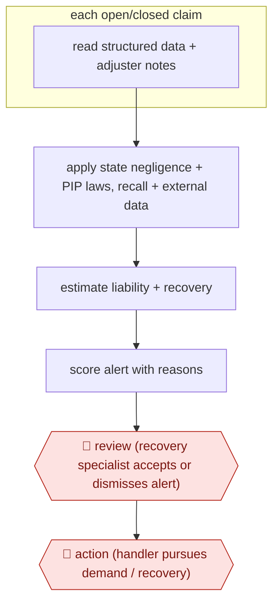

# Subrogation alert triage

`PRO › INS › CLAIMS` · sampled · evidence B · **draft: needs a reference example** ([how to add one](../../../../../CONTRIBUTING.md#1-add-an-example-run))

**Shape:** `each open/closed claim: read structured data + adjuster notes → apply state negligence + PIP laws, recall + external data → estimate liability + recovery → score alert with reasons → 🛑 review (recovery specialist accepts or dismisses alert) → 🛑 action (handler pursues demand / recovery)`
**How it differs:** AWF-0094, AWF-0095 and AWF-0096 decide or communicate what the insurer pays its own customer. This recovers money from third parties after payment; the agent screens all claims unattended and humans see only alerts. Deliverable and autonomy differ.
**Variants:** `shift-subrogation` · `megaputer-subrocheck`

<!-- shape diagram: generated by scripts/build_diagrams.py from `shape`; don't edit -->

<!-- end shape diagram -->

## Steps
1. Scan every claim file, structured fields and free-text adjuster notes (synthesised with GenAI), to establish what happened, who was involved and whether other parties may be at fault [[1]](#sources)[[2]](#sources).
2. Apply external data: state comparative-negligence and PIP/MedPay rules, statutes of limitation, product recall lists, vehicle registration data (e.g., confirming a rideshare/livery vehicle for New York PIP) [[1]](#sources)[[3]](#sources).
3. Estimate liability and potential recovery; generate scored alerts with a summary of the reasons and details driving the score [[1]](#sources).
4. 🛑 **Review**: recovery staff review alerts instead of every claim: 'we no longer have to review every single claim' [[2]](#sources).
5. 🛑 **Action**: claims handlers pursue the recovery; handlers still refer claims manually, with the tool catching misses [[2]](#sources).

**Output:** Prioritised subrogation referrals with liability estimate and supporting reasons, worked by the recovery team.
**Failure modes → guards:** Missed recoveries when handlers forget to refer → background scan of all claims including closed ones. Statute of limitations lapses → state rules applied in the alert. Adjuster distrust → position as support, train teams [2].

## Public runs

Coverage as of 2026-11-13: **Weak**: only anonymous, vendor-linked or journalist-told accounts. Collected and re-checked in [Third collection pass](../../../../../research/2026-11-third-pass.md).

- [Shift Technology, Top US P&C insurer streamlines subrogation](https://www.shift-technology.com/resources/case-studies/top-25-us-auto-and-property-insurer-streamlines-subrogation) (2026-07-09). Auto then property lines; GenAI reads notes, scored alerts ahead of handler referrals. "recurring average recovery of over $1 million per month". *First-hand: vendor; confidence: med.*
- [Shift Technology, Central Insurance](https://www.shift-technology.com/resources/reports-and-insights/subrogation-central-insurance) (2024-07-09). Recovery supervisor: team reviews alerts not every closed claim; Massachusetts PIP example. No number. "It is saving my team hours every week.". *First-hand: interview; confidence: med.*

## Sources

1. Shift Technology, Case Study: Top US P&C insurer streamlines subrogation, 2026-07-09. https://www.shift-technology.com/resources/case-studies/top-25-us-auto-and-property-insurer-streamlines-subrogation
2. Shift Technology, Central Insurance: The benefits of AI in subrogation (Callie Byrne, Claims Recovery Supervisor), 2024-07-09. https://www.shift-technology.com/resources/reports-and-insights/subrogation-central-insurance
3. Shift Technology, AI in Action: Top 5 P&C insurer enhances PIP recovery opportunities with GenAI, 2024-11-27. https://www.shift-technology.com/resources/case-studies/genai-in-action/pip-recovery-opportunities
