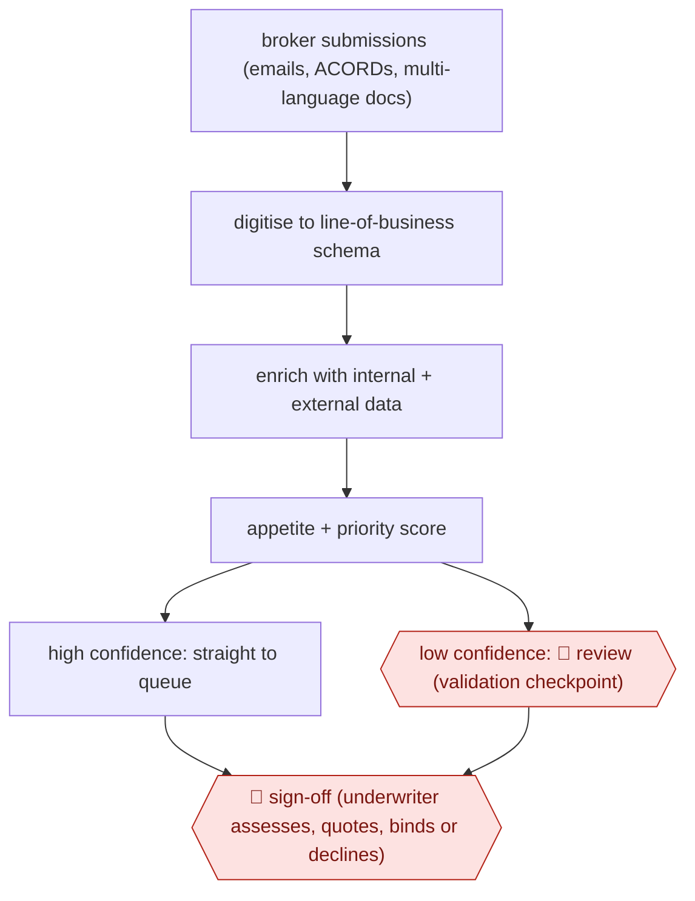

# Decision-ready submission triage

`PRO › INS › UW` · checkpointed · evidence B · **draft: needs a reference example** ([how to add one](../../../../../CONTRIBUTING.md#1-add-an-example-run))

**Shape:** `broker submissions (emails, ACORDs, multi-language docs) → digitise to line-of-business schema → enrich with internal + external data → appetite + priority score → high confidence: straight to queue | low confidence: 🛑 review (validation checkpoint) → 🛑 sign-off (underwriter assesses, quotes, binds or declines)`
**Variants:** `cytora` · `kalepa`

<!-- shape diagram: generated by scripts/build_diagrams.py from `shape`; don't edit -->

<!-- end shape diagram -->

## Background

A business that wants insurance for a risk, such as a factory or a fleet of vehicles, usually goes through a broker, who sends the insurer a submission: an email with attachments, forms and spreadsheets describing what is to be insured. An underwriter at the insurer decides whether to take the risk and at what price. Before the underwriter can look at it, someone has to read the submission, type the key facts into the insurer's system, add outside information and work out whether it fits what the insurer writes. That is slow, and a team can only look at as many submissions as it has people to read them. Here the agent turns each submission into structured data, adds information, scores how well it fits and puts it in a ranked queue. A person checks the ones the agent is unsure about. The underwriter still assesses, prices, binds or declines every risk, because that decision commits the insurer's money.

**Terms:**
- **Broker**: an intermediary who places a client's risk with insurers.
- **Submission**: the broker's package of documents describing the risk.
- **ACORD**: a widely used standard insurance form.
- **Line of business**: a class of insurance, such as property or marine, each with its own data fields (the schema).
- **Underwriter**: the person who decides whether to accept a risk and on what terms.
- **Appetite**: the types of risk the insurer wants to write, and on what terms.
- **Quote, bind, decline**: to offer a price, to accept the risk and put cover in force, to refuse.
- **Enrich**: add data from the insurer's own records and outside sources to what the submission says.
- **Workbench**: the underwriter's working screen and queue.

## Build it with an agent

**Form:** `service`. Submissions arrive in an inbox with nobody at a keyboard, and people see only the low-confidence items and the ranked queue.

**You need:** read access to the submissions inbox; one schema file per line of business, listing the fields to extract; the appetite and priority rules as a reference file kept by the underwriting team; connectors or scripts for the insurer's own records and the outside data it uses; a queue or the underwriting workbench where the structured submissions land. Give the agent no tool that quotes, binds or declines, and no tool that replies to the broker. Submissions contain clients' business and personal data, so use a setup approved for it.

| Step | Built as |
|---|---|
| broker submissions → digitise to line-of-business schema | A cloud scheduled task, or your own program starting `claude -p` or an Agent SDK program, picks up new submissions. A skill extracts the fields for the matching line of business, including from other languages, and records for each field where in the document it came from and a confidence. |
| enrich with internal + external data | MCP connectors or scripts, one per data source, called from the skill. |
| appetite + priority score | The skill applies the appetite file and writes a score with the reasons. |
| high confidence: straight to queue \| low confidence: 🛑 review | A script compares each field's confidence with a threshold. Items above it are written to the queue; the rest go to a validation queue. |
| 🛑 sign-off (underwriter assesses, quotes, binds or declines) | See Checkpoints. |

**Checkpoints:** `review`: a low-confidence submission is held out of the underwriting queue and posted to a validation queue with the extracted fields beside the source passages; a person corrects it and releases it. The threshold sits in the script, so the agent cannot lower it. `sign-off`: the agent has no tool that quotes, binds or declines, so the underwriter does it in the downstream system.

**Since the sources:** The dated sources run from 2025-11 to 2026-11, and three are undated. Most sources are vendor or carrier accounts of products (Cytora, Kalepa) that do this work inside their own platforms, with their own models, data feeds and integrations with underwriting systems; this build uses a general agent with schema and appetite files and does not reproduce them. Their figures are in Public runs and are not claims about this build. The confidence value the agent reports for each field is an estimate that should be checked against a sample of corrected items before a threshold is trusted.

*A design based on this entry's steps and the tool documentation as of 2026-11, not a reported run.*

## Steps

*As reported by the sources.*

1. The system ingests unstructured submissions and converts them into structured, 'decision-ready' risks against the carrier's schema [[1]](#sources)[[2]](#sources).
2. The system enriches them with external data and ranks them by appetite and strategy [[3]](#sources)[[4]](#sources).
3. The system sends high-confidence submissions straight to the underwriting queue [[2]](#sources).
4. 🛑 **Review**: low-confidence submissions stop at 'human-in-the-loop validation checkpoints', where a person checks the extracted data before the submission enters the queue [[2]](#sources).
5. 🛑 **Sign-off**: the underwriter assesses, quotes and binds (or declines) in the downstream system [[1]](#sources)[[4]](#sources).

**Output:** Prioritised queue of structured submissions in the underwriting workbench.
**Failure modes → guards:** Extraction errors flow into pricing → confidence thresholds and validation checkpoints. Underwriters only see a fraction of the inbox → full-inbox triage (Paragon) and decline routing.

**Recent practice (2026):**
- Step 2: Hiscox's UK high-net-worth model categorises broker submissions by risk appetite to streamline underwriter workflow (Hiscox 2025 Annual Report). [[5]](#sources)
**How it differs:** Hiscox quote drafting (above) produces a priced quote. Here the deliverable is a ranked submission queue, and the underwriter still prices every risk. AWF-0022 is close in shape but produces payables, not underwriting decisions.

## Public runs

Coverage as of 2026-11-06: **Partial**: first-hand runs that cover part of the shape or put checkpoints elsewhere. Collected and re-checked in [Second collection pass](../../../../../research/2026-11-second-pass.md).

- [Ivans, Arch Insurance submission intake](https://www.ivans.com/blog/posts/arch-insurance-ai-submission-intake-cytora/) (2026-05-26). Four lines live in under three months. "from two to three days down to two hours". *First-hand: vendor; confidence: med.*
- [Cytora, Zurich scales Agentic AI](https://cytora.com/risk-flow-center/blog/zurich-scales-agentic-ai-to-5-countries-in-90-days-proving-the-target-model-for-itsglobal-rollout) (n.d.). Rollout across Zurich country units. "manual triage time falling from 75 minutes to 15 minutes". *First-hand: vendor; confidence: med.*
- [Markel, AI can accelerate underwriting](https://www.markel.com/insights-and-resources/insights/ai-can-accelerate-underwriting-people-must-remain-accountable) (2026-11-02). Carrier's own account; underwriters finalise every quote. "a 65% quote-to-submission ratio". *First-hand: yes; confidence: high.*
- [Kalepa, Paragon case study](https://kalepa.com/case-studies/paragon-doubled-quote-to-bind-rate) (n.d.). Whole inbox through triage within 90 days; quotes from Paragon executives. "somewhere around 98 to 99% accurate now". *First-hand: vendor; confidence: med.*

## Sources

1. Cytora, Zurich scales Agentic AI to 5 countries in 90 days. https://cytora.com/risk-flow-center/blog/zurich-scales-agentic-ai-to-5-countries-in-90-days-proving-the-target-model-for-itsglobal-rollout
2. Ivans, From Days to Hours: How Arch Insurance Automated Submission Intake, 2026-05-26. https://www.ivans.com/blog/posts/arch-insurance-ai-submission-intake-cytora/
3. Markel, AI can accelerate underwriting. People must remain accountable, 2026-11-02. https://www.markel.com/insights-and-resources/insights/ai-can-accelerate-underwriting-people-must-remain-accountable
4. Kalepa, How Paragon Doubled Its Quote-to-Bind Rate. https://kalepa.com/case-studies/paragon-doubled-quote-to-bind-rate
5. Hiscox Ltd, 2025 Annual Report and Accounts (filed with BMA). https://cdn.bma.bm/documents/2026-07-16-21-20-40-Hiscox-Ltd-2025-Financial-Statement-Group.pdf
6. Reinsurance News, AI adoption drives productivity growth and opens business opportunities: Hiscox CFO Cooper, 2025-11-07. https://www.reinsurancene.ws/ai-adoption-drives-productivity-growth-and-opens-business-opportunities-hiscox-cfo-cooper/
