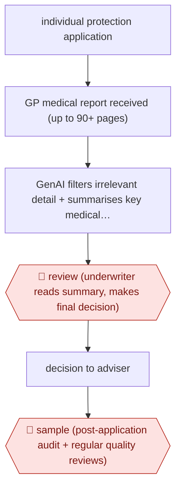

# Summarised GP-report underwriting

`PRO › INS › UW` · assist · evidence A · **draft: needs a reference example** ([how to add one](../../../../../CONTRIBUTING.md#1-add-an-example-run))

**Shape:** `individual protection application → GP medical report received (up to 90+ pages) → GenAI filters irrelevant detail + summarises key medical facts → 🛑 review (underwriter reads summary, makes final decision) → decision to adviser → 🛑 sample (post-application audit + regular quality reviews)`
**Variants:** `aviva-in-house` · `vitality-in-house`

<!-- shape diagram: generated by scripts/build_diagrams.py from `shape`; don't edit -->

<!-- end shape diagram -->

## Background

Protection insurance, such as life cover or critical-illness cover, pays out if the customer dies or is diagnosed with a serious illness. When someone applies, the insurer may ask their family doctor (GP, general practitioner) for a medical report. An underwriter, the insurer's specialist who decides whether to offer cover and on what terms, reads the report for conditions and results that change the risk. These reports can run past 90 pages, and most of the content has no bearing on the decision, so reading them takes a long time and a material detail can be missed. Here an AI model filters out the irrelevant detail and summarises the key medical facts. The underwriter reads the summary and makes the decision on every case, because the decision decides whether a person gets cover, and the insurer's work is audited afterwards.

**Terms:**
- **Protection insurance**: cover that pays out on death, serious illness or inability to work, rather than on property loss.
- **Critical illness (CI) and serious illness cover**: cover that pays a lump sum on diagnosis of a listed condition.
- **GP medical report**: a report from the applicant's doctor on their medical history.
- **Underwriter**: the person who decides whether to offer cover and on what terms.
- **Adviser**: the intermediary who arranged the application for the customer, and who receives the decision.
- **Post-application audit**: a later review of decided cases to check that decisions were sound.

## Build it with an agent

**Form:** `skill`. One underwriter works one application at a time and stays in the conversation, so a skill that summarises one medical report for that underwriter is enough. Weighed against `service`, since a report could be summarised on arrival; a person reads each summary either way, so the smaller form is kept.

**You need:** the GP report as a file; the insurer's list of the conditions and results that matter for each product, as a reference file beside the skill; the underwriting manual the underwriter already uses. Health data is among the most sensitive personal data: use only a setup your organisation has approved for it, and give the agent no mail or adviser-messaging tool and no write access to the policy system.

| Step | Built as |
|---|---|
| individual protection application → GP medical report received (up to 90+ pages) | The underwriter gives the skill the report file for one application. |
| GenAI filters irrelevant detail + summarises key medical facts | The skill reads the whole report and writes a summary under fixed headings (conditions, medication, tests and results, lifestyle, referrals), each fact with the page it came from, and ends with a list of sections it judged irrelevant and left out. For a very long report, built-in subagents each take a block of pages and return their facts. |
| 🛑 review (underwriter reads summary, makes final decision) → decision to adviser | See Checkpoints. |
| 🛑 sample (post-application audit + regular quality reviews) | See Checkpoints. |

**Checkpoints:** `review`: the skill ends with the summary and the list of omitted sections and stops. It never writes a decision, and the underwriter decides in the policy system and sends the decision to the adviser from there; the agent has no tool for either. `sample`: audit is not part of the live case. A reviewer picks a sample of decided cases and runs the skill's check mode, which compares the stored summary with the full report and lists any condition in the report that the summary left out; the reviewer judges the result.

**Since the sources:** The sources date from 2025-11 to 2026-04. Aviva and Vitality built the summarisation in house and report 18 months of testing with accuracy validation before launch, and Vitality started with lower-risk cases; this build has no such testing, so it should be tried on cases whose outcome is known and compared against underwriters' own readings before use. Aviva reports that its tool is also used for post-application auditing. The sources do not describe their prompts or models. The figures reported for time and length are in Public runs and are not claims about this build.

*A design based on this entry's steps and the tool documentation as of 2026-11, not a reported run.*

## Steps

*As reported by the sources.*

1. The insurer needs a GP medical report for an individual life, critical-illness or serious-illness application [[1]](#sources)[[2]](#sources)[[3]](#sources).
2. A generative AI model analyses the report, filters out irrelevant details and highlights key information, cutting reports 'sometimes over 90 pages' to concise summaries [[1]](#sources).
3. The insurer starts the rollout with lower-risk cases before wider use [[3]](#sources).
4. 🛑 **Review**: 'Aviva underwriters will review these summaries and make the final decision' [[1]](#sources).
5. 🛑 **Sample**: post-application auditing and 'regular quality reviews and ongoing oversight' [[2]](#sources)[[3]](#sources).

**Output:** Underwriting decision on the protection application, communicated to the adviser and customer.
**Failure modes → guards:** Summary drops a material condition → 18 months of testing, accuracy validation across conditions before extending to CI, start with lower-risk cases, ongoing quality reviews [1][2][3].
**How it differs:** AWF-0149 triages broker submissions into a scored queue; AWF-0155 drafts a priced broker quote email. Here the agent condenses one applicant's medical evidence and the underwriter decides every case (assist): different deliverable (individual risk decision on medical evidence) and checkpoint. Enables the UW class (three distinct workflows).

## Public runs

Coverage as of 2026-11-13: **Strong**: a first-hand, detailed run that matches most of the shape. Collected and re-checked in [Third collection pass](../../../../../research/2026-11-third-pass.md).

- [Aviva, AI underwriting tool launch](https://www.aviva.com/newsroom/news-and-research-overview/news-releases/2025/11/aviva-to-launch-groundbreaking-ai-underwriting-tool/) (2025-11-18). Life underwriting rollout after 18 months' testing; underwriter decides every case. "already processed 1,000 cases in an active test phase". *First-hand: yes; confidence: high.*
- [Aviva, extends to Critical Illness](https://www.aviva.com/newsroom/news-and-research-overview/news-releases/2026/03/aviva-extends-industry-first-ai-underwriting-tool-to-critical-illness-cover/) (2026-03-18). Extended to CI; also used for post-application auditing. "reduced the time underwriters spend reviewing each case by around half". *First-hand: yes; confidence: high.*
- [IFA Magazine, Vitality AI underwriting](https://ifamagazine.com/vitality-launches-ai-powered-underwriting-to-speed-up-adviser-case-decisions/) (2026-04-15). In-house LLM GP-report summaries, piloted 18 months, lower-risk cases first. CEO quoted. "an 81% reduction in GP report length". *First-hand: vendor; confidence: med.*

## Sources

1. Aviva plc, Aviva to launch groundbreaking AI Underwriting Tool, 2025-11-18. https://www.aviva.com/newsroom/news-and-research-overview/news-releases/2025/11/aviva-to-launch-groundbreaking-ai-underwriting-tool/
2. Aviva plc, Aviva extends industry-first AI underwriting tool to Critical Illness cover, 2026-03-18. https://www.aviva.com/newsroom/news-and-research-overview/news-releases/2026/03/aviva-extends-industry-first-ai-underwriting-tool-to-critical-illness-cover/
3. IFA Magazine (Bratley M.), Vitality launches AI powered underwriting to speed up adviser case decisions, 2026-04-15. https://ifamagazine.com/vitality-launches-ai-powered-underwriting-to-speed-up-adviser-case-decisions/
