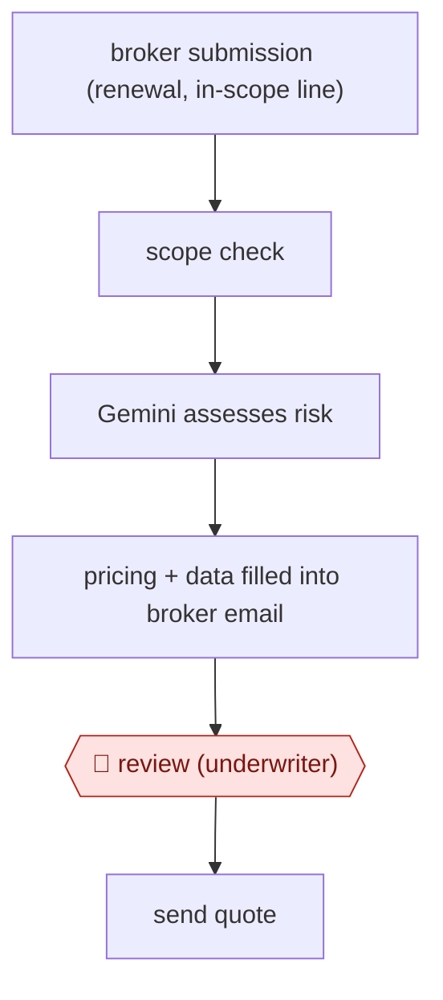

# Underwriter-reviewed broker quote

`PRO › INS › UW` · checkpointed · evidence A · **draft: needs a reference example** ([how to add one](../../../../../CONTRIBUTING.md#1-add-an-example-run))

**Shape:** `broker submission (renewal, in-scope line) → scope check → Gemini assesses risk → pricing + data filled into broker email → 🛑 review (underwriter) → send quote`
**How it differs:** AWF-0051 Governed-library response draft answers questionnaires from an approved answer library. Here the deliverable is a priced quote on one risk, and a single underwriter review gates it.
**Variants:** `gemini-vertex`

<!-- shape diagram: generated by scripts/build_diagrams.py from `shape`; don't edit -->

<!-- end shape diagram -->

## Steps
1. Scope: renewals of existing US and Canada sabotage and terrorism risks, excluding the New York and Chicago metro areas [[1]](#sources).
2. In-scope risks are assessed with Gemini combined with Hiscox's in-house AI tool (Hailo) [[1]](#sources).
3. The system generates an email to the broker with pricing and other data already filled in [[1]](#sources).
4. 🛑 **Review**: the email is 'ready for underwriter review' before it goes to the broker [[1]](#sources).

**Output:** Priced quote email to the broker, sent after underwriter review.
**Failure modes → guards:** Out-of-scope or complex risks being auto-priced → scope limited by line, renewal status and geography; underwriters keep the complex risks.

**Recent practice (2026):**
- Step 1: By 2026 scope extended to middle-market risks, and the sabotage & terrorism tool connects directly to a broker's platform (Hiscox Q1 2026 trading statement). [[2]](#sources)

## Public runs

Coverage as of 2026-11-06: **Strong**: a first-hand, detailed run that matches most of the shape. Collected and re-checked in [Second collection pass](../../../../../research/2026-11-second-pass.md). More runs added in [Third collection pass](../../../../../research/2026-11-third-pass.md).

- [Hiscox, GenAI lead underwriting model goes live](https://www.hiscoxgroup.com/news/press-releases/2024/12-08-24) (2024-08-12). Live in the London market; first risk written with broker WTW. "an insurance quote in a matter of minutes". *First-hand: yes; confidence: high.*
- [Reinsurance News, Hiscox CFO Cooper on AI adoption](https://www.reinsurancene.ws/ai-adoption-drives-productivity-growth-and-opens-business-opportunities-hiscox-cfo-cooper/) (2025-11-07). Augmented lead underwriting industrialised for sabotage and terrorism; extending to mid-market property. "from a turnaround time of about three days to certainly around three minutes"; "around two-thirds of the sabotage and terrorism business now subject to the augmented underwriting process". *First-hand: interview; confidence: high.*
- [Hiscox Group, Q3 2026 trading statement](https://www.hiscoxgroup.com/news/press-releases/2026/03-11-26) (2026-11-03). AI submission-to-quote in US broker lines, rolling out across Retail. "improved our speed to quote by around 75% in terrorism and architects and engineers". *First-hand: yes; confidence: high.*

## Sources

1. Hiscox Group, Hiscox's generative AI-enhanced lead underwriting model enabled by Google Cloud goes live, 2024-08-12. https://www.hiscoxgroup.com/news/press-releases/2024/12-08-24
2. Hiscox Group, Q1 2026 trading statement, 2026-05-07. https://www.hiscoxgroup.com/news/press-releases/2026/07-05-26
3. Hiscox Group, Q3 2026 trading statement, 2026-11-03. https://www.hiscoxgroup.com/news/press-releases/2026/03-11-26
