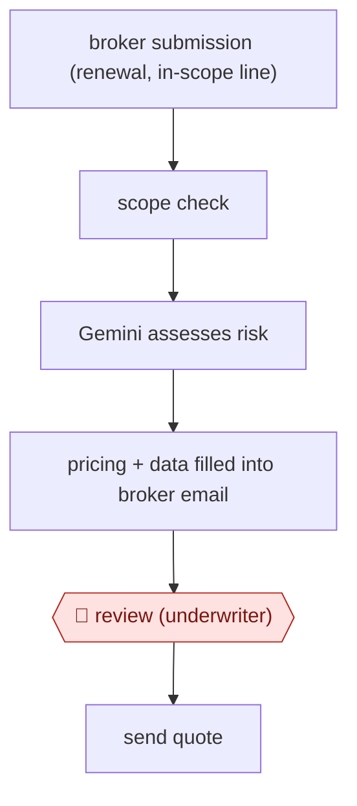

# Underwriter-reviewed broker quote

`PRO › INS › UW` · checkpointed · evidence A · **draft: needs a reference example** ([how to add one](../../../../../CONTRIBUTING.md#1-add-an-example-run))

**Shape:** `broker submission (renewal, in-scope line) → scope check → Gemini assesses risk → pricing + data filled into broker email → 🛑 review (underwriter) → send quote`
**Variants:** `gemini-vertex`

<!-- shape diagram: generated by scripts/build_diagrams.py from `shape`; don't edit -->

<!-- end shape diagram -->

## Background

Specialist commercial insurance is mostly sold through brokers, who send an insurer the details of a risk and ask for a price. When the policy is already in force and about to be renewed, the underwriter, who decides the terms and the price, still has to review the risk again and send the broker a quote. The details are mostly the same as last year, but the work of reading the submission, checking it against the insurer's rules and pricing it takes time that the underwriter could spend on harder risks. Here the agent checks that the renewal falls inside a narrow scope, assesses the risk, and fills a quote email to the broker with the price and other data. An underwriter reads that email and decides whether to send it, because the quote commits the insurer to a price and the agent is only allowed to handle the simple cases.

**Terms:**
- **Broker**: an intermediary who places a client's risk with insurers and asks for quotes.
- **Underwriter**: the person who decides whether to accept a risk and at what price.
- **Renewal**: the policy was already written and is being offered again for the next period.
- **Quote**: the insurer's written offer of cover at a price.
- **Lead underwriting**: setting the terms and price that other insurers on the same risk follow.
- **Sabotage and terrorism insurance**: specialist cover for property damage and loss from such acts, written for businesses.
- **Scope check**: a test that the risk is of a kind the agent is allowed to handle: here a line of business, renewal status and geography.
- **Metro area**: here the New York and Chicago city regions, left out of the scope.

## Build it with an agent

**Form:** `service`. A broker submission arrives with nobody at a keyboard, and the underwriter sees only the finished draft email. Weighed against `skill`, since a person reviews each quote; the run starts on arrival, not at their request.

**You need:** read access to the submissions inbox and the prior-year policy record; the scope rules written down (line, renewal status, region, exclusions) as a file that a script can check; the insurer's pricing method or rating tool as a script or connector the agent can call but not edit; an email template; a drafts folder or queue where the underwriter sees the email. Give the agent no tool that sends mail to a broker.

| Step | Built as |
|---|---|
| broker submission (renewal, in-scope line) → scope check | A cloud scheduled task, or your own program starting `claude -p` or an Agent SDK program, picks up each new submission. A script applies the scope rules; anything out of scope is left for the underwriter with a note saying why. |
| Gemini assesses risk | A skill reads the submission and the prior-year record and writes a risk assessment against the insurer's underwriting rules, each point with its source. |
| pricing + data filled into broker email | The skill calls the pricing script, fills the email template with the price and the other data, and saves it as a draft. |
| 🛑 review (underwriter) → send quote | See Checkpoints. |

**Checkpoints:** `review`: the run ends by putting the draft email and the risk assessment in the underwriter's queue. The agent has no send tool, and a `PreToolUse` hook denies any mail-sending call, so the underwriter edits the draft and sends it themselves, or declines to. The scope check is a script and not an instruction, so a risk outside the scope cannot be priced by the agent.

**Since the sources:** Sources date from 2024-08 to 2026-11. Hiscox built this with Google Cloud's Gemini model and its own in-house AI tool (Hailo), and reports no details of their prompts or pricing; this build uses a general agent, and any model choice is separate from the design. The 2026 trading statements report the scope growing to middle-market risks and the sabotage and terrorism tool connecting directly to a broker's platform; this build does not. The pricing method is the insurer's own, so the agent calls it and does not reproduce it.

*A design based on this entry's steps and the tool documentation as of 2026-11, not a reported run.*

## Steps

*As reported by the sources.*

1. Hiscox limits the scope to renewals of existing US and Canada sabotage and terrorism risks, excluding the New York and Chicago metro areas [[1]](#sources).
2. The system assesses in-scope risks with Gemini combined with Hiscox's in-house AI tool (Hailo) [[1]](#sources).
3. The system generates an email to the broker with pricing and other data already filled in [[1]](#sources).
4. 🛑 **Review**: the email is 'ready for underwriter review' before it goes to the broker [[1]](#sources).

**Output:** Priced quote email to the broker, sent after underwriter review.
**Failure modes → guards:** Out-of-scope or complex risks being auto-priced → scope limited by line, renewal status and geography; underwriters keep the complex risks.

**Recent practice (2026):**
- Step 1: By 2026 scope extended to middle-market risks, and the sabotage & terrorism tool connects directly to a broker's platform (Hiscox Q1 2026 trading statement). [[2]](#sources)
**How it differs:** AWF-0051 Governed-library response draft answers questionnaires from an approved answer library. Here the deliverable is a priced quote on one risk, and a single underwriter review gates it.

## Public runs

Coverage as of 2026-11-06: **Strong**: a first-hand, detailed run that matches most of the shape. Collected and re-checked in [Second collection pass](../../../../../research/2026-11-second-pass.md). More runs added in [Third collection pass](../../../../../research/2026-11-third-pass.md).

- [Hiscox, GenAI lead underwriting model goes live](https://www.hiscoxgroup.com/news/press-releases/2024/12-08-24) (2024-08-12). Live in the London market; first risk written with broker WTW. "an insurance quote in a matter of minutes". *First-hand: yes; confidence: high.*
- [Reinsurance News, Hiscox CFO Cooper on AI adoption](https://www.reinsurancene.ws/ai-adoption-drives-productivity-growth-and-opens-business-opportunities-hiscox-cfo-cooper/) (2025-11-07). Augmented lead underwriting industrialised for sabotage and terrorism; extending to mid-market property. "from a turnaround time of about three days to certainly around three minutes"; "around two-thirds of the sabotage and terrorism business now subject to the augmented underwriting process". *First-hand: interview; confidence: high.*
- [Hiscox Group, Q3 2026 trading statement](https://www.hiscoxgroup.com/news/press-releases/2026/03-11-26) (2026-11-03). AI submission-to-quote in US broker lines, rolling out across Retail. "improved our speed to quote by around 75% in terrorism and architects and engineers". *First-hand: yes; confidence: high.*

## Sources

1. Hiscox Group, Hiscox's generative AI-enhanced lead underwriting model enabled by Google Cloud goes live, 2024-08-12. https://www.hiscoxgroup.com/news/press-releases/2024/12-08-24
2. Hiscox Group, Q1 2026 trading statement, 2026-05-07. https://www.hiscoxgroup.com/news/press-releases/2026/07-05-26
3. Hiscox Group, Q3 2026 trading statement, 2026-11-03. https://www.hiscoxgroup.com/news/press-releases/2026/03-11-26
