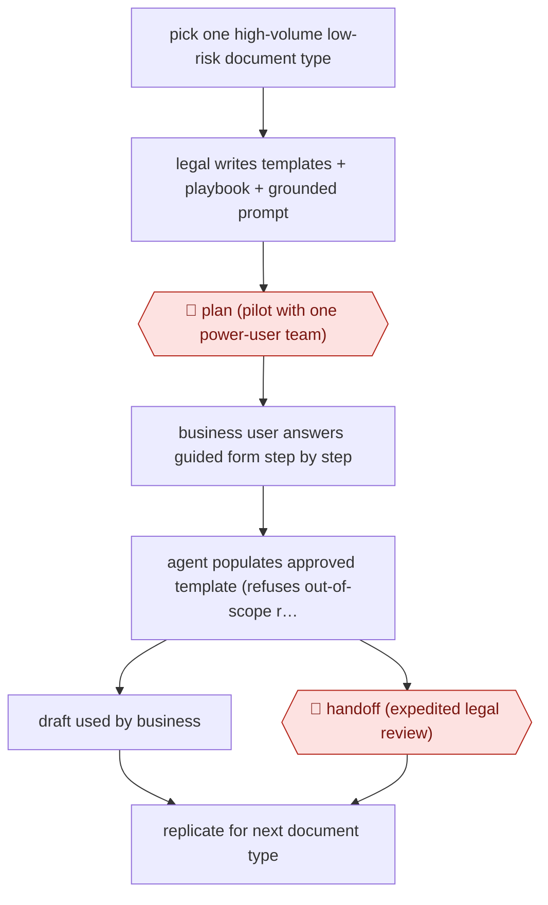

# Business self-serve drafting

`PRO › LEG › CONTRACT` · checkpointed · evidence A · **draft: needs a reference example** ([how to add one](../../../../../CONTRIBUTING.md#1-add-an-example-run))

**Shape:** `pick one high-volume low-risk document type → legal writes templates + playbook + grounded prompt → 🛑 plan (pilot with one power-user team) → business user answers guided form step by step → agent populates approved template (refuses out-of-scope requests) → draft used by business | 🛑 handoff (expedited legal review) → replicate for next document type`
**Variants:** `gemini-gems`

<!-- shape diagram: generated by scripts/build_diagrams.py from `shape`; don't edit -->

<!-- end shape diagram -->

## Background

Companies sign a steady stream of short, routine agreements: a letter ending a supplier contract, a purchasing addendum, a non-disclosure agreement. Each one normally starts as an email from a business colleague to a lawyer, who fills in a template and sends it back, so the legal team spends its time on documents that rarely need real legal judgement and the business waits days. In this workflow the legal team writes the approved templates and the rules for using them once, and a business colleague answers a guided form to get a first draft on company paper. The agent only fills in the approved template and declines anything outside it. A lawyer is still needed for any request the template does not cover, and for any draft the business wants checked, because the company is legally bound by what it signs and only a lawyer can judge terms outside the template.

**Terms:**
- **Template**: a contract document written and approved by the legal team, with blanks for the details that change.
- **Playbook**: the legal team's written rules for the template, such as which wording is allowed and when a request must go to a lawyer.
- **Grounded prompt**: instructions that limit the agent to the supplied templates and data, so it does not invent terms.
- **NDA**: non-disclosure agreement, a contract in which the parties promise to keep shared information confidential.
- **SOW change order**: a signed change to the scope, price or schedule of work set out in a statement of work.
- **Termination letter**: a formal letter ending a contract.

## Build it with an agent

**Form:** `skill`. Each business user prepares one document at a time and stays in the conversation, so one skill holding the form, the templates and the rules is enough. Legal writes it once and every business user runs it.

**You need:** the approved templates, one file per document type; the playbook as a reference file beside the skill, including the list of requests that must go to Legal; the guided form written as the questions the skill asks, in order; a setup your organisation has approved for confidential contract details. Give the agent no mail or e-signature tool, and no template other than the approved ones.

| Step | Built as |
|---|---|
| pick one high-volume low-risk document type | A decision for the legal team, made before any build: one skill per document type. |
| legal writes templates + playbook + grounded prompt | Legal writes the template files, `playbook.md` and the skill's instructions: use only the supplied files and decline anything else. |
| 🛑 plan (pilot with one power-user team) | See Checkpoints. |
| business user answers guided form step by step | The skill asks the questions one at a time and checks each answer, for example that the termination date is after the contract date. |
| agent populates approved template (refuses out-of-scope requests) | The skill copies the template, fills the blanks and changes nothing else. If a request matches a playbook exclusion, it stops and says so. |
| draft used by business \| 🛑 handoff (expedited legal review) | The skill saves the draft and asks whether the user wants Legal to review it. If so it writes a short note for Legal that lists the answers given. |
| replicate for next document type | A copy of the skill with new template and playbook files. |

**Checkpoints:** `plan`: the legal team runs the skill with one team before it is shared, reads the drafts and changes the templates and playbook. Nothing in the skill enforces this; it is a rollout decision. `handoff`: the skill stops when a request falls outside the playbook, or when the user asks for review, and states what it could not decide and why. The agent has no sending tool, so the draft reaches Legal only when the user forwards it.

**Since the sources:** The only source dates from 2026-01. It could not be opened when this section was written (the site refused the request), so the build follows the steps as the entry states them. The source is filed under the tool `gemini-gems`, which is a configured assistant inside a vendor's chat product. A skill with reference files does the same job in any app that loads skills. The source reports a company's own rollout of its tools, not an agent running the process unattended: the business user drives each draft.

*A design based on this entry's steps and the tool documentation as of 2026-11, not a reported run.*

## Steps

*As reported by the sources.*

1. The legal team finds the highest-volume, most repetitive drafting requests, then starts with one, such as termination letters [[1]](#sources).
2. Legal writes the templates, the logic and a grounded prompt. The tool may only use the provided templates and data, and must refuse requests outside its scope [[1]](#sources).
3. 🛑 **Plan**: the legal team pilots the tool with one power-user team (Sourcing and Procurement), refines it, then rolls it out to all business units [[1]](#sources).
4. A business user (Procurement, HR or Sales) fills in a guided form, for example counterparty, contract date, termination date and reason [[1]](#sources).
5. The agent turns the approved template and playbook into a compliant first draft of a termination letter, purchasing addendum, NDA, amendment or SOW change order [[1]](#sources).
6. 🛑 **Handoff**: the business user uses the draft directly, or sends it to Legal for a final, expedited review [[1]](#sources).
7. The legal team copies the model to the next document type. Each new tool takes a few weeks to build [[1]](#sources).

**Output:** A first draft on company paper from approved templates, used by the business or sent to Legal for expedited review.
**Failure modes → guards:** The tool might invent terms → it is grounded in templates only and refuses out-of-scope requests. Users keep emailing their lawyer → training, how-to guides and the 'speed to signature' pitch.
**How it differs:** AWF-0024 Playbook contract review is the nearest. In it a lawyer redlines counterparty paper clause by clause and signs off every contract. Here business users write first drafts on company templates, and lawyers only review drafts that are sent to them.

## Public runs

Coverage as of 2026-11-06: **Partial**: first-hand runs that cover part of the shape or put checkpoints elsewhere. Collected and re-checked in [Second collection pass](../../../../../research/2026-11-second-pass.md).

- [ACC / Palo Alto Networks legal self-service Gems](https://www.acc.com/sites/default/files/resources/upload/ACC-AI-USE-CASE-Hayden-O.-Creque-of-Palo-Alto-Networks.pdf) (2026-01-20). In-house counsel describes his team's own self-serve drafting tools, rollout phases and impact. "Turnaround time for these routine documents has been reduced from an average of 3-5 business days to one business day.". *First-hand: yes; confidence: med.*

## Sources

1. ACC, AI Use Case: Hayden O. Creque of Palo Alto Networks — Self-Service for Low-Complexity Business Agreements, 2026-01-20. https://www.acc.com/sites/default/files/resources/upload/ACC-AI-USE-CASE-Hayden-O.-Creque-of-Palo-Alto-Networks.pdf
