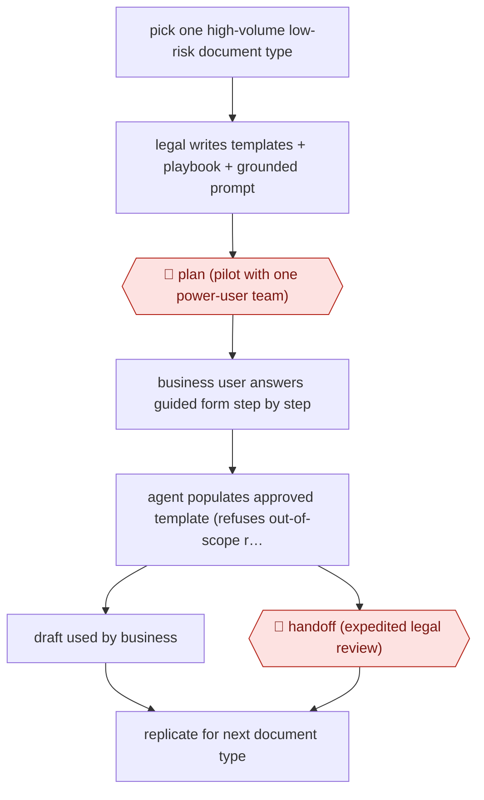

# Business self-serve drafting

`PRO › LEG › CONTRACT` · checkpointed · evidence A · **draft: needs a reference example** ([how to add one](../../../../../CONTRIBUTING.md#1-add-an-example-run))

**Shape:** `pick one high-volume low-risk document type → legal writes templates + playbook + grounded prompt → 🛑 plan (pilot with one power-user team) → business user answers guided form step by step → agent populates approved template (refuses out-of-scope requests) → draft used by business | 🛑 handoff (expedited legal review) → replicate for next document type`
**How it differs:** AWF-0024 Playbook contract review is the nearest. In it a lawyer redlines counterparty paper clause by clause and signs off every contract. Here business users write first drafts on company templates, and lawyers only review drafts that are sent to them.
**Variants:** `gemini-gems`

<!-- shape diagram: generated by scripts/build_diagrams.py from `shape`; don't edit -->

<!-- end shape diagram -->

## Steps
1. Find the highest-volume, most repetitive drafting requests, then start with one, such as termination letters [[1]](#sources).
2. Legal writes the templates, the logic and a grounded prompt. The tool may only use the provided templates and data, and must refuse requests outside its scope [[1]](#sources).
3. 🛑 **Plan**: pilot the tool with one power-user team (Sourcing and Procurement), refine it, then roll it out to all business units [[1]](#sources).
4. A business user (Procurement, HR or Sales) fills in a guided form, for example counterparty, contract date, termination date and reason [[1]](#sources).
5. The tool turns the approved template and playbook into a compliant first draft of a termination letter, purchasing addendum, NDA, amendment or SOW change order [[1]](#sources).
6. 🛑 **Handoff**: the business uses the draft directly, or sends it to Legal for a final, expedited review [[1]](#sources).
7. Copy the model to the next document type. Each new tool takes a few weeks to build [[1]](#sources).

**Output:** A first draft on company paper from approved templates, used by the business or sent to Legal for expedited review.
**Failure modes → guards:** The tool might invent terms → it is grounded in templates only and refuses out-of-scope requests. Users keep emailing their lawyer → training, how-to guides and the 'speed to signature' pitch.

## Public runs

Coverage as of 2026-11-06: **Partial**: first-hand runs that cover part of the shape or put checkpoints elsewhere. Collected and re-checked in [Second collection pass](../../../../../research/2026-11-second-pass.md).

- [ACC / Palo Alto Networks legal self-service Gems](https://www.acc.com/sites/default/files/resources/upload/ACC-AI-USE-CASE-Hayden-O.-Creque-of-Palo-Alto-Networks.pdf) (2026-01-20). In-house counsel describes his team's own self-serve drafting tools, rollout phases and impact. "Turnaround time for these routine documents has been reduced from an average of 3-5 business days to one business day.". *First-hand: yes; confidence: med.*

## Sources

1. ACC, AI Use Case: Hayden O. Creque of Palo Alto Networks — Self-Service for Low-Complexity Business Agreements, 2026-01-20. https://www.acc.com/sites/default/files/resources/upload/ACC-AI-USE-CASE-Hayden-O.-Creque-of-Palo-Alto-Networks.pdf
