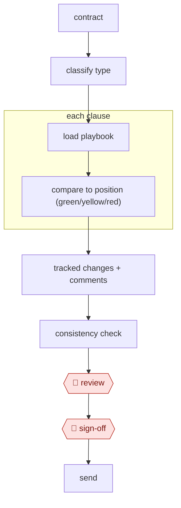

# Playbook contract review

`PRO › LEG › CONTRACT` · checkpointed · evidence A · **draft: needs a reference example** ([how to add one](../../../../../CONTRIBUTING.md#1-add-an-example-run))

**Shape:** `contract → classify type → load playbook → each clause: compare to position (green/yellow/red) → tracked changes + comments → consistency check → 🛑 review → 🛑 sign-off → send`
**Variants:** `harvey` · `spellbook` · `luminance` · `claude-playbook-skill`

<!-- shape diagram: generated by scripts/build_diagrams.py from `shape`; don't edit -->

<!-- end shape diagram -->

## Steps
1. Classify the agreement and load the matching playbook (standard positions, fallbacks, walk-away points per clause).
2. Segment the clauses, map each to a playbook entry, and flag missing clauses.
3. Analyze clauses in parallel for deviation.
4. Generate Word tracked changes with margin comments explaining each change.
5. Check internal consistency: defined terms, cross-references, liability caps vs. indemnities.
6. 🛑 **Review**: an attorney reviews yellow and red items.
7. 🛑 **Sign-off**: the attorney sends.

## Public runs

Coverage as of 2026-11-06: **Partial**: first-hand runs that cover part of the shape or put checkpoints elsewhere. From [Where are the real runs?](../../../../../research/2026-11-real-runs.md); every number was re-checked against its page.

- [Ashurst, *Vox PopulAI*](https://www.ashurstperkinscoie.com/en/insights/vox-populai-lessons-from-a-global-law-firms-exploration-of-generative-ai) (2024-06-10). Firm-wide trials; four expert lawyers blind-score AI against human work. "45% on creating first draft legal briefings"; "3 out of 5" vs "3.5 out of 5". *First-hand: yes; confidence: med.*

