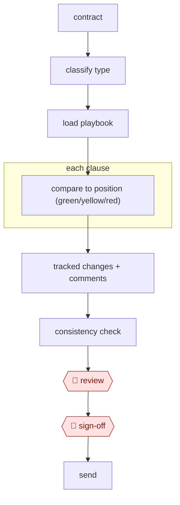

# Playbook contract review

`PRO › LEG › CONTRACT` · checkpointed · evidence A · **draft: needs a reference example** ([how to add one](../../../../../CONTRIBUTING.md#1-add-an-example-run))

**Shape:** `contract → classify type → load playbook → each clause: compare to position (green/yellow/red) → tracked changes + comments → consistency check → 🛑 review → 🛑 sign-off → send`
**Variants:** `harvey` · `spellbook` · `luminance` · `claude-playbook-skill`

<!-- shape diagram: generated by scripts/build_diagrams.py from `shape`; don't edit -->

<!-- end shape diagram -->

## Background

Before a company signs a contract that someone else drafted (a supplier's terms, a customer's non-disclosure agreement), a lawyer reads it clause by clause against the company's own rules for what it will and will not accept. Those rules are written down in a playbook. Most of the lawyer's time goes on clauses that turn out to be acceptable, and on writing the same corrections and explanations again and again. The agent does the clause-by-clause comparison, proposes the corrected wording and explains each change. A lawyer still judges every clause that departs from the playbook and is the only one who sends the result, because the lawyer is professionally responsible for the advice and the other side will treat what is sent as the company's position.

**Terms:**
- **Playbook**: for each clause type, the company's preferred wording, the fallback wording it will accept if pushed, and the walk-away point below which it will not sign.
- **Green / yellow / red**: the clause matches the preferred position / is within the fallbacks / is beyond the walk-away point or missing.
- **Tracked changes (a redline)**: edits recorded in the Word file so the other side can see each insertion and deletion.
- **Defined terms**: capitalised words given a fixed meaning in the contract; an edit to one clause can break another that uses the same term.
- **Liability cap and indemnity**: the limit on what one party can owe the other, and a promise to cover the other's losses. They must be read together, because an indemnity can sit outside the cap.

## Build it with an agent

**Form:** `skill`. One lawyer reviews one contract at a time and stays in the conversation, so a single skill holding the procedure and the playbooks is enough.

**You need:** the contract as a `.docx` file; the playbook as reference files beside the skill, one per agreement type; a way to write tracked changes into a Word file, such as a document-editing skill or a script beside the skill; a setup your organisation has approved for confidential and privileged client documents. Do not connect a mail tool.

| Step | Built as |
|---|---|
| contract → classify type → load playbook | The skill's first instruction: read the contract, name its type, open `playbooks/<type>.md`. If no playbook matches, stop and say so. |
| each clause: compare to position (green/yellow/red) | The main conversation for a short contract. For a long one, built-in subagents take one group of clauses each and return a table: clause, playbook position, rating, proposed wording. |
| tracked changes + comments | A script or document skill writes the changes into a copy of the file, never the original, with one comment per change giving the playbook reason. |
| consistency check | A second pass over the whole redlined copy in the main conversation: defined terms, cross-references, liability caps against indemnities. |
| 🛑 review → 🛑 sign-off → send | See Checkpoints. |

**Checkpoints:** `review`: the skill ends by listing every yellow and red clause with the playbook position and the proposed change, then stops; the lawyer edits the redlined copy. `sign-off`: the skill has no sending step and the agent has no mail tool, so the lawyer sends from their own mailbox.

**Since the sources:** The steps cite no source; the one public run dates from 2024-06. No newer first-hand account was looked for when this was written. The tools listed for this entry (`harvey`, `spellbook`, `luminance`) are legal products that run these steps inside Word or their own review screen. A general agent with a skill runs the same steps on a file; it does not work inside Word's interface. This entry's steps cite no source, and its one public run reports a law firm's general trials of drafting tools, not this build.

*A design based on this entry's steps and the tool documentation as of 2026-11, not a reported run.*

## Steps

*As reported by the sources.*

1. The agent classifies the agreement and loads the matching playbook (standard positions, fallbacks, walk-away points per clause).
2. The agent splits the contract into clauses, maps each to a playbook entry, and flags clauses the playbook expects but the contract lacks.
3. The agent compares the clauses with the playbook in parallel and rates each one green, yellow or red.
4. The agent writes Word tracked changes, with a margin comment explaining each change.
5. The agent checks the redlined contract for internal consistency: defined terms, cross-references, liability caps vs. indemnities.
6. 🛑 **Review**: an attorney reviews yellow and red items.
7. 🛑 **Sign-off**: the attorney sends.

## Public runs

Coverage as of 2026-11-06: **Partial**: first-hand runs that cover part of the shape or put checkpoints elsewhere. From [Where are the real runs?](../../../../../research/2026-11-real-runs.md); every number was re-checked against its page.

- [Ashurst, *Vox PopulAI*](https://www.ashurstperkinscoie.com/en/insights/vox-populai-lessons-from-a-global-law-firms-exploration-of-generative-ai) (2024-06-10). Firm-wide trials; four expert lawyers blind-score AI against human work. "45% on creating first draft legal briefings"; "3 out of 5" vs "3.5 out of 5". *First-hand: yes; confidence: med.*
