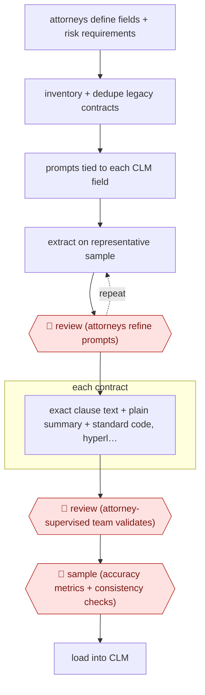

# Sample-tuned contract abstraction

`PRO › LEG › CONTRACT` · checkpointed · evidence A · **draft: needs a reference example** ([how to add one](../../../../../CONTRIBUTING.md#1-add-an-example-run))

**Shape:** `attorneys define fields + risk requirements → inventory + dedupe legacy contracts → prompts tied to each CLM field → (extract on representative sample ⟲ 🛑 review (attorneys refine prompts)) → each contract: exact clause text + plain summary + standard code, hyperlinked to source → 🛑 review (attorney-supervised team validates) → 🛑 sample (accuracy metrics + consistency checks) → load into CLM`
**Variants:** `hebbia` · `elevate-elm` · `ironclad` · `contractpodai-leah`

<!-- shape diagram: generated by scripts/build_diagrams.py from `shape`; don't edit -->

<!-- end shape diagram -->

## Background

Large companies often hold thousands of signed contracts in shared folders, with no searchable record of what each one says: who the parties are, when it ends, whether it renews, whether it can be assigned to someone else. A contract lifecycle management system (CLM) holds exactly those facts as fields, so before a company adopts one, lawyers or contract staff read the whole back catalogue and key in the answers. That is slow and tedious, and two readers often record the same clause differently. Here the agent reads each contract and proposes the field values, the exact clause wording behind them and a plain-language summary, each linked back to the source text. Lawyers still decide which fields matter, tune the instructions on a sample, check the results against the source and untangle how related documents fit together, because the company will rely on the loaded data for renewals, notices and risk decisions.

**Terms:**
- **CLM**: contract lifecycle management system, software that stores contracts and tracks their key dates and terms.
- **Legacy contracts**: signed agreements already on file, as opposed to ones being drafted now.
- **Abstraction (metadata extraction)**: pulling the key facts and clauses out of a contract into structured fields.
- **Dedupe**: removing drafts, copies and unsigned versions so that each agreement is counted once.
- **Parent-child relationship (contract family)**: a master agreement and the amendments and orders that change it; a fact in the child may override the parent.
- **SME**: subject matter expert, here a lawyer who knows the clause type well enough to say what the correct field value is.

## Build it with an agent

**Form:** `project`. A skill alone is not enough: the work runs over a whole portfolio of contracts in parallel, each result has to be checked against its source text in a way that cannot be skipped, and the field definitions are standing knowledge that every run needs.

**You need:** the contracts as files, held in a setup your organisation has approved for confidential commercial documents; the attorneys' list of fields and risk requirements, as a reference file with the CLM's import format; one prompt per CLM field, kept as files beside the skill; a spreadsheet or table where the agent records, per contract, each field value, the quoted clause and its location in the file; a way for reviewers to open the quoted text next to each value. Give the agent no write access to the CLM.

| Step | Built as |
|---|---|
| attorneys define fields + risk requirements | A reference file the attorneys write: fields, what counts as a risk, and the CLM import format. |
| inventory + dedupe legacy contracts | A script lists the files and flags drafts, copies and unsigned versions by name and content. Attorneys confirm the in-scope list. |
| prompts tied to each CLM field | A skill holding one prompt per field and the output format the CLM imports. |
| (extract on representative sample ⟲ 🛑 review (attorneys refine prompts)) | The skill runs on a sample the attorneys choose, shows the results beside the source text, and takes their changes to the prompts. Repeat until they approve. See Checkpoints. |
| each contract: exact clause text + plain summary + standard code, hyperlinked to source | A dynamic workflow, or a subagent per batch of contracts, applies the skill and returns one row per contract. A script checks that each quoted clause appears word for word in the file and rejects any row where it does not. |
| 🛑 review (attorney-supervised team validates) | See Checkpoints. Attorneys also reconcile contract families from a table of which documents amend which. |
| 🛑 sample (accuracy metrics + consistency checks) | A script runs the consistency checks (for example an end date before a start date) and draws the sample for review. See Checkpoints. |
| load into CLM | A person runs the import from the approved export file. |

**Checkpoints:** `review`: after each test round on the sample the skill stops and shows the results beside the source text; the attorneys change the prompts and approve before the full run starts. After the full run, the reviewing team opens each value's source link and corrects the row. The dynamic workflow cannot take input mid-run, so these stops sit before and after it, not inside it. `sample`: a script draws a fixed share of rows for attorney checking, computes the agreed accuracy figures from their verdicts, and runs the consistency checks over the whole set. The export file is not produced until those results are recorded, and the agent has no tool that writes to the CLM, so a person performs the load.

**Since the sources:** Sources date from 2026-04 to 2026-05. The agent in this build does the first-pass extraction that the sources describe as AI-assisted, and the review steps stay with people, as in the sources. The sources use named platforms (the entry lists `hebbia`, `elevate-elm`, `ironclad`, `contractpodai-leah`) for extraction and loading; this build replaces the extraction platform with files, a script and a dynamic workflow, and leaves the CLM load to a person. Neither source publishes its prompts, so the prompt files in this build are for each team to write. The accuracy figures in Public runs are the sources' own and say nothing about this design.

*A design based on this entry's steps and the tool documentation as of 2026-11, not a reported run.*

## Steps

*As reported by the sources.*

1. Corporate attorneys define which provisions and attributes matter (parties, location, term, renewal options, assignment, other critical terms) [[1]](#sources).
2. The team inventories the repository, removes drafts, duplicates and unsigned versions, and narrows to in-scope documents (e.g., ~98,000 files to 60,000) [[2]](#sources).
3. The team configures AI prompts tied to specific CLM fields, producing output in the CLM platform's import format [[1]](#sources).
4. 🛑 **Review**: the team tests on a representative sample of contracts and refine prompts and outputs before scaling [[1]](#sources); 'sample-based playbook validation' and SME calibration [[2]](#sources).
5. For each contract the AI pulls the exact provision language, writes a plain-language summary and applies standardized coding [[1]](#sources).
6. 🛑 **Review**: reviewers click from each data point to the underlying text to validate, under attorney supervision; lawyers reconcile parent-child relationships across contract families [[1]](#sources)[[2]](#sources).
7. 🛑 **Sample**: quality framework with defined accuracy metrics, feedback loops and automated consistency checks before migration [[2]](#sources).

**Output:** Validated, source-linked contract metadata loaded into the client's CLM system.
**Failure modes → guards:** Prompt misses field nuance → sample pilot before scale. Parent-child hierarchy errors (amendments vs MSAs) → lawyer-led family reconciliation. Silent extraction errors → hyperlinks to source text and accuracy metrics.
**How it differs:** AWF-0024 Playbook contract review redlines one incoming contract for negotiation; AWF-0092 drafts new low-risk documents. Here the deliverable is structured metadata across a whole legacy portfolio, with a sample calibration loop and portfolio-level QC; deliverable and checkpoints differ.

## Public runs

Coverage as of 2026-11-13: **Strong**: a first-hand, detailed run that matches most of the shape. Collected and re-checked in [Third collection pass](../../../../../research/2026-11-third-pass.md).

- [Troutman Pepper Locke, Accelerating CLM Implementation](https://www.troutman.com/insights/accelerating-clm-implementation/) (2026-04-20). Firm's own run: 1,000+ legacy gas-utility contracts, sample-tested prompts, attorney-supervised validation. "roughly half of what a traditional manual review would have taken". *First-hand: yes; confidence: high.*
- [Elevate, CLM-ready contract repository](https://elevate.law/case-studies/how-ai-enabled-review-delivered-a-clm-ready-contract-repository/) (2026-05-27). Legal service provider's own engagement: 98K files triaged, 60K extracted, migrated to Ironclad. ">99% accuracy across extracted metadata". *First-hand: vendor; confidence: med.*

## Sources

1. Troutman Pepper Locke (Warpula C., Frankel M., Dacher-Shapiro R.), Accelerating CLM Implementation, AI Case Study, 2026-04-20. https://www.troutman.com/insights/accelerating-clm-implementation/
2. Elevate, How AI-Enabled Review Delivered a CLM-Ready Contract Repository, 2026-05-27. https://elevate.law/case-studies/how-ai-enabled-review-delivered-a-clm-ready-contract-repository/
