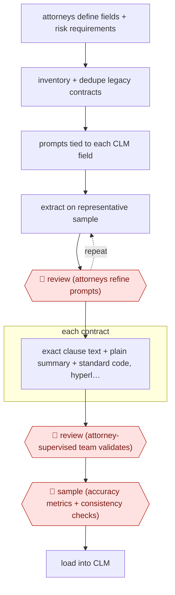

# Sample-tuned contract abstraction

`PRO › LEG › CONTRACT` · checkpointed · evidence A · **draft: needs a reference example** ([how to add one](../../../../../CONTRIBUTING.md#1-add-an-example-run))

**Shape:** `attorneys define fields + risk requirements → inventory + dedupe legacy contracts → prompts tied to each CLM field → (extract on representative sample ⟲ 🛑 review (attorneys refine prompts)) → each contract: exact clause text + plain summary + standard code, hyperlinked to source → 🛑 review (attorney-supervised team validates) → 🛑 sample (accuracy metrics + consistency checks) → load into CLM`
**How it differs:** AWF-0024 Playbook contract review redlines one incoming contract for negotiation; AWF-0092 drafts new low-risk documents. Here the deliverable is structured metadata across a whole legacy portfolio, with a sample calibration loop and portfolio-level QC; deliverable and checkpoints differ.
**Variants:** `hebbia` · `elevate-elm` · `ironclad` · `contractpodai-leah`

<!-- shape diagram: generated by scripts/build_diagrams.py from `shape`; don't edit -->

<!-- end shape diagram -->

## Steps
1. Corporate attorneys define which provisions and attributes matter (parties, location, term, renewal options, assignment, other critical terms) [[1]](#sources).
2. Inventory the repository, remove drafts, duplicates and unsigned versions, and narrow to in-scope documents (e.g., ~98,000 files to 60,000) [[2]](#sources).
3. Configure AI prompts tied to specific CLM fields, producing output in the CLM platform's import format [[1]](#sources).
4. 🛑 **Review**: test on a representative sample of contracts and refine prompts and outputs before scaling [[1]](#sources); 'sample-based playbook validation' and SME calibration [[2]](#sources).
5. For each contract the AI pulls the exact provision language, writes a plain-language summary and applies standardized coding [[1]](#sources).
6. 🛑 **Review**: reviewers click from each data point to the underlying text to validate, under attorney supervision; lawyers reconcile parent-child relationships across contract families [[1]](#sources)[[2]](#sources).
7. 🛑 **Sample**: quality framework with defined accuracy metrics, feedback loops and automated consistency checks before migration [[2]](#sources).

**Output:** Validated, source-linked contract metadata loaded into the client's CLM system.
**Failure modes → guards:** Prompt misses field nuance → sample pilot before scale. Parent-child hierarchy errors (amendments vs MSAs) → lawyer-led family reconciliation. Silent extraction errors → hyperlinks to source text and accuracy metrics.

## Public runs

Coverage as of 2026-11-13: **Strong**: a first-hand, detailed run that matches most of the shape. Collected and re-checked in [Third collection pass](../../../../../research/2026-11-third-pass.md).

- [Troutman Pepper Locke, Accelerating CLM Implementation](https://www.troutman.com/insights/accelerating-clm-implementation/) (2026-04-20). Firm's own run: 1,000+ legacy gas-utility contracts, sample-tested prompts, attorney-supervised validation. "roughly half of what a traditional manual review would have taken". *First-hand: yes; confidence: high.*
- [Elevate, CLM-ready contract repository](https://elevate.law/case-studies/how-ai-enabled-review-delivered-a-clm-ready-contract-repository/) (2026-05-27). Legal service provider's own engagement: 98K files triaged, 60K extracted, migrated to Ironclad. ">99% accuracy across extracted metadata". *First-hand: vendor; confidence: med.*

## Sources

1. Troutman Pepper Locke (Warpula C., Frankel M., Dacher-Shapiro R.), Accelerating CLM Implementation, AI Case Study, 2026-04-20. https://www.troutman.com/insights/accelerating-clm-implementation/
2. Elevate, How AI-Enabled Review Delivered a CLM-Ready Contract Repository, 2026-05-27. https://elevate.law/case-studies/how-ai-enabled-review-delivered-a-clm-ready-contract-repository/
