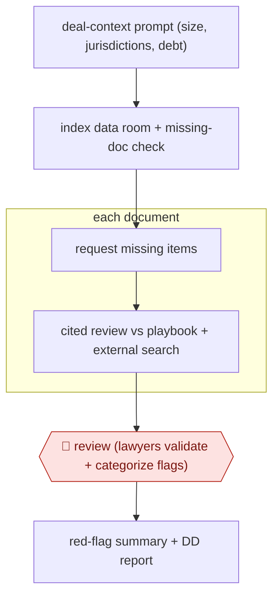

# Data-room red-flag review

`PRO › LEG › DD` · checkpointed · evidence B · **draft: needs a reference example** ([how to add one](../../../../../CONTRIBUTING.md#1-add-an-example-run))

**Shape:** `deal-context prompt (size, jurisdictions, debt) → index data room + missing-doc check → request missing items → each document: cited review vs playbook + external search → 🛑 review (lawyers validate + categorize flags) → red-flag summary + DD report`
**How it differs:** AWF-0024 Playbook contract review (CONTRACT) redlines one contract. This covers a whole data room in parallel, requests missing documents, and delivers a deal-level red-flag report.
**Variants:** `harvey` · `deeligence`

<!-- shape diagram: generated by scripts/build_diagrams.py from `shape`; don't edit -->

<!-- end shape diagram -->

## Steps
1. Before review, set up a system prompt with deal context: company size, jurisdictions and debt facilities. This triggers the matching regulatory checks [[1]](#sources).
2. Conditional AI checks find missing or misfiled documents and draft requests to the target [[1]](#sources).
3. Each document in the data room gets a prompt-driven review with citations, plus searches of statutory/regulatory databases and public sources for external risks [[1]](#sources).
4. 🛑 **Review**: Lawyers validate, iterate and categorize the flagged risks against the citations [[1]](#sources). Associates check AI reviews side by side with the source [[2]](#sources).
5. Generate red-flag summaries and the DD report from the validated flags [[1]](#sources).

**Output:** A lawyer-validated red-flag summary and DD report, delivered to the deal team and client.
**Failure modes → guards:** Over-reliance on AI flags → lawyer validation in the loop [[1]](#sources). Data rooms change mid-deal → track changes in the platform [[2]](#sources).

## Public runs

Coverage as of 2026-11-06: **Weak**: only anonymous, vendor-linked or journalist-told accounts. Collected and re-checked in [New workflows for empty categories](../../../../../research/2026-11-new-workflows.md).

- [Harvey, GSK Stockmann due diligence](https://www.harvey.ai/customers/gsk-stockmann) (2025-09-26). Co-designed DD workflows for corporate and real estate deals with lawyer validation of flags. "up to 75% when applied to unstructured data rooms". *First-hand: vendor; confidence: med.*
- [Deeligence, Mayne Wetherell](https://www.deeligence.com/resources/mayne-wetherell-market-leading-due-diligence-practice-adopts-deeligence) (n.d.). AI material-contract review on a large transaction with associate checks. "75+ hours of lawyer time saved on a recent deal". *First-hand: vendor; confidence: med.*

## Sources

1. Harvey, GSK Stockmann and Harvey: Redefining the Due Diligence Process, 2025-09-26. https://www.harvey.ai/customers/gsk-stockmann
2. Deeligence, Mayne Wetherell: the first New Zealand firm to run due diligence on Deeligence, n.d. https://www.deeligence.com/resources/mayne-wetherell-market-leading-due-diligence-practice-adopts-deeligence
