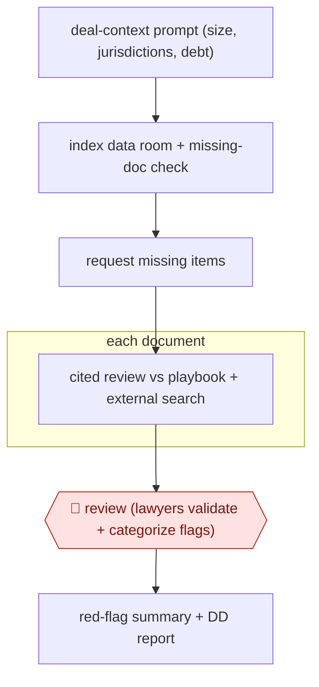

# Data-room red-flag review

`PRO › LEG › DD` · checkpointed · evidence B · **draft: needs a reference example** ([how to add one](../../../../../CONTRIBUTING.md#1-add-an-example-run))

**Shape:** `deal-context prompt (size, jurisdictions, debt) → index data room + missing-doc check → request missing items → each document: cited review vs playbook + external search → 🛑 review (lawyers validate + categorize flags) → red-flag summary + DD report`
**Variants:** `harvey` · `deeligence`

<!-- shape diagram: generated by scripts/build_diagrams.py from `shape`; don't edit -->

<!-- end shape diagram -->

## Background

When a company is bought, or buys another business, the buyer's lawyers examine the target's documents before the deal closes. This is called due diligence. The target uploads its contracts, licences, loan agreements, litigation files and corporate records to a shared online folder called a data room, often hundreds of files that are poorly organised. Lawyers read them all looking for red flags, the findings that could change the price or the terms or stop the deal, such as a contract that ends if the company is sold. It is slow, and a missed clause can cost the client money. The agent indexes the room, notices what is missing, reads every document against the firm's checklist and quotes the passage behind each flag. Lawyers still validate and categorise every flag and sign the report, because the client relies on their advice and a wrong or missing flag is the firm's professional responsibility.

**Terms:**
- **Data room**: the shared online folder where the seller puts documents for the buyer's advisers to review.
- **Red flag**: a finding in a document that could affect the price, the terms or whether the deal goes ahead.
- **Playbook**: the lawyers' checklist of what to look for in each type of document and what counts as a problem.
- **Target**: the company being bought or invested in.
- **Change of control**: a contract clause that lets the other party end or change the contract when the company is sold.
- **Debt facilities**: loans and credit lines the company has taken out, which often come with conditions triggered by a sale.
- **DD**: due diligence.

## Build it with an agent

**Form:** `skill`. One deal team reviews one data room at a time and stays in the conversation, so one skill holding the playbook and the procedure is enough, with built-in subagents to read documents in parallel.

**You need:** the data room documents downloaded as files, or a connector the seller's data room permits; the playbook as reference files, one per document type; the deal facts (size, jurisdictions, debt); a setup your organisation and the deal's confidentiality agreement allow for the target's documents. Check the confidentiality agreement before any file is passed to an AI tool, because it may limit who may receive the documents. Give the agent no mail tool: requests to the target are drafted, not sent.

| Step | Built as |
|---|---|
| deal-context prompt (size, jurisdictions, debt) | The skill's first step: ask for the deal facts and save them to a file that every later step reads. |
| index data room + missing-doc check | The agent lists and classifies every file, then compares the list with the checklist of documents the playbook expects for these deal facts. |
| request missing items | The agent drafts a request list for the lawyers to send to the target. |
| each document: cited review vs playbook + external search | Built-in subagents take batches of documents and return one row per document: playbook point, finding, quoted passage with its page, and rating. A web or database search covers public sources, and the results are marked as external. |
| 🛑 review (lawyers validate + categorize flags) | See Checkpoints. |
| red-flag summary + DD report | The skill drafts both from the flags the lawyers have accepted, in the report template. |

**Checkpoints:** `review`: after the document review the skill stops and presents the flags with their quoted passages. Lawyers confirm, reject and categorise each one, and the report is drafted only from the confirmed list. The skill has no sending step and the agent has no mail tool, so the report and the requests to the target go out from the lawyers' own systems.

**Since the sources:** Sources date from 2025-09 to undated, and both are vendor case studies. A search in 2026-11 found no independent account of the practice. It found Harvey's own explainer on data-room review, dated 2026-09 ([link](https://www.harvey.ai/blog/data-room-due-diligence)), and a comparison article reporting that law firms now warn that uploading data room files to a third-party AI tool may breach the confidentiality agreement ([link](https://www.peony.ink/blog/ai-due-diligence-tools), citing a 2026-08 report). That is why this build lists the confidentiality check under You need. The sources run the steps inside two vendor products (`harvey`, `deeligence`), including the platform's tracking of data-room changes; this build has no change tracking, so a data room that changes mid-deal needs the review rerun on the new files. The sources report firm-led trials with lawyer validation, not an agent running the process unattended.

*A design based on this entry's steps and the tool documentation as of 2026-11, not a reported run.*

## Steps

*As reported by the sources.*

1. Before review, the deal team sets up a system prompt with deal context: company size, jurisdictions and debt facilities. This triggers the matching regulatory checks [[1]](#sources).
2. Conditional AI checks find missing or misfiled documents and draft requests to the target [[1]](#sources).
3. Each document in the data room gets a prompt-driven review with citations, plus searches of statutory/regulatory databases and public sources for external risks [[1]](#sources).
4. 🛑 **Review**: Lawyers validate, iterate and categorize the flagged risks against the citations [[1]](#sources). Associates check AI reviews side by side with the source [[2]](#sources).
5. The agent generates red-flag summaries and the DD report from the validated flags [[1]](#sources).

**Output:** A lawyer-validated red-flag summary and DD report, delivered to the deal team and client.
**Failure modes → guards:** Over-reliance on AI flags → lawyer validation in the loop [[1]](#sources). Data rooms change mid-deal → track changes in the platform [[2]](#sources).
**How it differs:** AWF-0024 Playbook contract review (CONTRACT) redlines one contract. This covers a whole data room in parallel, requests missing documents, and delivers a deal-level red-flag report.

## Public runs

Coverage as of 2026-11-06: **Weak**: only anonymous, vendor-linked or journalist-told accounts. Collected and re-checked in [New workflows for empty categories](../../../../../research/2026-11-new-workflows.md).

- [Harvey, GSK Stockmann due diligence](https://www.harvey.ai/customers/gsk-stockmann) (2025-09-26). Co-designed DD workflows for corporate and real estate deals with lawyer validation of flags. "up to 75% when applied to unstructured data rooms". *First-hand: vendor; confidence: med.*
- [Deeligence, Mayne Wetherell](https://www.deeligence.com/resources/mayne-wetherell-market-leading-due-diligence-practice-adopts-deeligence) (n.d.). AI material-contract review on a large transaction with associate checks. "75+ hours of lawyer time saved on a recent deal". *First-hand: vendor; confidence: med.*

## Sources

1. Harvey, GSK Stockmann and Harvey: Redefining the Due Diligence Process, 2025-09-26. https://www.harvey.ai/customers/gsk-stockmann
2. Deeligence, Mayne Wetherell: the first New Zealand firm to run due diligence on Deeligence, n.d. https://www.deeligence.com/resources/mayne-wetherell-market-leading-due-diligence-practice-adopts-deeligence
