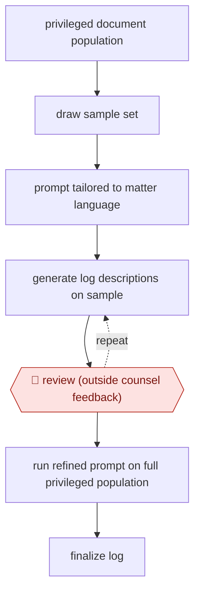

# Calibrated privilege log

`PRO › LEG › LITIG` · checkpointed · evidence B · **draft: needs a reference example** ([how to add one](../../../../../CONTRIBUTING.md#1-add-an-example-run))

**Shape:** `privileged document population → draw sample set → prompt tailored to matter language → (generate log descriptions on sample ⟲ 🛑 review (outside counsel feedback)) → run refined prompt on full privileged population → finalize log`
**Variants:** `lighthouse-genai-privilege`

<!-- shape diagram: generated by scripts/build_diagrams.py from `shape`; don't edit -->

<!-- end shape diagram -->

## Background

In a lawsuit or a regulatory investigation, each side must hand over its relevant documents. A document protected by privilege, such as a lawyer's advice to the client, may be withheld, but the withholding side must then serve a privilege log: a list that describes each withheld document well enough for the other side and the court to judge the claim, without revealing the protected content. A large case can mean hundreds of thousands of entries, and writing them by hand is slow and turns out inconsistent. Here the agent drafts each description, first on a sample so that the lawyers can correct the wording, then across the whole set. The lawyers who are responsible for the case still decide the wording rules and approve the prompt, because the log is served on the other side under their name and a description that gives away protected content waives the protection.

**Terms:**
- **Privilege**: the legal protection that lets a party keep confidential communications, such as advice from its lawyer, out of what it hands over.
- **Privilege log**: the list served on the other side that describes each document withheld as privileged.
- **Privileged population**: the documents already decided to be privileged and to be withheld.
- **Outside counsel**: the law firm representing the client in the case.
- **Production**: handing the relevant, non-privileged documents to the other side.
- **Prompt**: the written instructions the model follows when drafting each description.

## Build it with an agent

**Form:** `project`. A skill alone is not enough: the full run covers a very large set of documents in parallel, and every description must be checked by a script for protected content before it can reach the log. That check has to hold every time, and a hook can enforce it where the skill's text cannot.

**You need:** the privileged documents as files, in a setup your organisation and the case's protective order allow for privileged material, and no connection to any system outside it; the log format the case requires; an instruction file with the matter's names, terms and the wording rules counsel set (what a description may say and must never say); a place to store the sample outputs with counsel's comments. Give the agent no tool to serve or produce anything.

| Step | Built as |
|---|---|
| privileged document population → draw sample set | A script draws the sample at random from the list of privileged documents and records which ones were drawn. |
| prompt tailored to matter language | A skill holding the prompt, the matter's names and terms, and the wording rules. |
| (generate log descriptions on sample ⟲ 🛑 review (outside counsel feedback)) | The skill drafts descriptions for the sample and writes them to a file for counsel. Counsel's comments are used to edit the prompt, and the sample is run again until counsel approves. See Checkpoints. |
| run refined prompt on full privileged population | A dynamic workflow, or a subagent per batch of documents, applies the approved prompt and returns one description per document. A hook or script rejects any description that contains a term on counsel's never-say list. |
| finalize log | A script merges the descriptions into the case's log format. |

**Checkpoints:** `review`: after each sample run the skill stops and lists the drafted descriptions for outside counsel; the full run starts only when counsel has approved the current prompt, and the prompt file records the approval. The dynamic workflow cannot take input mid-run, so the stop sits before it. The source names no review of the full run, so add a sampled read-through by counsel of the full run's output before the log is finalised. The agent has no tool to serve the log or send it outside; counsel serves it from their own system.

**Since the sources:** The one source dates from 2025-08. Searches in 2026-11 found no newer first-hand account of this exact practice. They found the vendor's own product page, which now describes a privilege log builder that creates editable entries for second-level review ([IQ Priv](https://lighthouseglobal.com/iq-priv)), and a 2026-03 account of a Legalweek panel calling AI-drafted log descriptions the lower-risk entry point, with attorneys reviewing and adjusting each entry and the workflow validated and sampled ([ComplexDiscovery](https://complexdiscovery.com/defensible-by-design-what-legal-teams-must-get-right-about-ai-privilege-workflows/)). The same panel reported two federal courts ruling differently on 2026-02-10 on whether material produced with AI is privileged or work product, so a team should check what its court says about AI use before it starts. The source describes a vendor consultant's run with a platform; this build does the same steps with files, scripts and a dynamic workflow, and nothing in the source reports it running that way. The build also adds the descriptions check and the sampled read-through, which the source does not describe.

*A design based on this entry's steps and the tool documentation as of 2026-11, not a reported run.*

## Steps

*As reported by the sources.*

1. The team starts from documents already determined to be privileged, and draw a sample set from them [[1]](#sources).
2. The vendor's consultants write a prompt tailored to the dataset, so descriptions are unique but consistent and use the matter's own language and context [[1]](#sources).
3. The agent generates log descriptions for the sample and the team sends them to outside counsel [[1]](#sources).
4. 🛑 **Review**: outside counsel's feedback drives prompt revisions until they are confident in the refined prompt [[1]](#sources).
5. The agent runs the refined prompt across the whole privileged population and the results pass the results into the log-finalization workflow [[1]](#sources).

**Output:** A privilege log of document descriptions, ready for counsel to serve.
**Failure modes → guards:** Descriptions come out generic or repeated → the prompt is tuned to matter context and checked by counsel on the sample before the full run. The source names no formal QC sampling of the full run, so add one before serving the log.
**How it differs:** AWF-0035 Validated GenAI first-pass is the nearest. It codes responsiveness and validates recall and elusion statistically. This workflow writes a served log of descriptions, and the checkpoint is counsel calibrating the wording on a sample, not a recall sign-off.

## Public runs

Coverage as of 2026-11-06: **Weak**: only anonymous, vendor-linked or journalist-told accounts. Collected and re-checked in [Second collection pass](../../../../../research/2026-11-second-pass.md).

- [Boone/Lighthouse, 200,000-line privilege log](https://www.lighthouseglobal.com/blog/privilege-log-gen-ai) (2025-08-04). Vendor consultant describes sample-calibrated prompt, then full run; counsel wrote no descriptions manually. "more than 200,000 entries". *First-hand: vendor; confidence: med.*

## Sources

1. Aaron Boone (Lighthouse), What Working on a 200,000-Line Privilege Log Taught Me About Generative AI, 2025-08-04. https://www.lighthouseglobal.com/blog/privilege-log-gen-ai
