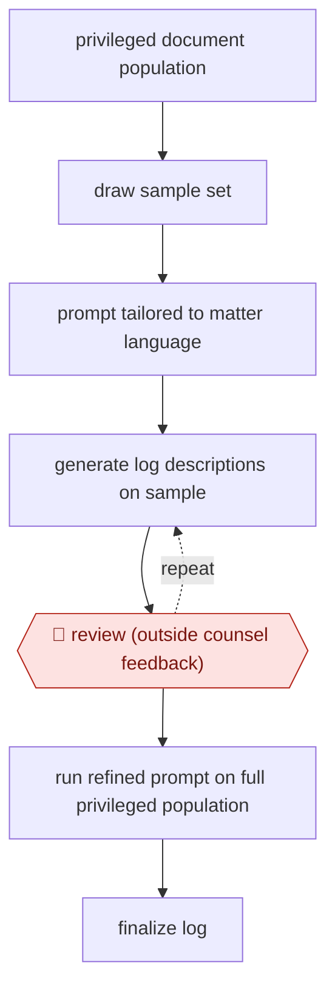

# Calibrated privilege log

`PRO › LEG › LITIG` · checkpointed · evidence B · **draft: needs a reference example** ([how to add one](../../../../../CONTRIBUTING.md#1-add-an-example-run))

**Shape:** `privileged document population → draw sample set → prompt tailored to matter language → (generate log descriptions on sample ⟲ 🛑 review (outside counsel feedback)) → run refined prompt on full privileged population → finalize log`
**How it differs:** AWF-0035 Validated GenAI first-pass is the nearest. It codes responsiveness and validates recall and elusion statistically. This workflow writes a served log of descriptions, and the checkpoint is counsel calibrating the wording on a sample, not a recall sign-off.
**Variants:** `lighthouse-genai-privilege`

<!-- shape diagram: generated by scripts/build_diagrams.py from `shape`; don't edit -->

<!-- end shape diagram -->

## Steps
1. Start from documents already determined to be privileged, and draw a sample set from them [[1]](#sources).
2. Write a prompt tailored to the dataset, so descriptions are unique but consistent and use the matter's own language and context [[1]](#sources).
3. Generate log descriptions for the sample and send them to outside counsel [[1]](#sources).
4. 🛑 **Review**: outside counsel's feedback drives prompt revisions until they are confident in the refined prompt [[1]](#sources).
5. Run the refined prompt across the whole privileged population and pass the results into the log-finalization workflow [[1]](#sources).

**Output:** A privilege log of document descriptions, ready for counsel to serve.
**Failure modes → guards:** Descriptions come out generic or repeated → the prompt is tuned to matter context and checked by counsel on the sample before the full run. The source names no formal QC sampling of the full run, so add one before serving the log.

## Public runs

Coverage as of 2026-11-06: **Weak**: only anonymous, vendor-linked or journalist-told accounts. Collected and re-checked in [Second collection pass](../../../../../research/2026-11-second-pass.md).

- [Boone/Lighthouse, 200,000-line privilege log](https://www.lighthouseglobal.com/blog/privilege-log-gen-ai) (2025-08-04). Vendor consultant describes sample-calibrated prompt, then full run; counsel wrote no descriptions manually. "more than 200,000 entries". *First-hand: vendor; confidence: med.*

## Sources

1. Aaron Boone (Lighthouse), What Working on a 200,000-Line Privilege Log Taught Me About Generative AI, 2025-08-04. https://www.lighthouseglobal.com/blog/privilege-log-gen-ai
