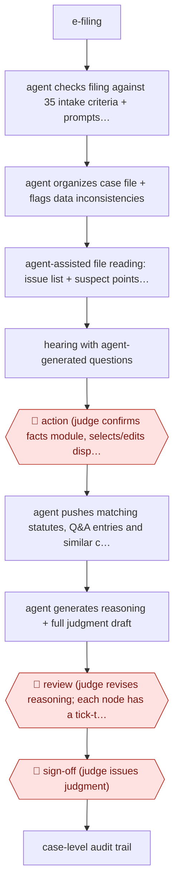

# Judge-decided opinion drafting

`PRO › LEG › LITIG` · assist · evidence A · **draft: needs a reference example** ([how to add one](../../../../../CONTRIBUTING.md#1-add-an-example-run))

**Shape:** `e-filing → agent checks filing against 35 intake criteria + prompts party for missing material → agent organizes case file + flags data inconsistencies → agent-assisted file reading: issue list + suspect points for the bench → hearing with agent-generated questions → 🛑 action (judge confirms facts module, selects/edits disputed issues, enters decision on each) → agent pushes matching statutes, Q&A entries and similar cases → agent generates reasoning + full judgment draft → 🛑 review (judge revises reasoning; each node has a tick-to-confirm gate) → 🛑 sign-off (judge issues judgment) → case-level audit trail`
**Variants:** `shenzhen-intelligent-adjudication-system` · `modelbest-judicial-llm`

<!-- shape diagram: generated by scripts/build_diagrams.py from `shape`; don't edit -->

<!-- end shape diagram -->

## Background

A court case begins when a party files a claim, and ends when a judge issues a judgment: a written decision that sets out the facts found, the legal reasoning and the result. Between those points the court staff check that the filing is complete, assemble the evidence into a case file, and the judge reads it, holds a hearing and decides each disputed issue. Then the judge writes the judgment, which is slow because the reasoning must follow the evidence and the law step by step. In this workflow the agent prepares the case file, lists the issues and suggests questions for the hearing, and drafts the reasoning only after the judge has decided each issue. The judge confirms every step, because a judgment is a public act of the court and only a judge may decide a case. The agent is built so that the person decides first and the agent writes the justification afterwards.

**Terms:**
- **Judgment (裁判文书)**: the court's written decision, with the facts found, the reasoning and the ruling.
- **Case-acceptance criteria (立案标准)**: the checks a filing must pass before a court takes the case, such as a named defendant and a stated claim.
- **Disputed issues (争议焦点)**: the points on which the parties disagree and that the judge must decide.
- **Suspect points (疑点)**: gaps or oddities in the evidence that the judge may want to ask about at the hearing.
- **Similar cases (类案)**: earlier decisions on comparable facts, which the judge may use as guidance.
- **Audit trail**: a record of every action taken in the case, kept so that the process can be supervised afterwards.

## Build it with an agent

**Form:** `platform`. The source is a court's own case-handling system, joined to its electronic filing and case-file records and to a legal language model trained for judicial work, which a general agent does not replace. A general agent can run the middle part, from an exported case file to the issue list, hearing questions and a reasoning draft, as a `skill` that the judge runs in the conversation.

**You need:** a case file exported as documents, in an environment the court has approved for case material (this is confidential and sometimes sealed); the court's intake criteria, if the intake check is in scope; a reference file of the statutes and guidance the court uses; a template for the judgment. Give the agent no connection to the court's case-management or filing system and no way to issue or publish anything.

| Step | Built as |
|---|---|
| e-filing → agent checks filing against 35 intake criteria + prompts party for missing material | The court's filing platform. A skill can check an exported filing against a criteria file and draft the request to the party. The court sends it. |
| agent organizes case file + flags data inconsistencies | A skill that lists the documents and flags clashing dates, names and figures with the page for each. |
| agent-assisted file reading: issue list + suspect points for the bench | The same skill drafts the list of disputed issues and the suspect points, each tied to a page. |
| hearing with agent-generated questions | The skill writes a list of questions for the judge to use or discard. The hearing record is the court's own system. |
| 🛑 action (judge confirms facts module, selects/edits disputed issues, enters decision on each) | See Checkpoints. |
| agent pushes matching statutes, Q&A entries and similar cases | The skill searches the reference file for statutes and guidance. Similar cases come from the court's judgment database, which is a platform feature. |
| agent generates reasoning + full judgment draft | The skill drafts reasoning and judgment from the judge's decisions and the established facts, and nothing else. |
| 🛑 review (judge revises reasoning; each node has a tick-to-confirm gate) | See Checkpoints. |
| 🛑 sign-off (judge issues judgment) | See Checkpoints. |
| case-level audit trail | The court's platform. In a general agent, a hook that logs every tool call to a file; it is not a substitute for the court's own record. |

**Checkpoints:** `action`: the skill refuses to draft any reasoning until the judge has entered a decision on each disputed issue in a decisions file, and the draft uses only that file for the outcome. Before the judge decides, the skill shows the facts and the issue list and stops. `review`: after the draft the skill stops and shows it with each paragraph's source in the decisions file or the case file; the judge edits it, and each section is marked confirmed before the next is shown. `sign-off`: the agent has no tool to issue or publish a judgment, so the judge issues it in the court's own system.

**Since the sources:** Sources date from 2024-08 to 2025-01. Source 1 (the peer-reviewed study) could not be opened when this section was written; the site refused the request. Newer reporting found in 2026-11: a business-press article dated 2026-06-16 says the Shenzhen system has been used in more than 600,000 cases, and has been taken into the Supreme People's Court's national unified case-handling platform, with trial operation in 23 courts before wider rollout ([第一财经](https://www.yicai.com/news/103232904.html)). I did not find a newer account of how the judge-decides-first design itself has changed. The sources describe the court's own platform and a trained judicial model; this build covers only the text steps on exported files, and the intake check, the hearing record and the court's audit record stay in the court's systems. The failure mode in Steps (a draft that reinforces the judge's first view) applies to this build as well and is not removed by it. Whether and how a court may use AI in drafting is set by that court's own rules; check them before any trial of this design.

*A design based on this entry's steps and the tool documentation as of 2026-11, not a reported run.*

## Steps

*As reported by the sources.*

1. A case is filed electronically. The intake module checks the filing against 35 case-acceptance criteria, auto-classifies and calibrates case data, and prompts the party for missing material. In the first period after launch the module had assisted over 310,000 filings and issued more than 9,000 one-time requests for supplementary material [[2]](#sources).
2. The agent organizes the electronic case file, corrects data inconsistencies (dates, years, names, figures) and produces an issue list plus 'suspect points' for the judge — for example analysing the financial dealings between spouses in a marital-debt dispute and generating the questions to put at the hearing [[2]](#sources).
3. The judge holds the hearing, putting the generated questions to the parties; the system assists the hearing record [[2]](#sources).
4. 🛑 **Action**: the judge establishes and records the facts (supplementing the system's draft 'this court ascertains' section from the evidence and hearing), reviews and edits the system's list of disputed issues, and enters a decision on each issue — whether each of the plaintiff's claims is upheld or rejected [[1]](#sources).
5. The agent pushes applicable statutes, authoritative Q&A entries and similar cases from the judgment-guidance corpus; the judge weighs the contract terms and case similarity and makes the legal characterisation [[2]](#sources).
6. The agent generates the reasoning and a full judgment draft from the judge's decisions and established facts. One judge reports the draft being produced in seconds, at over 90% completeness, after the judge has approved the information, given instructions and confirmed the conclusions [[2]](#sources).
7. 🛑 **Review**: the judge revises the AI-generated reasoning to produce the final judgment. Every node in the system carries review / confirm / decide options and prompts that the judge must tick one by one, which is what finally determines the case outcome — described as preventing 'machine adjudication' while preserving the judge's discretion [[1]](#sources)[[2]](#sources).
8. 🛑 **Sign-off**: the judge issues the judgment. The whole process leaves a trace for supervision and accountability, and the system monitors case progress with real-time alerts [[2]](#sources).

**Output:** A judgment in the court's file, issued by the judge; aggregate case data also feeds judicial-recommendation reports and mediation guidance.
**Failure modes → guards:** The agent writes well-structured reasoning for whatever conclusion the judge entered, which can reinforce an initial error or bias — the peer-reviewed study names this 'echoes of bias' and finds mixed experimental evidence for it among 139 judges → the judge must independently establish facts and edit the reasoning, and the system is barred from choosing outcomes. Documents arrive with wrong dates, names and figures → automated calibration plus the 35-criterion intake check. Over-reliance on generated drafts → per-node tick-to-confirm gates and a full audit trail.
**How it differs:** Nearest in this class is AWF-0161 Page-cited medical chronology (also assist, also a document built from a case file), but the deliverable there is a litigator's chronology or deposition summary checked entry-by-entry against cited pages, and the agent never touches an outcome. Here the deliverable is the court's own judgment, and the checkpoint arrangement is inverted: the human decides first and the agent writes the justification afterwards, with a per-node confirm gate. It is equally far from AWF-0035 and AWF-0093, which are population-level review products with sampling-based validation. Note: this is court-side adjudication rather than law-firm litigation work, so it may justify opening a PRO/LEG/ADJUDICATION class if a second and third adjudication workflow appear.

## Public runs

Coverage as of 2026-11-13: **Strong**: a first-hand, detailed run that matches most of the shape. Collected and re-checked in [Fourth collection pass](../../../../../research/2026-11-fourth-pass.md).

- [Liu & Li, How do judges use large language models? Evidence from Shenzhen, Journal of Legal Analysis](https://academic.oup.com/jla/article/16/1/235/7941565) (2025-01-02). Peer-reviewed account of the judge-decides-then-AI-reasons interaction pattern. "An experiment with real judges" — a vignette experiment "with 139 judges from China", average sixteen years' judicial experience. *First-hand: study; confidence: high.*
- [人民法院报, 在深圳，智赋未来 (Supreme People's Court)](https://www.court.gov.cn/zixun/xiangqing/441351.html) (2024-08-29). Production volumes and the per-node confirmation gate, from the court itself. "系统全面上线36个工作日，智能辅助阅卷57052件，辅助庭审23701次，辅助生成裁判文书52554份". *First-hand: interview; confidence: high.*
- [人民法院报, 在深圳，智赋未来 (Supreme People's Court)](https://www.court.gov.cn/zixun/xiangqing/441351.html) (2024-08-29). Named judge describes draft completeness after her confirmations. "只用了几秒，一份由法官核准信息、给出指令、认定结论之后的裁判文书初稿就生成了，完成度超九成". *First-hand: interview; confidence: med.*

## Sources

1. Liu, J.Z. & Li, X., How do judges use large language models? Evidence from Shenzhen, Journal of Legal Analysis 16(1):235-262, published online 2 January 2025. https://academic.oup.com/jla/article/16/1/235/7941565
2. 人民法院报 (People's Court Daily), 在深圳，智赋未来, published on the Supreme People's Court site, 2024-08-29. https://www.court.gov.cn/zixun/xiangqing/441351.html
