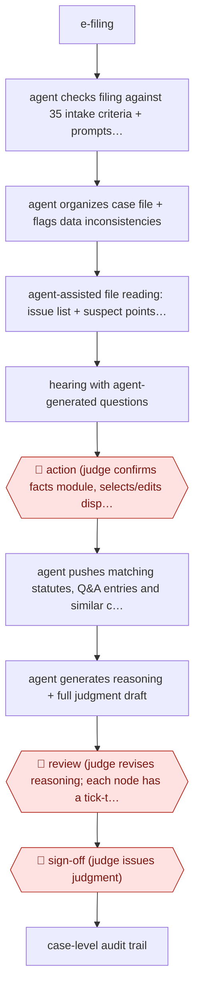

# Judge-decided opinion drafting

`PRO › LEG › LITIG` · assist · evidence A · **draft: needs a reference example** ([how to add one](../../../../../CONTRIBUTING.md#1-add-an-example-run))

**Shape:** `e-filing → agent checks filing against 35 intake criteria + prompts party for missing material → agent organizes case file + flags data inconsistencies → agent-assisted file reading: issue list + suspect points for the bench → hearing with agent-generated questions → 🛑 action (judge confirms facts module, selects/edits disputed issues, enters decision on each) → agent pushes matching statutes, Q&A entries and similar cases → agent generates reasoning + full judgment draft → 🛑 review (judge revises reasoning; each node has a tick-to-confirm gate) → 🛑 sign-off (judge issues judgment) → case-level audit trail`
**How it differs:** Nearest in this class is AWF-0161 Page-cited medical chronology (also assist, also a document built from a case file), but the deliverable there is a litigator's chronology or deposition summary checked entry-by-entry against cited pages, and the agent never touches an outcome. Here the deliverable is the court's own judgment, and the checkpoint arrangement is inverted: the human decides first and the agent writes the justification afterwards, with a per-node confirm gate. It is equally far from AWF-0035 and AWF-0093, which are population-level review products with sampling-based validation. Note: this is court-side adjudication rather than law-firm litigation work, so it may justify opening a PRO/LEG/ADJUDICATION class if a second and third adjudication workflow appear.
**Variants:** `shenzhen-intelligent-adjudication-system` · `modelbest-judicial-llm`

<!-- shape diagram: generated by scripts/build_diagrams.py from `shape`; don't edit -->

<!-- end shape diagram -->

## Steps
1. A case is filed electronically. The intake module checks the filing against 35 case-acceptance criteria, auto-classifies and calibrates case data, and prompts the party for missing material. In the first period after launch the module had assisted over 310,000 filings and issued more than 9,000 one-time requests for supplementary material [[2]](#sources).
2. The agent organizes the electronic case file, corrects data inconsistencies (dates, years, names, figures) and produces an issue list plus 'suspect points' for the judge — for example analysing the financial dealings between spouses in a marital-debt dispute and generating the questions to put at the hearing [[2]](#sources).
3. The judge holds the hearing, putting the generated questions to the parties; the system assists the hearing record [[2]](#sources).
4. 🛑 **Action**: the judge establishes and records the facts (supplementing the system's draft 'this court ascertains' section from the evidence and hearing), reviews and edits the system's list of disputed issues, and enters a decision on each issue — whether each of the plaintiff's claims is upheld or rejected [[1]](#sources).
5. The agent pushes applicable statutes, authoritative Q&A entries and similar cases from the judgment-guidance corpus; the judge weighs the contract terms and case similarity and makes the legal characterisation [[2]](#sources).
6. The agent generates the reasoning and a full judgment draft from the judge's decisions and established facts. One judge reports the draft being produced in seconds, at over 90% completeness, after the judge has approved the information, given instructions and confirmed the conclusions [[2]](#sources).
7. 🛑 **Review**: the judge revises the AI-generated reasoning to produce the final judgment. Every node in the system carries review / confirm / decide options and prompts that the judge must tick one by one, which is what finally determines the case outcome — described as preventing 'machine adjudication' while preserving the judge's discretion [[1]](#sources)[[2]](#sources).
8. 🛑 **Sign-off**: the judge issues the judgment. The whole process leaves a trace for supervision and accountability, and the system monitors case progress with real-time alerts [[2]](#sources).

**Output:** A judgment in the court's file, issued by the judge; aggregate case data also feeds judicial-recommendation reports and mediation guidance.
**Failure modes → guards:** The agent writes well-structured reasoning for whatever conclusion the judge entered, which can reinforce an initial error or bias — the peer-reviewed study names this 'echoes of bias' and finds mixed experimental evidence for it among 139 judges → the judge must independently establish facts and edit the reasoning, and the system is barred from choosing outcomes. Documents arrive with wrong dates, names and figures → automated calibration plus the 35-criterion intake check. Over-reliance on generated drafts → per-node tick-to-confirm gates and a full audit trail.

## Public runs

Coverage as of 2026-11-13: **Strong**: a first-hand, detailed run that matches most of the shape. Collected and re-checked in [Fourth collection pass](../../../../../research/2026-11-fourth-pass.md).

- [Liu & Li, How do judges use large language models? Evidence from Shenzhen, Journal of Legal Analysis](https://academic.oup.com/jla/article/16/1/235/7941565) (2025-01-02). Peer-reviewed account of the judge-decides-then-AI-reasons interaction pattern. "An experiment with real judges" — a vignette experiment "with 139 judges from China", average sixteen years' judicial experience. *First-hand: study; confidence: high.*
- [人民法院报, 在深圳，智赋未来 (Supreme People's Court)](https://www.court.gov.cn/zixun/xiangqing/441351.html) (2024-08-29). Production volumes and the per-node confirmation gate, from the court itself. "系统全面上线36个工作日，智能辅助阅卷57052件，辅助庭审23701次，辅助生成裁判文书52554份". *First-hand: interview; confidence: high.*
- [人民法院报, 在深圳，智赋未来 (Supreme People's Court)](https://www.court.gov.cn/zixun/xiangqing/441351.html) (2024-08-29). Named judge describes draft completeness after her confirmations. "只用了几秒，一份由法官核准信息、给出指令、认定结论之后的裁判文书初稿就生成了，完成度超九成". *First-hand: interview; confidence: med.*

## Sources

1. Liu, J.Z. & Li, X., How do judges use large language models? Evidence from Shenzhen, Journal of Legal Analysis 16(1):235-262, published online 2 January 2025. https://academic.oup.com/jla/article/16/1/235/7941565
2. 人民法院报 (People's Court Daily), 在深圳，智赋未来, published on the Supreme People's Court site, 2024-08-29. https://www.court.gov.cn/zixun/xiangqing/441351.html
