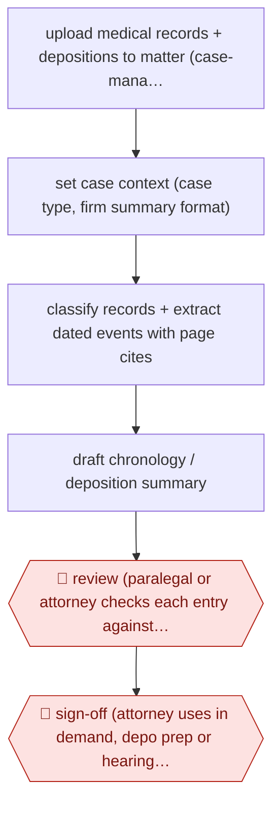

# Page-cited medical chronology

`PRO › LEG › LITIG` · assist · evidence B · **draft: needs a reference example** ([how to add one](../../../../../CONTRIBUTING.md#1-add-an-example-run))

**Shape:** `upload medical records + depositions to matter (case-management link) → set case context (case type, firm summary format) → classify records + extract dated events with page cites → draft chronology / deposition summary → 🛑 review (paralegal or attorney checks each entry against cited page) → 🛑 sign-off (attorney uses in demand, depo prep or hearing memo)`
**How it differs:** AWF-0035 and AWF-0093 classify or log large document populations for production. Here the deliverable is a per-case factual chronology for the firm's own case preparation, reviewed entry by entry against cited pages; deliverable and checkpoint differ.
**Variants:** `squary` · `supio`

<!-- shape diagram: generated by scripts/build_diagrams.py from `shape`; don't edit -->

<!-- end shape diagram -->

## Steps
1. Upload medical records, depositions and case files to the matter workspace, connected to case management (e.g., Filevine) [[1]](#sources).
2. Select the task (medical chronology, deposition summary, pre-hearing memo); firms can supply their own summary format so output matches how a partner writes [[1]](#sources)[[2]](#sources).
3. The tool extracts dated clinical events and testimony and drafts a structured chronology or summary with page-level citations for every claim [[1]](#sources)[[2]](#sources).
4. 🛑 **Review**: attorneys and paralegals click through to the cited line or page to confirm context; 'If we can't trace a statement back to the record, it's not usable' [[1]](#sources).
5. 🛑 **Sign-off**: the attorney uses the verified chronology in demand letters, deposition preparation or hearings [[1]](#sources)[[2]](#sources).

**Output:** Source-linked medical chronology or deposition summary in the matter file, feeding demand drafting and deposition prep.
**Failure modes → guards:** Unsupported or misdated facts → every entry page-cited and checked against source. Firm style mismatch → upload the firm's own summary template.

## Public runs

Coverage as of 2026-11-13: **Weak**: only anonymous, vendor-linked or journalist-told accounts. Collected and re-checked in [Third collection pass](../../../../../research/2026-11-third-pass.md).

- [Squary, Quatrini Law Group](https://www.squary.ai/blog/how-quatrini-law-group-modernized-legal-workflows-with-squary-ai) (2025-11-10). PI/disability firm: medical summaries and depo prep with page cites; founding partner quoted. Note: firm partner sits on vendor board. "up to 70% faster document reviews and 10-15 hours saved per case". *First-hand: vendor; confidence: med.*
- [Supio, GLP Attorneys](https://www.supio.com/customers/how-glp-personal-injury-attorneys-levels-the-playing-field-with-supio) (2026-09-02). Paralegals generate chronologies and demand drafts; partner uploads own summary format. "Catastrophic-injury medical record review, compressed from 40 hours". *First-hand: vendor; confidence: med.*

## Sources

1. Squary, How Quatrini Law Group modernized legal workflows with Squary AI, 2025-11-10. https://www.squary.ai/blog/how-quatrini-law-group-modernized-legal-workflows-with-squary-ai
2. Supio, GLP Attorneys Reviews Discovery 4x Faster with Supio, 2026-09-02. https://www.supio.com/customers/how-glp-personal-injury-attorneys-levels-the-playing-field-with-supio
