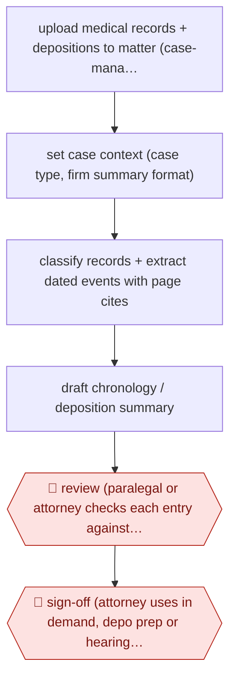

# Page-cited medical chronology

`PRO › LEG › LITIG` · assist · evidence B · **draft: needs a reference example** ([how to add one](../../../../../CONTRIBUTING.md#1-add-an-example-run))

**Shape:** `upload medical records + depositions to matter (case-management link) → set case context (case type, firm summary format) → classify records + extract dated events with page cites → draft chronology / deposition summary → 🛑 review (paralegal or attorney checks each entry against cited page) → 🛑 sign-off (attorney uses in demand, depo prep or hearing memo)`
**Variants:** `squary` · `supio`

<!-- shape diagram: generated by scripts/build_diagrams.py from `shape`; don't edit -->

<!-- end shape diagram -->

## Background

When someone is injured and claims compensation, their lawyers need to know exactly what happened to them medically and when: each visit, diagnosis, test and treatment, in order. The facts sit in hundreds or thousands of pages of medical records and in the transcripts of depositions (recorded question-and-answer sessions under oath). A paralegal or attorney reads them all and writes a medical chronology, a dated list of events that points to the page of each one. The same work produces deposition summaries and memos for hearings. It is slow, and one wrong date or an unsupported statement can weaken a demand letter or be used against the firm. Here the agent extracts the events and drafts the chronology with a page reference for every entry. A paralegal or attorney checks each entry against the cited page, and the attorney decides how it is used, because the attorney signs the demand and answers for it to the client and the court.

**Terms:**
- **Medical chronology**: a dated list of a person's medical events, each one tied to the record page that shows it.
- **Deposition**: sworn testimony taken before trial and written down; a **deposition summary** condenses it by topic and page.
- **Demand letter**: the letter that sets out the injury and asks the other side's insurer for a stated sum.
- **PI**: personal injury, the field of law that deals with claims for harm to a person.
- **Page cite**: a reference to the page (and line, for transcripts) where a statement can be found.
- **Matter**: the law firm's file for one client's case.
- **Case management system**: the firm's software for each matter's documents, tasks and deadlines.

## Build it with an agent

**Form:** `skill`. A paralegal or attorney works one matter at a time and stays in the conversation, so one skill that holds the chronology format and the citation rule is enough.

**You need:** the medical records and deposition transcripts as files, with page numbers that can be cited (text-searchable PDFs, or scanned pages converted to text first); the firm's own chronology or summary template as a file beside the skill; the case type, which sets what to look for; a setup approved for patient health information (these are protected health records). Do not connect a mail tool.

| Step | Built as |
|---|---|
| upload medical records + depositions to matter (case-management link) | The files are placed in a folder for the matter; the case management system can be reached through an MCP server connector if the firm has one. |
| set case context (case type, firm summary format) | The skill's first step: ask for the case type and read the firm's template. |
| classify records + extract dated events with page cites | The agent reads each record file and returns a table: date, event, source file, page. A subagent can take each file. An entry without a file and page is not kept. |
| draft chronology / deposition summary | The skill fills the firm's template from the table, one entry per row. |
| 🛑 review (paralegal or attorney checks each entry against cited page) | See Checkpoints. |
| 🛑 sign-off (attorney uses in demand, depo prep or hearing memo) | See Checkpoints. |

**Checkpoints:** `review`: the skill ends by presenting the chronology with a link to each cited page and stops; the paralegal or attorney opens the page for every entry and corrects or deletes it. A script that rejects any entry without a file and page number supports this but does not replace it. `sign-off`: the skill does not draft the demand letter, and the agent has no mail tool, so the attorney takes the verified chronology into the demand, deposition preparation or hearing memo in their own system.

**Since the sources:** Sources date from 2025-11 to 2026-09, and both are vendor case studies. The first source's page returned almost no text when read in 2026-11, so its details are taken from the entry. The sources run these steps inside two legal products (`squary`, `supio`) connected to the firm's case management system; this build reads files and leaves the matter system to the firm. Neither source shows how the product extracts or cites; the build's table of date, event, file and page is a design choice, not a description of either product. The sources report firms using products, with paralegals and attorneys checking the output, not an agent running the process unattended.

*A design based on this entry's steps and the tool documentation as of 2026-11, not a reported run.*

## Steps

*As reported by the sources.*

1. The firm uploads medical records, depositions and case files to the matter workspace, connected to case management (e.g., Filevine) [[1]](#sources).
2. The user selects the task (medical chronology, deposition summary, pre-hearing memo); firms can supply their own summary format so output matches how a partner writes [[1]](#sources)[[2]](#sources).
3. The agent extracts dated clinical events and testimony and drafts a structured chronology or summary with page-level citations for every claim [[1]](#sources)[[2]](#sources).
4. 🛑 **Review**: attorneys and paralegals click through to the cited line or page to confirm context; 'If we can't trace a statement back to the record, it's not usable' [[1]](#sources).
5. 🛑 **Sign-off**: the attorney uses the verified chronology in demand letters, deposition preparation or hearings [[1]](#sources)[[2]](#sources).

**Output:** Source-linked medical chronology or deposition summary in the matter file, feeding demand drafting and deposition prep.
**Failure modes → guards:** Unsupported or misdated facts → every entry page-cited and checked against source. Firm style mismatch → upload the firm's own summary template.
**How it differs:** AWF-0035 and AWF-0093 classify or log large document populations for production. Here the deliverable is a per-case factual chronology for the firm's own case preparation, reviewed entry by entry against cited pages; deliverable and checkpoint differ.

## Public runs

Coverage as of 2026-11-13: **Weak**: only anonymous, vendor-linked or journalist-told accounts. Collected and re-checked in [Third collection pass](../../../../../research/2026-11-third-pass.md).

- [Squary, Quatrini Law Group](https://www.squary.ai/blog/how-quatrini-law-group-modernized-legal-workflows-with-squary-ai) (2025-11-10). PI/disability firm: medical summaries and depo prep with page cites; founding partner quoted. Note: firm partner sits on vendor board. "up to 70% faster document reviews and 10-15 hours saved per case". *First-hand: vendor; confidence: med.*
- [Supio, GLP Attorneys](https://www.supio.com/customers/how-glp-personal-injury-attorneys-levels-the-playing-field-with-supio) (2026-09-02). Paralegals generate chronologies and demand drafts; partner uploads own summary format. "Catastrophic-injury medical record review, compressed from 40 hours". *First-hand: vendor; confidence: med.*

## Sources

1. Squary, How Quatrini Law Group modernized legal workflows with Squary AI, 2025-11-10. https://www.squary.ai/blog/how-quatrini-law-group-modernized-legal-workflows-with-squary-ai
2. Supio, GLP Attorneys Reviews Discovery 4x Faster with Supio, 2026-09-02. https://www.supio.com/customers/how-glp-personal-injury-attorneys-levels-the-playing-field-with-supio
