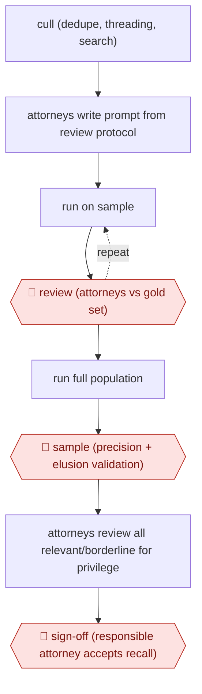

# Validated GenAI first-pass

`PRO › LEG › LITIG` · sampled · evidence A · **draft: needs a reference example** ([how to add one](../../../../../CONTRIBUTING.md#1-add-an-example-run))

**Shape:** `cull (dedupe, threading, search) → attorneys write prompt from review protocol → (run on sample ⟲ 🛑 review (attorneys vs gold set)) → run full population → 🛑 sample (precision + elusion validation) → attorneys review all relevant/borderline for privilege → 🛑 sign-off (responsible attorney accepts recall)`
**How it differs:** AWF-0009 Screening funnel (LITREV) has a similar screen-and-sample shape, but here the deliverable is a court production with elusion-based recall validation and privilege review. AWF-0024 is a single-contract redline.
**Variants:** `relativity-air-for-review` · `everlaw-coding-suggestions`

<!-- shape diagram: generated by scripts/build_diagrams.py from `shape`; don't edit -->

<!-- end shape diagram -->

## Background

In litigation, one side asks the other for documents, and the answer is a production: everything responsive, nothing privileged, delivered on a deadline. In a large matter the population runs to millions of documents, so the question is never "have we read them all" but "can we show that our method found what was there". For a decade the defensible method was technology-assisted review: a seed set, iterative training, and recall statistics from a random sample. Generative AI changes the mechanics and not the obligation. A model can now make a responsiveness call on each document from a written protocol, with a rationale, without a training set — which is faster, and which also means the thing that needs validating is a prompt rather than a classifier. The validation is the workflow: attorneys write the instruction, test it against documents they have coded themselves, refine it until the disagreements are understood, run it over the population, and then measure two numbers that a court will ask about — precision, the share of what the model produced that really was responsive, and elusion, the share of what it discarded that should have been produced. Recall is only as credible as the elusion sample behind it, which is why the responsible attorney signs off on that estimate rather than on the tool's marketing.

**Terms:**
- **culling**: reducing the population by deduplication, email threading and search terms before any review.
- **review protocol**: the written description of what is responsive and what is not, the source the prompt is drafted from.
- **gold set**: documents coded by attorneys, used to measure the model's calls.
- **precision**: of the documents the model calls responsive, the share that truly are.
- **elusion**: the estimated share of documents the process failed to produce that should have been produced; measured by sampling the discards.
- **recall**: the share of truly responsive documents that were produced.
- **seed set**: human-coded examples used to train classic predictive coding, which a prompt-driven review does not need.
- **prompt log**: the record of which instruction version produced a given set of calls.
- **privilege review**: the attorney pass that withholds protected communications and logs them.

## Build it with an agent

**Form:** `project`. A review runs for months over one matter: the protocol, the prompt versions, the gold set, the validation samples and the privilege log all have to persist and stay consistent, and every later decision is argued against what was recorded earlier. That is a repository with a workflow, not a skill run and not an unattended service.

**You need:** the culled population with dedupe and threading preserved, since a produced document without its family is a new dispute; the review protocol in writing before any prompt exists; a gold set coded by the attorneys who will sign off, large enough to measure disagreement rather than to illustrate it; the elusion sample drawn by a method fixed in advance, because the sample that gets drawn after seeing the result is not evidence; version control on prompts, since "the model changed" and "we changed the instruction" are different defences and only one of them is checkable; and the privilege log, which the build must never populate itself. The agent must not make the privilege call and must not certify recall: both belong to the attorney who signs.

| Step | Built as |
|---|---|
| cull (dedupe, threading, search) | A deterministic first pass that records what it removed and why, because the culling decisions are the first thing a requesting party can challenge. |
| attorneys write prompt from review protocol | The instruction is drafted by lawyers from the protocol, not by engineers from the data, and it is stored as a versioned artefact with the rationale for each change. |
| (run on sample ⟲ 🛑 review (attorneys vs gold set)) | Each prompt version is run against the gold set; disagreements are read one by one, and the loop ends when the remaining disagreements are understood rather than when the rate looks acceptable. |
| run full population | The signed-off prompt version runs over everything, and each call stores its rationale plus the prompt version that produced it, which is what makes a later challenge answerable. |
| 🛑 sample (precision + elusion validation) | Two samples, drawn to a stated confidence and margin, one from the produced set and one from the discards; the elusion figure is computed from the second and reported with its interval. |
| attorneys review all relevant/borderline for privilege | Every responsive or borderline document gets an attorney read for privilege; the build can flag candidates but has no path to a withhold decision. |
| 🛑 sign-off (responsible attorney accepts recall) | The attorney accepts a recall estimate with the elusion interval attached, and the build has no route to production without that acceptance. |

**Checkpoints:** `review`: the prompt loop is where quality is decided, and it is a legal judgement — attorneys compare the model's calls with their own coding and decide which disagreements are the model's fault. `sample`: precision and elusion are measured on samples drawn by a method fixed before the run, since a defensible number is one the other side could have drawn too. `sign-off`: the responsible attorney accepts the recall estimate, which keeps the accountability where the rules put it — the tool produces statistics, the lawyer makes the call.

**Since the sources:** Sources date from 2026-03 to 2026-06: a peer-reviewed real-world study, a vendor case study and a vendor customer story. The study and the Dinsmore case study were not re-opened on this pass; two decisions from mid-2026 were opened. What has changed since: the courts have started saying how this is reviewed, and the answer is "like any other technology-assisted review". In *Schulte v. LinkedIn* (N.D. Cal., 2026-06-30) a magistrate judge [treated a generative review tool as a form of TAR](https://www.arnoldporter.com/en/perspectives/blogs/edata-edge/2026/07/court-declines-to-give-generative-ai-review-special-scrutiny), applied the existing ESI-protocol disclosure obligation to it, upheld search-term pre-culling, and refused to compel validation metrics absent a specific showing of deficiency — which cuts both ways for this workflow: the method is safe if the protocol was followed, and the numbers are your protection rather than your obligation until someone shows a gap. A stipulated protocol three weeks later shows the other direction of travel: in *James v. Cerebras* (N.D. Cal., 2026-07-07) the parties agreed a 95% confidence level with a 2% margin of error on documents the AI excludes, a 3% ceiling on elusion, and disclosure of every prompt, template and parameter set with later prompt changes redlined. Two practical consequences for the build above. First, the prompt log is not bookkeeping, it is now a likely production item, so prompt versions and their diffs have to be exportable. Second, the decision's framing makes the prompt, not the model, the thing on trial: the disclosure that satisfied the court included whether a seed set was used, whether the tool makes final calls and what human QC supports it — the same three questions this entry's checkpoints answer.

*A design based on this entry's steps and the tool documentation as of 2026-11, not a reported run.*

## Steps

*As reported by the sources.*

1. Cull the population first with search, email threading and dedupe. Dinsmore removed about 20,000 contract drafts. HSF Kramer cut five million documents to roughly 140,000 [[2]](#sources)[[3]](#sources).
2. Attorneys, not technologists, write the coding instructions from the review protocol: case description, code definitions, and examples of non-responsive language [[2]](#sources).
3. 🛑 **Review**: Attorneys code a ground-truth sample (120 docs at Dinsmore; a 1,600-doc control set in the law-review study). They compare the AI's calls and refine the prompt over several rounds [[1]](#sources)[[2]](#sources)[[3]](#sources).
4. Run the GenAI classifier over the full set. Decide whether to treat 'borderline' predictions as responsive [[1]](#sources).
5. 🛑 **Sample**: Pull statistically valid precision and elusion samples. Rerun or layer predictive coding if recall falls short [[2]](#sources).
6. Lawyers review every relevant or borderline document to confirm relevance, assess privilege and isolate confidential material. Active learning and QC cover the rest [[3]](#sources).
7. 🛑 **Sign-off**: The attorney responsible for the outcome accepts the validated recall before production [[2]](#sources).

**Output:** A validated responsive (and privilege-screened) production set with documented recall and precision, defensible to the court or opposing party.
**Failure modes → guards:** The tool ignores family relationships, hyperlinks, metadata and image text; it errors on long text and makes some ungrounded citations → rerun errored docs and review non-text files manually [[1]](#sources). Including borderline docs raises recall to 96.2% but cuts precision to 58.4% → decide the borderline policy up front [[1]](#sources).

## Public runs

Coverage as of 2026-11-06: **Weak**: only anonymous, vendor-linked or journalist-told accounts. Collected and re-checked in [New workflows for empty categories](../../../../../research/2026-11-new-workflows.md).

- [Keeling et al., GenAI document review real-world study](https://scholarship.law.ufl.edu/jtlp/vol30/iss2/6/) (2026-06-30). 1,600-doc sample from a real matter compared against a gold-standard attorney review. "high recall rate of 83.9% and a precision rate of 84.7%". *First-hand: study (1,600-document sample from a past client matter); confidence: high.*
- [Everlaw, Dinsmore & Shohl cyber contract review](https://www.everlaw.com/blog/case-studies/dinsmore-recall-coding-suggestions-case-study/) (2026-03-24). Search, then GenAI coding, then predictive coding, validated by attorney samples at each phase. "98.2% recall rate". *First-hand: vendor; confidence: med.*
- [Relativity, HSF Kramer High Court disclosure](https://www.relativity.com/resources/customers/hsf-kramer-relativity-air-for-review/) (n.d.). Pilot thresholds set first, then live first-level review with lawyer second pass. "Reviewed roughly 100,000 documents in about 12 hours". *First-hand: vendor; confidence: med.*

## Sources

1. Keeling R., Mangum R., Hanke A., Ogden A., Prompting Change with GenAI in Large-Scale Document Review: A Real-World Study, Journal of Technology Law & Policy 30(2), 2026-06-30. https://scholarship.law.ufl.edu/jtlp/vol30/iss2/6/
2. Jurva G., How Dinsmore & Shohl Engineered a 98.2% Recall Rate in High-Stakes Cyber Contract Review Using Everlaw, Everlaw, 2026-03-24. https://www.everlaw.com/blog/case-studies/dinsmore-recall-coding-suggestions-case-study/
3. Relativity, Herbert Smith Freehills Kramer Brings Defensible AI Review to High Court Disclosure with aiR Review, n.d. https://www.relativity.com/resources/customers/hsf-kramer-relativity-air-for-review/
4. Arnold & Porter, Court Declines to Give Generative AI Review Special Scrutiny, Treats It as TAR (Schulte v. LinkedIn Corp., N.D. Cal., 2026-06-30), 2026-07. https://www.arnoldporter.com/en/perspectives/blogs/edata-edge/2026/07/court-declines-to-give-generative-ai-review-special-scrutiny
5. Doug Austin, eDiscovery Today, Comprehensive ESI Protocol Includes Hyperlinked Files, Generative AI and More (James v. Cerebras, N.D. Cal., 2026-07-07), as reported 2026-07-09. https://relevantediscovery.com/news/comprehensive-esi-protocol-includes-hyperlinked-files-generative-ai-and-142839
