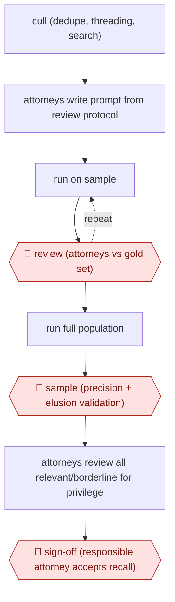

# Validated GenAI first-pass

`PRO › LEG › LITIG` · sampled · evidence A · **draft: needs a reference example** ([how to add one](../../../../../CONTRIBUTING.md#1-add-an-example-run))

**Shape:** `cull (dedupe, threading, search) → attorneys write prompt from review protocol → (run on sample ⟲ 🛑 review (attorneys vs gold set)) → run full population → 🛑 sample (precision + elusion validation) → attorneys review all relevant/borderline for privilege → 🛑 sign-off (responsible attorney accepts recall)`
**How it differs:** AWF-0009 Screening funnel (LITREV) has a similar screen-and-sample shape, but here the deliverable is a court production with elusion-based recall validation and privilege review. AWF-0024 is a single-contract redline.
**Variants:** `relativity-air-for-review` · `everlaw-coding-suggestions`

<!-- shape diagram: generated by scripts/build_diagrams.py from `shape`; don't edit -->

<!-- end shape diagram -->

## Steps
1. Cull the population first with search, email threading and dedupe. Dinsmore removed about 20,000 contract drafts. HSF Kramer cut five million documents to roughly 140,000 [[2]](#sources)[[3]](#sources).
2. Attorneys, not technologists, write the coding instructions from the review protocol: case description, code definitions, and examples of non-responsive language [[2]](#sources).
3. 🛑 **Review**: Attorneys code a ground-truth sample (120 docs at Dinsmore; a 1,600-doc control set in the law-review study). They compare the AI's calls and refine the prompt over several rounds [[1]](#sources)[[2]](#sources)[[3]](#sources).
4. Run the GenAI classifier over the full set. Decide whether to treat 'borderline' predictions as responsive [[1]](#sources).
5. 🛑 **Sample**: Pull statistically valid precision and elusion samples. Rerun or layer predictive coding if recall falls short [[2]](#sources).
6. Lawyers review every relevant or borderline document to confirm relevance, assess privilege and isolate confidential material. Active learning and QC cover the rest [[3]](#sources).
7. 🛑 **Sign-off**: The attorney responsible for the outcome accepts the validated recall before production [[2]](#sources).

**Output:** A validated responsive (and privilege-screened) production set with documented recall and precision, defensible to the court or opposing party.
**Failure modes → guards:** The tool ignores family relationships, hyperlinks, metadata and image text; it errors on long text and makes some ungrounded citations → rerun errored docs and review non-text files manually [[1]](#sources). Including borderline docs raises recall to 96.2% but cuts precision to 58.4% → decide the borderline policy up front [[1]](#sources).

## Public runs

Coverage as of 2026-11-06: **Weak**: only anonymous, vendor-linked or journalist-told accounts. Collected and re-checked in [New workflows for empty categories](../../../../../research/2026-11-new-workflows.md).

- [Keeling et al., GenAI document review real-world study](https://scholarship.law.ufl.edu/jtlp/vol30/iss2/6/) (2026-06-30). 1,600-doc sample from a real matter compared against a gold-standard attorney review. "high recall rate of 83.9% and a precision rate of 84.7%". *First-hand: study (1,600-document sample from a past client matter); confidence: high.*
- [Everlaw, Dinsmore & Shohl cyber contract review](https://www.everlaw.com/blog/case-studies/dinsmore-recall-coding-suggestions-case-study/) (2026-03-24). Search, then GenAI coding, then predictive coding, validated by attorney samples at each phase. "98.2% recall rate". *First-hand: vendor; confidence: med.*
- [Relativity, HSF Kramer High Court disclosure](https://www.relativity.com/resources/customers/hsf-kramer-relativity-air-for-review/) (n.d.). Pilot thresholds set first, then live first-level review with lawyer second pass. "Reviewed roughly 100,000 documents in about 12 hours". *First-hand: vendor; confidence: med.*

## Sources

1. Keeling R., Mangum R., Hanke A., Ogden A., Prompting Change with GenAI in Large-Scale Document Review: A Real-World Study, Journal of Technology Law & Policy 30(2), 2026-06-30. https://scholarship.law.ufl.edu/jtlp/vol30/iss2/6/
2. Jurva G., How Dinsmore & Shohl Engineered a 98.2% Recall Rate in High-Stakes Cyber Contract Review Using Everlaw, Everlaw, 2026-03-24. https://www.everlaw.com/blog/case-studies/dinsmore-recall-coding-suggestions-case-study/
3. Relativity, Herbert Smith Freehills Kramer Brings Defensible AI Review to High Court Disclosure with aiR Review, n.d. https://www.relativity.com/resources/customers/hsf-kramer-relativity-air-for-review/
