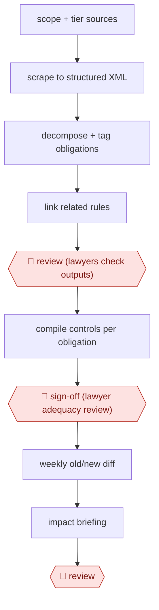

# Obligations register build

`PRO › LEG › REG` · assist · evidence A · **draft: needs a reference example** ([how to add one](../../../../../CONTRIBUTING.md#1-add-an-example-run))

**Shape:** `scope + tier sources → scrape to structured XML → decompose + tag obligations → link related rules → 🛑 review (lawyers check outputs) → compile controls per obligation → 🛑 sign-off (lawyer adequacy review) → weekly old/new diff → impact briefing → 🛑 review`
**How it differs:** AWF-0025 Grounded legal memo (RESEARCH) answers one legal question. This builds and maintains a standing register mapped to controls, with weekly change diffs.
**Variants:** `llm-xml-ingest-pipeline`

<!-- shape diagram: generated by scripts/build_diagrams.py from `shape`; don't edit -->

<!-- end shape diagram -->

## Steps
1. Scope and tier the regulatory sources. A custom pipeline scrapes HTML, PDF and scanned texts into structured XML in the client's template [[1]](#sources).
2. The LLM identifies, summarizes and tags individual obligations, decomposes the text into discrete provisions mapped to themes, and links related rules and guidance through semantic search [[1]](#sources).
3. 🛑 **Review**: Firm lawyers check all LLM outputs. Prompts are iterated with subject-matter experts [[1]](#sources).
4. For each obligation, the LLM compiles the institution's controls, standards and policies into one source and does a thematic review [[1]](#sources).
5. 🛑 **Sign-off**: Lawyers judge whether the controls are adequate for each obligation, producing the obligations register [[1]](#sources).
6. Weekly automated updates: the LLM ingests old and new regulation text and summarizes changes and business impact for stakeholder briefings [[1]](#sources).
7. 🛑 **Review**: Lawyers check each briefing before it reaches the client [[1]](#sources).

**Output:** A legally reviewed obligations register mapped to internal controls, kept current with weekly change summaries. It feeds controls mapping, horizon scanning and GRC tooling.
**Failure modes → guards:** Telling real legal changes from editorial edits, and overlapping data across sources and jurisdictions → structured ingestion plus lawyer review of every output [[1]](#sources).

## Public runs

Coverage as of 2026-11-06: **Partial**: first-hand runs that cover part of the shape or put checkpoints elsewhere. Collected and re-checked in [New workflows for empty categories](../../../../../research/2026-11-new-workflows.md).

- [Simmons & Simmons, Hybrid AI regulatory analysis](https://www.simmons-simmons.de/en/publications/cmpfm506100biut6kwnu801wd/case-study-hybrid-ai-regulatory-analysis) (2026-03-25). Client obligations mapped across UK, EU and Middle East; lawyers check every output. "100+ jurisdictions" (highlights panel only; the body names the UK, EU and Middle East). *First-hand: yes; confidence: low.*

## Sources

1. Simmons & Simmons, Case study: hybrid AI regulatory analysis, 2026-03-25. https://www.simmons-simmons.de/en/publications/cmpfm506100biut6kwnu801wd/case-study-hybrid-ai-regulatory-analysis
