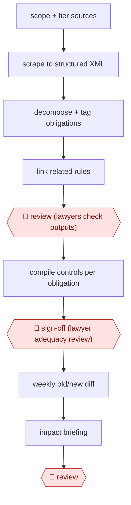

# Obligations register build

`PRO › LEG › REG` · assist · evidence A · **draft: needs a reference example** ([how to add one](../../../../../CONTRIBUTING.md#1-add-an-example-run))

**Shape:** `scope + tier sources → scrape to structured XML → decompose + tag obligations → link related rules → 🛑 review (lawyers check outputs) → compile controls per obligation → 🛑 sign-off (lawyer adequacy review) → weekly old/new diff → impact briefing → 🛑 review`
**How it differs:** AWF-0025 Grounded legal memo (RESEARCH) answers one legal question. This builds and maintains a standing register mapped to controls, with weekly change diffs.
**Variants:** `llm-xml-ingest-pipeline`

<!-- shape diagram: generated by scripts/build_diagrams.py from `shape`; don't edit -->

<!-- end shape diagram -->

## Background

A regulated institution is subject to more rules than any one person can hold: the statute, the implementing regulation, the supervisory guidance that says how the regulation will be read, and the internal policy that claims to satisfy all three. Keeping those in a single view is the job an obligations register does — each rule decomposed into the thing you must do, mapped to the control that does it, and reviewed by someone who can say whether the control is adequate. The labour is in the decomposition and in the watching: rules arrive as PDFs and scanned circulars, they overlap across jurisdictions, and they change a few clauses at a time, which means the work that matters is noticing which of the few changed clauses reach an obligation you have promised to meet. A model can do the reading — scrape, decompose, tag, link, and produce a weekly diff with an impact note — and cannot do the judging, because "adequate control" is a legal and operational conclusion that depends on facts the document does not contain. The two things that make this workflow trustworthy are therefore unglamorous: a structured representation, so a change is a field that changed rather than a paragraph that looks different, and a lawyer at each end, checking the extraction and signing off on adequacy.

**Terms:**
- **obligations register**: the structured list of what the institution must do, with the source of each duty.
- **tiering**: ranking sources by authority — statute, regulation, guidance, internal policy — because they conflict.
- **obligation**: one discrete duty extracted from a rule, the unit the register is built from.
- **control**: the internal process or policy that satisfies an obligation.
- **adequacy**: the lawyer's judgement that the control actually meets the obligation.
- **thematic review**: reading a set of obligations together to see whether the controls cover the theme, not just each clause.
- **horizon scanning**: tracking proposals and phased deadlines, as distinct from monitoring what has been published.
- **stop-the-clock**: a legislative delay that moves an application date without changing the underlying rule.

## Build it with an agent

**Form:** `project`. The register is a standing asset with a history: every obligation carries the instrument that created it, the version in force, the control that answers it and the date a lawyer last accepted it. A weekly diff is only meaningful against that stored history, so this is a repository that a team maintains, not a skill run and not a service that answers on demand.

**You need:** the source list tiered by authority before ingestion, or the register will cite guidance as if it were law; the client's own template, because a register that cannot be imported into the GRC tool is a document nobody uses; the internal controls, standards and policies as text, since the mapping step needs something to map to; dates attached to every instrument version, including the date that set them, because a moved deadline is the change most likely to be missed; and lawyer time booked for two distinct jobs — checking extraction, and judging adequacy — which are not the same review and should not be collapsed. The agent must not decide adequacy and must not decide that a change is editorial: both are the judgements the register exists to record.

| Step | Built as |
|---|---|
| scope + tier sources | A source inventory with authority level and jurisdiction per entry, reviewed once and versioned, since the tier decides which text wins when two disagree. |
| scrape to structured XML | Deterministic ingestion into the client's template, keeping the instrument, the version and its in-force dates as fields rather than as prose. |
| decompose + tag obligations | The model splits each instrument into discrete duties, tags them by theme and stores the exact passage each came from, so a lawyer can check the extraction against the clause. |
| link related rules | Semantic linking across instruments and jurisdictions, stored as edges with a reason, which is what lets a theme review see the same duty in three places. |
| 🛑 review (lawyers check outputs) | Lawyers check every extracted obligation against its passage; prompts are iterated with the subject-matter experts, and an extraction that cannot be traced to a clause is rejected. |
| compile controls per obligation | For each obligation the model assembles the institution's controls, standards and policies into one view and does a thematic review, flagging obligations with no obvious control. |
| 🛑 sign-off (lawyer adequacy review) | Lawyers judge whether the control is adequate, which produces the register as a legal work product rather than a model output. |
| weekly old/new diff → impact briefing | The diff is computed on structured fields, not on text similarity, so a moved date and a reworded sentence are different events; the briefing names the obligations affected and the business impact. |
| 🛑 review | Lawyers check each briefing before it reaches the client, which is also where false positives get removed from the following week's diff. |

**Checkpoints:** `review`: every extraction is checked against its source passage, and the check is possible only because the passage is stored — this gate is what stops a plausible paraphrase becoming an obligation. `sign-off`: adequacy is a lawyer's conclusion about the institution's controls, not about the rule, and the register is not usable for an audit until it is recorded; the build has no route to marking an obligation "covered" itself.

**Since the sources:** The source dates from 2026-03-25 and was not re-opened on this pass. What has changed since: the register's hardest failure mode got a textbook example, and it is a date. The EU AI Act's high-risk obligations were due to apply on 2026-08-02; Regulation (EU) 2026/1744, published 2026-07-24, moved the Annex III deadline to 2027-12-02 and the deadline for high-risk components embedded in regulated products to 2028-08-02, while [leaving the Article 50 transparency duties on their original date](https://www.legalfly.com/post/horizon-scanning-guide), which applied from 2026-08-02 with a marking transition to 2026-12-02 for generative systems already on the market. In the same period the corporate sustainability due diligence timeline moved twice: a stop-the-clock directive pushed the first application to 2028, and the Omnibus I directive of 2026-02-26 moved it again to 2029 while raising the employee threshold. Two lessons for this build. First, a team that read only the headline "the AI Act was delayed" would have missed the part that still applied in August, which is exactly the error a weekly text diff invites: the delay and the unchanged clause appear in different instruments, so only a register that stores which instrument set each date can tell them apart. Second, every date field needs its own provenance — the instrument that set it and when — because a register that logs a deadline without the instrument keeps planning around something that no longer holds, and the re-planning is the expensive part, not the reading.

*A design based on this entry's steps and the tool documentation as of 2026-11, not a reported run.*

## Steps

*As reported by the sources.*

1. Scope and tier the regulatory sources. A custom pipeline scrapes HTML, PDF and scanned texts into structured XML in the client's template [[1]](#sources).
2. The LLM identifies, summarizes and tags individual obligations, decomposes the text into discrete provisions mapped to themes, and links related rules and guidance through semantic search [[1]](#sources).
3. 🛑 **Review**: Firm lawyers check all LLM outputs. Prompts are iterated with subject-matter experts [[1]](#sources).
4. For each obligation, the LLM compiles the institution's controls, standards and policies into one source and does a thematic review [[1]](#sources).
5. 🛑 **Sign-off**: Lawyers judge whether the controls are adequate for each obligation, producing the obligations register [[1]](#sources).
6. Weekly automated updates: the LLM ingests old and new regulation text and summarizes changes and business impact for stakeholder briefings [[1]](#sources).
7. 🛑 **Review**: Lawyers check each briefing before it reaches the client [[1]](#sources).

**Output:** A legally reviewed obligations register mapped to internal controls, kept current with weekly change summaries. It feeds controls mapping, horizon scanning and GRC tooling.
**Failure modes → guards:** Telling real legal changes from editorial edits, and overlapping data across sources and jurisdictions → structured ingestion plus lawyer review of every output [[1]](#sources).

## Public runs

Coverage as of 2026-11-06: **Partial**: first-hand runs that cover part of the shape or put checkpoints elsewhere. Collected and re-checked in [New workflows for empty categories](../../../../../research/2026-11-new-workflows.md).

- [Simmons & Simmons, Hybrid AI regulatory analysis](https://www.simmons-simmons.de/en/publications/cmpfm506100biut6kwnu801wd/case-study-hybrid-ai-regulatory-analysis) (2026-03-25). Client obligations mapped across UK, EU and Middle East; lawyers check every output. "100+ jurisdictions" (highlights panel only; the body names the UK, EU and Middle East). *First-hand: yes; confidence: low.*

## Sources

1. Simmons & Simmons, Case study: hybrid AI regulatory analysis, 2026-03-25. https://www.simmons-simmons.de/en/publications/cmpfm506100biut6kwnu801wd/case-study-hybrid-ai-regulatory-analysis
2. LegalFly, Horizon Scanning in 2026: How Compliance Teams Spot Regulatory Change Before It Lands, 2026, covering Regulation (EU) 2026/1744 and the due-diligence stop-the-clock. https://www.legalfly.com/post/horizon-scanning-guide
