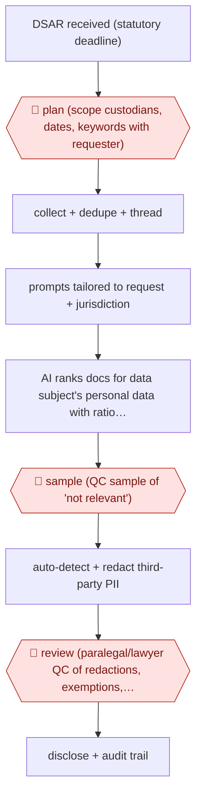

# Sampled DSAR disclosure

`PRO › LEG › REG` · sampled · evidence A · **draft: needs a reference example** ([how to add one](../../../../../CONTRIBUTING.md#1-add-an-example-run))

**Shape:** `DSAR received (statutory deadline) → 🛑 plan (scope custodians, dates, keywords with requester) → collect + dedupe + thread → prompts tailored to request + jurisdiction → AI ranks docs for data subject's personal data with rationale → 🛑 sample (QC sample of 'not relevant') → auto-detect + redact third-party PII → 🛑 review (paralegal/lawyer QC of redactions, exemptions, privilege) → disclose + audit trail`
**How it differs:** AWF-0035 Validated GenAI first-pass reviews for responsiveness in litigation with recall sign-off; AWF-0036 builds an obligations register. Here the deliverable is a statutory disclosure to an individual, with third-party redaction QC and a one-month deadline; checkpoints (scope with requester, redaction QC) and deliverable differ.
**Variants:** `relativity-air-for-review` · `cds-vision-ai` · `relativity-redact` · `aiimi`

<!-- shape diagram: generated by scripts/build_diagrams.py from `shape`; don't edit -->

<!-- end shape diagram -->

## Steps
1. 🛑 **Plan**: scope the request (custodians, date range, targeted keywords), ideally in discussion with the requester; record parameters for defensibility [[1]](#sources).
2. Collect from M365/Google/Slack, deduplicate and thread to cut volume (e.g., ~1,500 documents left in one matter; 75,000 to 11,671 in another) [[1]](#sources)[[2]](#sources).
3. Run GenAI review with DSAR-specific prompts tailored to the request's scope and jurisdiction to rank documents and give rationales and citations [[1]](#sources)[[3]](#sources).
4. 🛑 **Sample**: QC a targeted sample of 'Not Relevant' documents to validate AI predictions before scaling; 'two small validation samples' in one run [[1]](#sources)[[2]](#sources).
5. Automatically detect and redact personal data (names, emails, phone numbers, addresses) of third parties [[2]](#sources).
6. 🛑 **Review**: paralegals or client staff QC the redacted set and apply further confidentiality redactions; possible privilege hits isolated for experienced-attorney QC [[2]](#sources)[[3]](#sources).
7. Produce the disclosure within the one-month statutory window, keeping an audit trail [[1]](#sources).

**Output:** Redacted disclosure set and response to the data subject, with an audit record of scope, QC and redactions.
**Failure modes → guards:** Over-broad request (initials match common words) → scope negotiation before collection. AI misses relevant documents → elusion-style sampling of 'Not Relevant'. Third-party data or privileged advice disclosed → automated PII detection plus human redaction and privilege QC.

## Public runs

Coverage as of 2026-11-13: **Partial**: first-hand runs that cover part of the shape or put checkpoints elsewhere. Collected and re-checked in [Third collection pass](../../../../../research/2026-11-third-pass.md).

- [Gravity Stack, From Inbox to Disclosure](https://relativity.com/blog/from-inbox-to-disclosure-how-air-reshapes-dsar-compliance/) (2025-11-24). Ex-employee DSAR: scoped, deduped to ~1,500 docs, sampled 'Not Relevant' QC, produced. "The entire process, from receipt to production, was completed within 48 hours". *First-hand: yes; confidence: med.*
- [CDS, GenAI DSAR responses](https://cdslegal.com/insights/how-generative-ai-is-driving-faster-more-accurate-dsar-responses/) (2026-01-07). Two provider runs: filter, GenAI review, auto-redaction, paralegal/client QC. "saved more than £73,000 compared to their traditional method". *First-hand: yes; confidence: med.*
- [Relativity, Baker McKenzie aiR](https://www.relativity.com/resources/customers/baker-mckenzie-relativity-air/) (n.d.). Two DSARs in one week with tailored prompts; attorneys validate outputs. "One DSAR was completed in just 48 hours". *First-hand: vendor; confidence: med.*

## Sources

1. Gary Blair (Gravity Stack), From Inbox to Disclosure: How aiR Reshapes DSAR Compliance, Relativity Blog, 2025-11-24. https://relativity.com/blog/from-inbox-to-disclosure-how-air-reshapes-dsar-compliance/
2. Mark Anderson (Complete Discovery Source), How Generative AI Is Driving Faster, More Accurate DSAR Responses, 2026-01-07. https://cdslegal.com/insights/how-generative-ai-is-driving-faster-more-accurate-dsar-responses/
3. Relativity, Baker McKenzie – Relativity aiR customer story, n.d. https://www.relativity.com/resources/customers/baker-mckenzie-relativity-air/
