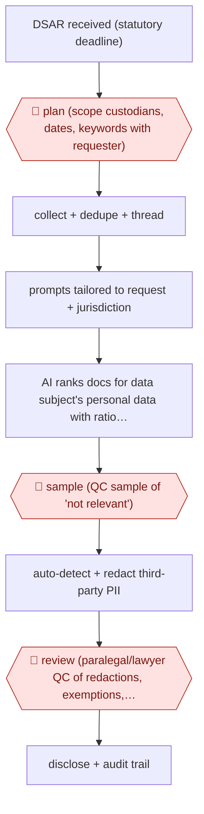

# Sampled DSAR disclosure

`PRO › LEG › REG` · sampled · evidence A · **draft: needs a reference example** ([how to add one](../../../../../CONTRIBUTING.md#1-add-an-example-run))

**Shape:** `DSAR received (statutory deadline) → 🛑 plan (scope custodians, dates, keywords with requester) → collect + dedupe + thread → prompts tailored to request + jurisdiction → AI ranks docs for data subject's personal data with rationale → 🛑 sample (QC sample of 'not relevant') → auto-detect + redact third-party PII → 🛑 review (paralegal/lawyer QC of redactions, exemptions, privilege) → disclose + audit trail`
**How it differs:** AWF-0035 Validated GenAI first-pass reviews for responsiveness in litigation with recall sign-off; AWF-0036 builds an obligations register. Here the deliverable is a statutory disclosure to an individual, with third-party redaction QC and a one-month deadline; checkpoints (scope with requester, redaction QC) and deliverable differ.
**Variants:** `relativity-air-for-review` · `cds-vision-ai` · `relativity-redact` · `aiimi`

<!-- shape diagram: generated by scripts/build_diagrams.py from `shape`; don't edit -->

<!-- end shape diagram -->

## Background

Anyone can ask an organisation what it holds about them, and in the UK and the EU the answer is owed within a month. The work looks like a small litigation disclosure and is harder in one respect: the deadline is statutory and short, so a request cannot wait for a quiet week, and the collection arrives from mailboxes, shared drives and chat, where the personal data of other people is mixed into the same documents. Two duties pull in opposite directions. The requester is entitled to their own data, so the filter has to be tight enough not to withhold what they asked for; and third parties have rights too, so names, contact details and identifying details of colleagues and customers have to come out before anything is sent. An AI review helps with both halves — ranking documents for the requester's personal data with a reason, and detecting third-party identifiers for redaction — and it decides neither, because a missed document is a compliance failure and an unredacted name is a data breach. The design that makes it defensible is a sample of what the system discarded, taken before the deadline rather than after a complaint, plus a human pass over every redaction, with the scope decision recorded at the start because that decision is what the requester will argue about if they argue at all.

**Terms:**
- **DSAR / SAR**: a data subject access request, an individual asking for their own personal data.
- **personal data**: information relating to an identified or identifiable person.
- **third-party data**: other people's personal data mixed into the same documents, which must be redacted.
- **exemption**: a legal ground for withholding, such as legal privilege or another person's rights.
- **scope**: the custodians, date range and search terms agreed for the request.
- **elusion sampling**: sampling the documents the system discarded, to estimate what was missed.
- **privilege**: legal professional privilege, one of the exemptions that has to be assessed by a lawyer.
- **audit trail**: the record of scope, sampling and redaction decisions, which is the defence if the regulator asks.

## Build it with an agent

**Form:** `service`. Requests arrive continuously from the public and from employees, each with its own one-month clock; collection, ranking and redaction run unattended on each one, and people appear at scope, at the sample and at the redaction QC. Nothing accumulates per requester that a project would own, and no single conversation can hold a mailbox.

**You need:** connectors into the mailboxes, drives and chat workspaces the scope names, with the collection time recorded, since a document's state at collection is what you can defend; deduplication and threading, because the same email appears in five custodians' boxes; prompts tailored per jurisdiction, because the exemptions differ; the scope decision written down and, where possible, agreed with the requester, since an over-broad request is the most common cause of a late answer; a sampling rule fixed in advance for the "not relevant" set; the redaction tool's identifier classes tuned to the locale; and a QC step staffed by someone who can apply exemptions, including privilege. The agent must not withhold anything on an exemption and must not certify that a disclosure is complete: both are legal decisions, and the deadline is no reason to compress them.

| Step | Built as |
|---|---|
| DSAR received (statutory deadline) | The clock starts at receipt and is a field on the case, not a note in someone's inbox; every later step is timestamped against it. |
| 🛑 plan (scope custodians, dates, keywords with requester) | A scoping record, ideally confirmed with the requester, that becomes the definition of what was searched — the first thing to be examined if the answer is challenged. |
| collect + dedupe + thread | An automated collection that logs source, collection time and what dedupe removed, because producing the same email five times is a redaction risk rather than thoroughness. |
| prompts tailored to request + jurisdiction | The ranking instruction names the requester, the period and the jurisdiction's exemptions, so the model's reason for a call is checkable against the scope. |
| AI ranks docs for data subject's personal data with rationale | Every document gets a rank and a reason citing the passage; low-confidence documents are treated as relevant, since the cost of including one is redaction time and the cost of excluding one is a breach. |
| 🛑 sample (QC sample of 'not relevant') | A sample of the discarded set is read by a person before the deadline, sized to the risk rather than to the time left; findings reopen the ranking for that category. |
| auto-detect + redact third-party PII | Identifier detection proposes redactions per document, and every proposal is visible as a decision rather than applied silently, so a QC reviewer can see what was removed and what was not. |
| 🛑 review (paralegal/lawyer QC of redactions, exemptions, privilege) | Staff check redactions and apply exemptions, with privilege isolated for a lawyer; the build cannot finalise a withhold. |
| disclose + audit trail | The package goes out with the record of scope, sample, redactions and exemptions, which is the file the regulator would ask for. |

**Checkpoints:** `plan`: the scope is agreed at the start, because a request answered narrowly is a complaint and a request answered broadly is a breach risk, and the decision has to be defensible rather than improvised under deadline. `sample`: the discarded set is sampled before disclosure, which is the only check that catches a filter tuned too tight — and the one most often skipped when the month runs short. `review`: every redaction and every exemption is decided by a person, with privilege reserved to a lawyer, and the build has no path to sending a package itself.

**Since the sources:** Sources date from 2025-11 to 2026-01, plus an undated vendor story. The Gravity Stack and CDS accounts were not re-opened on this pass; the regulator's published case data was opened. What has changed since: this workflow's subject has become the regulator's largest single complaint category. In the Information Commissioner's published completed-case extracts for the first quarter of 2026/27, right-of-access provisions were the primary issue in 11,731 of 24,132 cases, or 48.6%, up from 40.7% in the previous quarter — a share of published cases rather than a count of requests received, so read it as a trend in disputes rather than in volume. Two consequences for the build. The first is that the audit trail in the last step is no longer diligence, it is the thing that answers a complaint: scope, sample and redaction decisions are what a case handler will ask for, and a package produced quickly without them converts a fast answer into an investigation. The second is about where the risk has moved — with complaint volume concentrated here, the failure that gets punished is the plausible-looking incomplete answer, which is exactly what an unsampled ranking produces. The entry's other figures are unchanged and remain single-matter anecdotes: roughly 1,500 documents left after dedupe in one matter, 75,000 down to 11,671 in another, and a 48-hour turnaround on a scoped request.

*A design based on this entry's steps and the tool documentation as of 2026-11, not a reported run.*

## Steps

*As reported by the sources.*

1. 🛑 **Plan**: scope the request (custodians, date range, targeted keywords), ideally in discussion with the requester; record parameters for defensibility [[1]](#sources).
2. Collect from M365/Google/Slack, deduplicate and thread to cut volume (e.g., ~1,500 documents left in one matter; 75,000 to 11,671 in another) [[1]](#sources)[[2]](#sources).
3. Run GenAI review with DSAR-specific prompts tailored to the request's scope and jurisdiction to rank documents and give rationales and citations [[1]](#sources)[[3]](#sources).
4. 🛑 **Sample**: QC a targeted sample of 'Not Relevant' documents to validate AI predictions before scaling; 'two small validation samples' in one run [[1]](#sources)[[2]](#sources).
5. Automatically detect and redact personal data (names, emails, phone numbers, addresses) of third parties [[2]](#sources).
6. 🛑 **Review**: paralegals or client staff QC the redacted set and apply further confidentiality redactions; possible privilege hits isolated for experienced-attorney QC [[2]](#sources)[[3]](#sources).
7. Produce the disclosure within the one-month statutory window, keeping an audit trail [[1]](#sources).

**Output:** Redacted disclosure set and response to the data subject, with an audit record of scope, QC and redactions.
**Failure modes → guards:** Over-broad request (initials match common words) → scope negotiation before collection. AI misses relevant documents → elusion-style sampling of 'Not Relevant'. Third-party data or privileged advice disclosed → automated PII detection plus human redaction and privilege QC.

## Public runs

Coverage as of 2026-11-13: **Partial**: first-hand runs that cover part of the shape or put checkpoints elsewhere. Collected and re-checked in [Third collection pass](../../../../../research/2026-11-third-pass.md).

- [Gravity Stack, From Inbox to Disclosure](https://relativity.com/blog/from-inbox-to-disclosure-how-air-reshapes-dsar-compliance/) (2025-11-24). Ex-employee DSAR: scoped, deduped to ~1,500 docs, sampled 'Not Relevant' QC, produced. "The entire process, from receipt to production, was completed within 48 hours". *First-hand: yes; confidence: med.*
- [CDS, GenAI DSAR responses](https://cdslegal.com/insights/how-generative-ai-is-driving-faster-more-accurate-dsar-responses/) (2026-01-07). Two provider runs: filter, GenAI review, auto-redaction, paralegal/client QC. "saved more than £73,000 compared to their traditional method". *First-hand: yes; confidence: med.*
- [Relativity, Baker McKenzie aiR](https://www.relativity.com/resources/customers/baker-mckenzie-relativity-air/) (n.d.). Two DSARs in one week with tailored prompts; attorneys validate outputs. "One DSAR was completed in just 48 hours". *First-hand: vendor; confidence: med.*

## Sources

1. Gary Blair (Gravity Stack), From Inbox to Disclosure: How aiR Reshapes DSAR Compliance, Relativity Blog, 2025-11-24. https://relativity.com/blog/from-inbox-to-disclosure-how-air-reshapes-dsar-compliance/
2. Mark Anderson (Complete Discovery Source), How Generative AI Is Driving Faster, More Accurate DSAR Responses, 2026-01-07. https://cdslegal.com/insights/how-generative-ai-is-driving-faster-more-accurate-dsar-responses/
3. Relativity, Baker McKenzie – Relativity aiR customer story, n.d. https://www.relativity.com/resources/customers/baker-mckenzie-relativity-air/
4. Online CPD Academy, Subject Access Request statistics from the ICO's published completed-case extracts, checked 2026-10-15. https://gdprcourse.co.uk/blog/subject-access-request-statistics-uk
