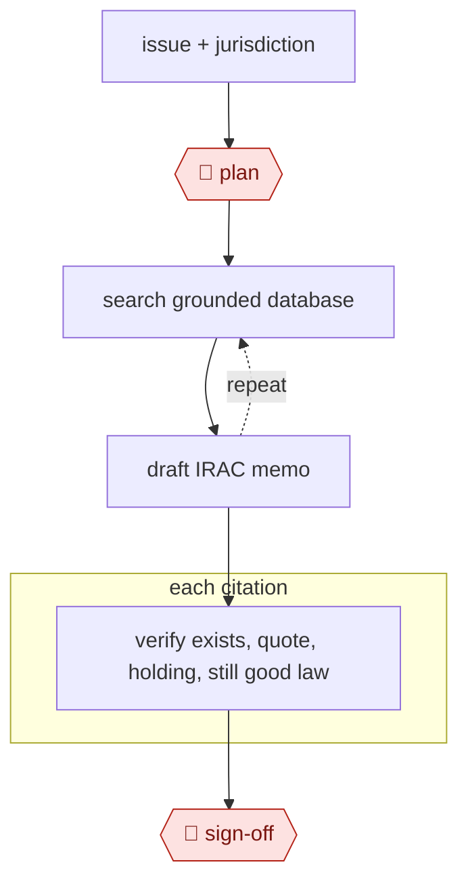

# Grounded legal memo

`PRO › LEG › RESEARCH` · assist · evidence A · **draft: needs a reference example** ([how to add one](../../../../../CONTRIBUTING.md#1-add-an-example-run))

**Shape:** `issue + jurisdiction → 🛑 plan → (search grounded database ⟲ draft IRAC memo) → each citation: verify exists, quote, holding, still good law → 🛑 sign-off`

<!-- shape diagram: generated by scripts/build_diagrams.py from `shape`; don't edit -->

<!-- end shape diagram -->

## Background

A legal memo answers one question: what the law is on this issue, in this jurisdiction, and what follows for the client. Its form is old and its value is in the authorities — a proposition is worth nothing without a case that holds it, quoted accurately, still good law, and applied to facts that resemble the client's. Producing one is a genuine skill and a slow one: find the leading case, check what later courts did to it, read the paragraph the proposition actually rests on, and write the analysis around it. A model with a grounded database is useful at the finding and drafting stages, and dangerous at exactly the seam between them, because the failure is not obvious. A fabricated citation has plausible parties, a plausible reporter and a real court; a real citation attached to a proposition it does not support is worse, because it survives a check that only asks whether the case exists. That is why this workflow's verification step names four separate checks rather than one, and why the lawyer plans the question before research starts: a memo answers the question it was given, and a model will happily answer a slightly different one with great confidence.

**Terms:**
- **IRAC**: Issue, Rule, Application, Conclusion — the memo's structure.
- **grounded database**: a licensed primary-law service the model retrieves from, as opposed to the open web.
- **pinpoint cite**: a reference to a specific page or paragraph, not just the case.
- **holding**: the rule the case actually decides, as distinct from what a party argued or what a judge mused.
- **citator**: the service that flags later treatment — overruled, doubted, distinguished.
- **negative treatment**: later authority that undermines the case relied on.
- **misgrounding**: a real citation used to support a proposition the source does not support.
- **certification**: the signature that a filing's authorities exist and are accurately cited, which several courts now require explicitly.

## Build it with an agent

**Form:** `skill`. One lawyer, one question, one memo, drafted and checked in a conversation, with files for the plan and the citation table. Nothing accumulates between matters and nothing runs unattended: the deliverable is the skill's output and the lawyer's name is on it.

**You need:** a subscription to a grounded primary-law service, because the whole design rests on retrieval from licensed content; the jurisdiction and the procedural posture, since the same words mean different things in different courts; the plan written before research starts, because scope creep in legal research is silent; and a citation table the skill fills in as it drafts, one row per authority with exists / quoted text / holding / citator status. Critically, the verification pass must be able to see the case, not the model's summary of it: the check that catches a misgrounded citation is reading the paragraph. The agent must not write the conclusion of the memo as a settled answer, and must not clear its own citations — the sign-off is a person's, and the sources show what happens when it is not.

| Step | Built as |
|---|---|
| issue + jurisdiction | Stated in a form the plan can be checked against: the question, the jurisdiction, the procedural posture and what the client needs to decide. |
| 🛑 plan | The lawyer approves the issue framing and the research plan before retrieval starts, which is the cheapest place to catch a memo that will answer the wrong question. |
| (search grounded database ⟲ draft IRAC memo) | Retrieval over licensed primary law, with each drafted proposition tied to the passage it came from; the loop repeats when a search returns nothing on point, rather than filling the gap from general knowledge. |
| each citation: verify exists, quote, holding, still good law | Four checks per authority, run as separate steps because they fail independently: open the case, compare the quoted words, read what it holds, run the citator. The table records each check's outcome and the reviewer's initials. |
| 🛑 sign-off | The attorney reads every authority cited, and the skill has no path to a finished memo that skips the table — the signature certifies the citations, which several courts now make explicit. |

**Checkpoints:** `plan`: the question and the plan are approved before retrieval, because a memo is judged against the question asked and a model will answer a near-miss with confidence. `sign-off`: the attorney reads every authority, which is the only check that survives a grounding failure — and the record of the four checks per cite is what makes that reading possible in the time available.

**Since the sources:** The sources are the 2023 *Mata v. Avianca* sanctions decision and a 2024-06 firm account of an internal trial, so this entry's evidence is older than the rest of the catalogue. What has changed since is substantial and goes against the entry's implicit assumption that grounding solves the problem. The public record of court decisions finding reliance on AI-fabricated material, maintained by Damien Charlotin, reached [2,006 cases by 2026-09-01](https://zandigital.in/rag-hallucination-court-sanctions) — 1,376 in the United States — having grown from 11 in 2023 and 37 in 2024 to 524 in 2025 and 668 in the first part of 2026; 28 of those decisions name a Westlaw, CoCounsel or Lexis product, 17 of them decided in 2026. A Stanford evaluation found those leading legal research tools hallucinated on 17% to 33% of benchmark queries, and the characteristic error was not invention but misattribution: a real case cited for something it does not say. That is the finding this entry has to absorb, because its shape already contains the right four checks in the right order, and the risk is that a reviewer performs only the first one. Two other developments bear on the sign-off. Courts have started writing the duty into the signature: New York's Part 161, in force 2026-06-01, makes filing certify a review for fabricated material; Florida's amended rule, from 2026-06, certifies that the authorities exist and are accurately cited; California's SB 574, from 2027-01-01, requires the filer to have personally read and verified every citation. And the sanctions have moved from fines to consequences — suspensions, disqualification, bar referrals, and co-signing counsel penalised for briefs they did not read. The entry's design is unchanged; what changed is how little slack the verification step has.

*A design based on this entry's steps and the tool documentation as of 2026-11, not a reported run.*

## Steps

*As reported by the sources.*

1. Frame the issue and jurisdiction. 🛑 **Plan**.
2. Search primary law in a grounded database (Westlaw/CoCounsel, Lexis+ AI, Harvey), not the open web.
3. Draft an IRAC memo with pinpoint cites.
4. **Run a separate verification pass on every citation**, including a citator check.
5. 🛑 **Sign-off**: the attorney reads every authority cited.

**Why the citation check is mandatory:** in *Mata v. Avianca* (S.D.N.Y., sanctions June 22, 2023), counsel submitted ChatGPT-fabricated opinions with fake quotes and citations [[24]](#sources).

## Public runs

Coverage as of 2026-11-06: **None found**: no public first-hand run yet. A real example run would be the first. From [Where are the real runs?](../../../../../research/2026-11-real-runs.md); every number was re-checked against its page.

- [Ashurst, *Vox PopulAI*](https://www.ashurstperkinscoie.com/en/insights/vox-populai-lessons-from-a-global-law-firms-exploration-of-generative-ai) (2024-06-10). Firm-wide trials; four expert lawyers blind-score AI against human work. "45% on creating first draft legal briefings"; "3 out of 5" vs "3.5 out of 5". *First-hand: yes; confidence: med.*

## Sources

24. *Mata v. Avianca, Inc.*, 678 F. Supp. 3d 443 (S.D.N.Y. 2023). https://en.wikipedia.org/wiki/Mata_v._Avianca,_Inc.
25. AI Hallucination Cases database (Damien Charlotin), as analysed by Zan Digital, October 2026, with the Stanford evaluation of legal research tools. https://zandigital.in/rag-hallucination-court-sanctions
26. Lexifina, Where do we draw the line on AI in court filings?, 2026, covering certification rules in New York, Florida and California and 2026 sanctions decisions. https://lexifina.com/blog/where-to-draw-the-line-on-ai-in-court-filings
