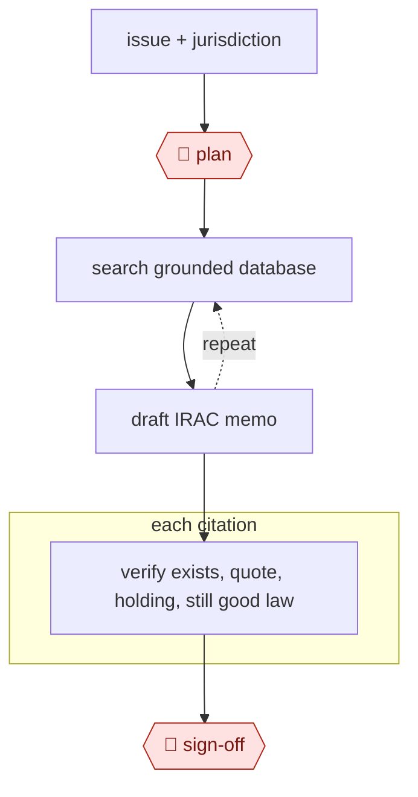

# Grounded legal memo

`PRO › LEG › RESEARCH` · assist · evidence A · **draft: needs a reference example** ([how to add one](../../../../../CONTRIBUTING.md#1-add-an-example-run))

**Shape:** `issue + jurisdiction → 🛑 plan → (search grounded database ⟲ draft IRAC memo) → each citation: verify exists, quote, holding, still good law → 🛑 sign-off`

<!-- shape diagram: generated by scripts/build_diagrams.py from `shape`; don't edit -->

<!-- end shape diagram -->

## Steps
1. Frame the issue and jurisdiction. 🛑 **Plan**.
2. Search primary law in a grounded database (Westlaw/CoCounsel, Lexis+ AI, Harvey), not the open web.
3. Draft an IRAC memo with pinpoint cites.
4. **Run a separate verification pass on every citation**, including a citator check.
5. 🛑 **Sign-off**: the attorney reads every authority cited.

**Why the citation check is mandatory:** in *Mata v. Avianca* (S.D.N.Y., sanctions June 22, 2023), counsel submitted ChatGPT-fabricated opinions with fake quotes and citations [[24]](#sources).

## Public runs

Coverage as of 2026-11-06: **None found**: no public first-hand run yet. A real example run would be the first. From [Where are the real runs?](../../../../../research/2026-11-real-runs.md); every number was re-checked against its page.

- [Ashurst, *Vox PopulAI*](https://www.ashurstperkinscoie.com/en/insights/vox-populai-lessons-from-a-global-law-firms-exploration-of-generative-ai) (2024-06-10). Firm-wide trials; four expert lawyers blind-score AI against human work. "45% on creating first draft legal briefings"; "3 out of 5" vs "3.5 out of 5". *First-hand: yes; confidence: med.*

## Sources

24. *Mata v. Avianca, Inc.*, 678 F. Supp. 3d 443 (S.D.N.Y. 2023). https://en.wikipedia.org/wiki/Mata_v._Avianca,_Inc.
