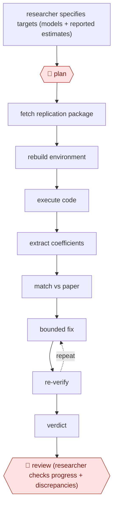

# Gated replication run

`PRO › RES › ANALYSIS` · checkpointed · evidence A · **draft: needs a reference example** ([how to add one](../../../../../CONTRIBUTING.md#1-add-an-example-run))

**Shape:** `researcher specifies targets (models + reported estimates) → 🛑 plan → fetch replication package → rebuild environment → execute code → extract coefficients → match vs paper → (bounded fix ⟲ re-verify) → verdict → 🛑 review (researcher checks progress + discrepancies)`
**Variants:** `claude-code` · `llm-orchestrator-versioned-rules`

<!-- shape diagram: generated by scripts/build_diagrams.py from `shape`; don't edit -->

<!-- end shape diagram -->

## Background

A research paper reports numbers, usually in regression tables: estimates (coefficients) that say how strongly one measured thing is linked to another. Many journals now require authors to deposit a replication package, the data and code that produced those numbers. Replicating a paper means rebuilding the software environment the code needs, running it, and checking that it prints the same estimates as the paper. By hand this is slow and fragile, because every package is set up differently and a run that finishes without errors can still give different numbers. The agent fetches the package, runs it, compares the output with the reported estimates and tries a bounded number of fixes. A researcher still sets what counts as the target, approves the plan, and judges every discrepancy, since only the researcher can say whether a mismatch is a code problem, restricted data or a flaw in the paper.

**Terms:**
- **Replication package**: the data, code and documentation an author deposits so others can reproduce a paper's results.
- **Estimate / coefficient**: a number a statistical model produces, such as the effect of one variable on another, as printed in the paper's tables.
- **Reproducible**: the deposited code, run on the deposited data, gives the numbers the paper reports.
- **IV diagnostics**: standard checks on instrumental-variable models, a method for estimating cause and effect when a direct comparison would be misleading; they can be run once a paper's code and data execute.
- **Version-controlled code**: scripts kept in a system such as git that records every change, so each number can be traced to the code that made it.
- **LLM orchestrator**: a language model that assigns the tasks and chooses what to try after a failure, while the calculations are done by ordinary code.

## Build it with an agent

**Form:** `skill`. One researcher replicates one paper at a time and stays in the conversation to approve the plan and read the discrepancies, so one skill holding the procedure is enough.

**You need:** a targets file listing each model and the reported estimates with the number of decimals the paper prints; the replication package, downloaded or reachable by URL; an isolated environment (a container or a separate machine) with the languages and packages the code needs, because the agent will run code it did not write; a folder the agent may write to. Where data are restricted, the researcher supplies them inside the environment; do not send them to any outside service.

| Step | Built as |
|---|---|
| researcher specifies targets → 🛑 plan | The skill asks for the targets file, then writes `plan.md` (package location, how the environment will be rebuilt, which models will be run) and stops. |
| fetch replication package → rebuild environment → execute code | Shell commands in the isolated environment, each set to ask under a permission rule until the researcher has approved the plan. The skill logs every command to a run file. |
| extract coefficients → match vs paper | A script beside the skill rounds each coefficient to the paper's precision and compares it with the targets file, so the match is computed by code and not judged by the agent. |
| (bounded fix ⟲ re-verify) | The main conversation proposes a fix as a diff, applies it to a copy of the package and reruns the script. The skill states a maximum number of attempts. A `PreToolUse` hook blocks edits to the targets file. |
| verdict | The script's output goes into a report: per model matched, not matched or not runnable, with missing or restricted data recorded as non-reproducible. |
| 🛑 review (researcher checks progress + discrepancies) | See Checkpoints. |

**Checkpoints:** `plan`: the skill writes the plan file and stops until the researcher approves it; plan mode also works, because it cannot run or edit anything. `review`: the skill ends with the report, listing every model that did not match, what was tried and the logged commands, then stops for the researcher to steer or accept. The researcher may then approve rules learned from failures for the skill's reference file; nothing is added to it automatically.

**Since the sources:** Sources date from 2026-03 to 2026-07. Source 1 runs a fixed pipeline over hundreds of papers, with versioned rules that carry what earlier runs learned. This build handles one paper at a time, and its rules file is edited only by the researcher; running many papers between two checkpoints would need a dynamic workflow. Source 2 describes an agent built on Claude Code with subagents for code generation, testing and quality checks, which the skill can use too. The build leaves out the sources' scale and their evaluation.

*A design based on this entry's steps and the tool documentation as of 2026-11, not a reported run.*

## Steps

*As reported by the sources.*

1. 🛑 **Plan**: the researcher specifies the empirical targets: model specifications and the reported quantities to reproduce [[1]](#sources).
2. An LLM orchestrator (a language model that routes tasks and picks recovery steps) directs the run. All numerical work runs as version-controlled code [[1]](#sources).
3. The agent fetches the replication package, rebuilds the computational environment and runs the code [[1]](#sources).
4. The agent then verifies in a separate gated phase. It rounds the coefficients from the code to the paper's precision, matches them to the reported values and gives a verdict. Failures enter a bounded fix loop [[1]](#sources).
5. 🛑 **Review**: at defined checkpoints the researcher reviews progress, gives feedback and steers the analysis while subagents generate, test and QA code [[2]](#sources).
6. The system encodes recurring failure patterns as versioned rules for the next run [[1]](#sources).

**Output:** A per-paper reproducibility verdict with matched estimates and an audit trail. It can feed systematic reanalysis such as IV diagnostics.
**Failure modes → guards:** Running the code is not the same as reproducing the results → separate, gated verification phase [[1]](#sources). Missing or restricted data → logged as non-reproducible, not as a code failure [[1]](#sources).
**How it differs:** AWF-0006 Governed query (ANALYTICS) answers business data questions. AWF-0009 screens literature. This re-executes published analyses and verifies them against reported numbers.

## Public runs

Coverage as of 2026-11-06: **Strong**: a first-hand, detailed run that matches most of the shape. Collected and re-checked in [New workflows for empty categories](../../../../../research/2026-11-new-workflows.md).

- [Xu & Yang, Scaling Reproducibility](https://arxiv.org/html/2602.16733v2) (2026-03-24). 384 political-science papers, 3,382 models replicated by the workflow. "94.4% of papers are fully reproducible (237/251)". *First-hand: yes; confidence: high.*
- [Birk et al., SHARP](https://arxiv.org/html/2604.18752) (2026-07-01). Checkpointed human-agent reproduction of a particle-physics jet classification. "within 0.1 percentage points in accuracy". *First-hand: yes; confidence: med.*

## Sources

1. Xu Y., Yang L.Y., Scaling Reproducibility: An AI-Assisted Workflow for Large-Scale Replication and Reanalysis, arXiv 2602.16733v2, 2026-03-24. https://arxiv.org/html/2602.16733v2
2. Birk J. et al., A Scientific Human-Agent Reproduction Pipeline (SHARP), arXiv 2604.18752, 2026-07-01. https://arxiv.org/html/2604.18752
