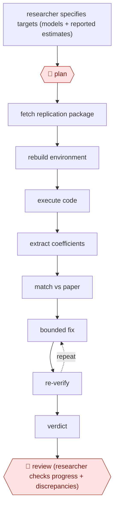

# Gated replication run

`PRO › RES › ANALYSIS` · checkpointed · evidence A · **draft: needs a reference example** ([how to add one](../../../../../CONTRIBUTING.md#1-add-an-example-run))

**Shape:** `researcher specifies targets (models + reported estimates) → 🛑 plan → fetch replication package → rebuild environment → execute code → extract coefficients → match vs paper → (bounded fix ⟲ re-verify) → verdict → 🛑 review (researcher checks progress + discrepancies)`
**How it differs:** AWF-0006 Governed query (ANALYTICS) answers business data questions. AWF-0009 screens literature. This re-executes published analyses and verifies them against reported numbers.
**Variants:** `claude-code` · `llm-orchestrator-versioned-rules`

<!-- shape diagram: generated by scripts/build_diagrams.py from `shape`; don't edit -->

<!-- end shape diagram -->

## Steps
1. 🛑 **Plan**: The researcher specifies the empirical targets: model specifications and the reported quantities to reproduce [[1]](#sources).
2. An LLM orchestrator routes tasks and picks recovery steps. All numerical work runs as version-controlled code [[1]](#sources).
3. Fetch the replication package, rebuild the computational environment, and run the code [[1]](#sources).
4. Verification is a separate gated phase. Code coefficients are rounded to the paper's precision, matched to reported values, and given a verdict. Failures enter a bounded fix loop [[1]](#sources).
5. 🛑 **Review**: At defined checkpoints the researcher reviews progress, gives feedback and steers the analysis while subagents generate, test and QA code [[2]](#sources).
6. Recurring failure patterns are encoded as versioned rules for the next run [[1]](#sources).

**Output:** A per-paper reproducibility verdict with matched estimates and an audit trail. It can feed systematic reanalysis such as IV diagnostics.
**Failure modes → guards:** Running the code is not the same as reproducing the results → separate, gated verification phase [[1]](#sources). Missing or restricted data → logged as non-reproducible, not as a code failure [[1]](#sources).

## Public runs

Coverage as of 2026-11-06: **Strong**: a first-hand, detailed run that matches most of the shape. Collected and re-checked in [New workflows for empty categories](../../../../../research/2026-11-new-workflows.md).

- [Xu & Yang, Scaling Reproducibility](https://arxiv.org/html/2602.16733v2) (2026-03-24). 384 political-science papers, 3,382 models replicated by the workflow. "94.4% of papers are fully reproducible (237/251)". *First-hand: yes; confidence: high.*
- [Birk et al., SHARP](https://arxiv.org/html/2604.18752) (2026-07-01). Checkpointed human-agent reproduction of a particle-physics jet classification. "within 0.1 percentage points in accuracy". *First-hand: yes; confidence: med.*

## Sources

1. Xu Y., Yang L.Y., Scaling Reproducibility: An AI-Assisted Workflow for Large-Scale Replication and Reanalysis, arXiv 2602.16733v2, 2026-03-24. https://arxiv.org/html/2602.16733v2
2. Birk J. et al., A Scientific Human-Agent Reproduction Pipeline (SHARP), arXiv 2604.18752, 2026-07-01. https://arxiv.org/html/2604.18752
