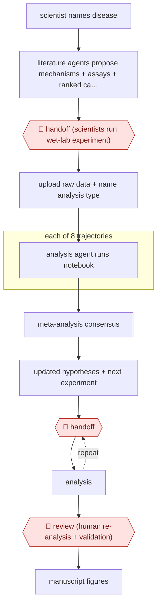

# Lab-in-the-loop discovery

`PRO › RES › ANALYSIS` · checkpointed · evidence A · **draft: needs a reference example** ([how to add one](../../../../../CONTRIBUTING.md#1-add-an-example-run))

**Shape:** `scientist names disease → literature agents propose mechanisms + assays + ranked candidates (tournament) → 🛑 handoff (scientists run wet-lab experiment) → upload raw data + name analysis type → each of 8 trajectories: analysis agent runs notebook → meta-analysis consensus → updated hypotheses + next experiment → (🛑 handoff ⟲ analysis) → 🛑 review (human re-analysis + validation) → manuscript figures`
**How it differs:** AWF-0044 Gated replication run re-executes an existing paper's code to verify reported estimates. Here the agent analyses new experimental data that humans generate between rounds and chooses the next experiment. Different deliverable, with a repeated wet-lab handoff checkpoint. (Also nearer than AWF-0104 Hypothesis tournament, which stops at proposals for lab validation and does not analyse the returned data.)
**Variants:** `futurehouse-robin`

<!-- shape diagram: generated by scripts/build_diagrams.py from `shape`; don't edit -->

<!-- end shape diagram -->

## Steps
1. Give the system a disease. Literature-search agents (Crow for concise and Falcon for deep summaries, built on PaperQA2) generate questions, identify candidate mechanisms and in vitro assays, and propose specific drug candidates. Claude 3.7 Sonnet ranks the candidates in a tournament [[1]](#sources)[[3]](#sources).
2. 🛑 **Handoff**: human scientists review the list and run the physical experiments on the top candidates. In the first round they tested ten molecules [[2]](#sources)[[3]](#sources).
3. Upload raw or semi-processed data (.FCS flow-cytometry files, RNA-seq gene counts) and prompt with the analysis type. The data-analysis agent (Finch) runs eight independent trajectories, each executing code in a Jupyter notebook. A meta-analysis then combines them into a consensus conclusion [[1]](#sources).
4. Use the results to generate the next hypotheses and experiments: an RNA-seq mechanism study, then a second round of ten candidates. The cycle continues 'until a human deems a drug candidate satisfactory' [[2]](#sources)[[3]](#sources).
5. 🛑 **Review**: humans check key results with their own analysis (Finch reported a 1.89-fold increase for ripasudil; human analysis showed 1.75-fold) and run dose-response and primary-cell validation [[1]](#sources).
6. Robin produced all hypotheses, experiment choices, analyses and main-text figures. Humans did the physical experiments and keep responsibility for interpretation [[2]](#sources)[[4]](#sources).

**Output:** Preclinically validated therapeutic candidates plus a mechanism hypothesis, written up as a manuscript (published in Nature) with the agent's notebooks as the analysis record.
**Failure modes → guards:** Analysis varies run to run (gating choices, RNA-seq filters, LLM stochasticity) → eight parallel trajectories plus consensus meta-analysis [1]. In vitro hits are false positives → human re-analysis, dose-response and replication; results stay preclinical [4].

## Public runs

Coverage as of 2026-11-13: **Strong**: a first-hand, detailed run that matches most of the shape. Collected and re-checked in [Third collection pass](../../../../../research/2026-11-third-pass.md).

- [Ghareeb et al., Nature](https://www.nature.com/articles/s41586-026-10652-y) (2026-05-19). dAMD: two candidate rounds plus RNA-seq; ripasudil identified and confirmed in vitro. "Robin analysed 551 papers in 30 min compared with an estimated time of 294 h for a human". *First-hand: yes; confidence: high.*

## Sources

1. Ghareeb A.E. et al. (FutureHouse), A multi-agent system for automating scientific discovery, Nature, 2026-05-19. https://www.nature.com/articles/s41586-026-10652-y
2. Sam Rodriques (FutureHouse), Demonstrating end-to-end scientific discovery with Robin, 2026-05-19. https://www.futurehouse.org/research/demonstrating-end-to-end-scientific-discovery-with-robin-a-multi-agent-system
3. DeepLearning.AI The Batch, Robin Automates Drug Discovery, 2026-07-17. https://www.deeplearning.ai/the-batch/put-the-lab-in-the-loop
4. Xing X. et al., Robin as a lab-in-the-loop multi-agent system for scientific discovery, AI Agent (OAE), 2026-11-06. https://www.oaepublish.com/articles/aiagent.2026.27
