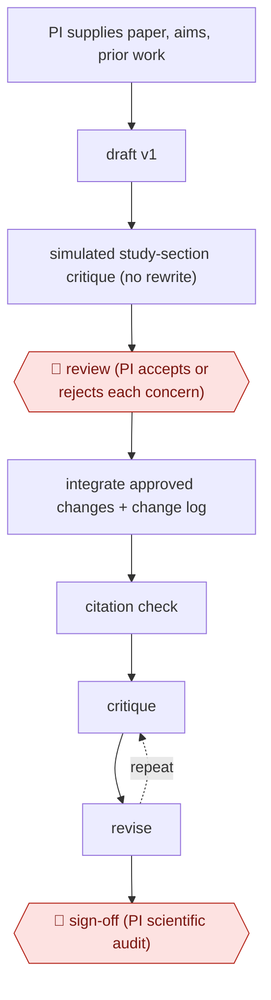

# Critique-first grant draft

`PRO › RES › GRANT` · checkpointed · evidence B · **draft: needs a reference example** ([how to add one](../../../../../CONTRIBUTING.md#1-add-an-example-run))

**Shape:** `PI supplies paper, aims, prior work → draft v1 → simulated study-section critique (no rewrite) → 🛑 review (PI accepts or rejects each concern) → integrate approved changes + change log → citation check → (critique ⟲ revise) → 🛑 sign-off (PI scientific audit)`
**How it differs:** AWF-0010 Reviewer-response revision (WRITE) revises a manuscript after real reviews. This drafts a new proposal against simulated reviewers before submission.
**Variants:** `claude`

<!-- shape diagram: generated by scripts/build_diagrams.py from `shape`; don't edit -->

<!-- end shape diagram -->

## Steps
1. The PI gives the model the lab's paper, research questions, prior work and history. The model organizes them into a v1 draft [[1]](#sources).
2. The model names the most consequential reviewer concerns without rewriting anything, for example an aim that lacked preliminary evidence [[1]](#sources).
3. 🛑 **Review**: The PI accepts or rejects each concern. The model integrates only the approved changes and keeps a change log [[1]](#sources).
4. A simulated study section and a PubMed citation check catch structural gaps and miscited support [[1]](#sources).
5. 🛑 **Sign-off**: The PI does manual editing and a scientific audit to reach a submission-ready version with verified citations [[1]](#sources).

**Output:** A PI-audited, guideline-conformant proposal draft with verified citations, ready for institutional submission.
**Failure modes → guards:** Citing a paper that actually supports a competing mechanism → citation check against PubMed [[1]](#sources). Strong results buried in supplements → simulated review surfaces them [[1]](#sources).

## Public runs

Coverage as of 2026-11-06: **Weak**: only anonymous, vendor-linked or journalist-told accounts. Collected and re-checked in [New workflows for empty categories](../../../../../research/2026-11-new-workflows.md).

- [Reactorfield, Northwell's Brian Kim NIH grant](https://reactorfield.com/blog/northwell-health) (2026-10-20). Named investigator drafts and audits a 14-page NIH proposal with critique-first loop. "One hour of active work produced 12 pages.". *First-hand: vendor; confidence: med.*

## Sources

1. Reactorfield, Northwell's Brian Kim Drafted a 12-Page NIH Grant in One Hour of Active Work, 2026-10-20. https://reactorfield.com/blog/northwell-health
