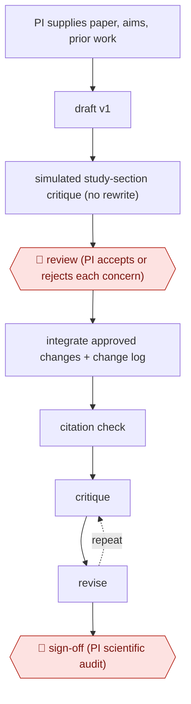

# Critique-first grant draft

`PRO › RES › GRANT` · checkpointed · evidence B · **draft: needs a reference example** ([how to add one](../../../../../CONTRIBUTING.md#1-add-an-example-run))

**Shape:** `PI supplies paper, aims, prior work → draft v1 → simulated study-section critique (no rewrite) → 🛑 review (PI accepts or rejects each concern) → integrate approved changes + change log → citation check → (critique ⟲ revise) → 🛑 sign-off (PI scientific audit)`
**Variants:** `claude`

<!-- shape diagram: generated by scripts/build_diagrams.py from `shape`; don't edit -->

<!-- end shape diagram -->

## Background

A grant proposal asks a funder for money to run a research project. The principal investigator (PI), the scientist who leads the lab, writes it, and before the funder decides, a panel of other scientists reads it and scores it. Writing a first draft takes weeks of time that could go to research, and the weak points that sink a proposal, such as an aim with no early evidence behind it or a cited paper that actually supports a rival explanation, are easy for the author to miss. Here the agent organises the lab's own material into a draft, plays the panel and lists its most serious concerns without rewriting anything, then makes only the changes the PI accepts and checks the citations. The PI decides which concerns are fair and is the only one who can vouch for the science, and the proposal goes out under the PI's name.

**Terms:**
- **PI (principal investigator)**: the scientist who leads the lab and is responsible for the proposal and the research.
- **NIH**: the US National Institutes of Health, a large funder of biomedical research.
- **Aim**: one of the research goals the proposal promises to pursue.
- **Preliminary evidence**: early results from the lab that show an aim is workable.
- **Study section**: the panel of scientists that reviews and scores proposals for a funder.
- **PubMed**: a public index of biomedical papers, used to check that each cited paper exists and says what the proposal claims.
- **Change log**: a list of every edit made and the concern it answered.

## Build it with an agent

**Form:** `skill`. One PI works on one proposal at a time and decides on each concern in the conversation, so one skill holding the procedure is enough.

**You need:** the lab's paper, the research questions, the prior work and the funder's guidelines for the proposal, as files; a way to look each cited paper up in PubMed (a connector or a script); a setup your institution has approved for unpublished data and unfunded ideas. The agent does not hold any submission account.

| Step | Built as |
|---|---|
| PI supplies paper, aims, prior work → draft v1 | The skill reads the files and writes `draft-v1.md` in the funder's section layout. |
| simulated study-section critique (no rewrite) | A reviewer subagent that sees only the draft and the guidelines returns the most consequential concerns, each with the aim it concerns. The skill forbids rewriting at this step. |
| 🛑 review (PI accepts or rejects each concern) | See Checkpoints. |
| integrate approved changes + change log | The skill edits a copy of the draft, only for the concerns marked accepted, and appends each edit and its concern to `changes.md`. |
| citation check | The skill looks up each citation in PubMed and lists any whose abstract does not support the sentence it is attached to. |
| (critique ⟲ revise) | The critique and revise steps repeat, with the PI deciding again on any new concerns. |
| 🛑 sign-off (PI scientific audit) | See Checkpoints. |

**Checkpoints:** `review`: the skill writes the concerns as a numbered list with an accept or reject slot for each and stops; it integrates nothing the PI has not marked accepted. `sign-off`: the skill ends with the draft, the change log and the citation report, then stops; the PI edits and audits it, and submits through the institution, since the agent has no submission tool.

**Since the sources:** The one source dates from 2026-10. It is a case study published by a company that runs a fellowship programme, about one investigator using Claude to draft and audit one proposal. It describes a researcher working with a model in conversation, not an agent running the steps, so this build is a design of the same loop as a reusable procedure. The source says the investigator plans to package the workflow as a reusable skill. It reports that the investigator spent many further hours on manual editing and audit, which the build does not replace.

*A design based on this entry's steps and the tool documentation as of 2026-11, not a reported run.*

## Steps

*As reported by the sources.*

1. The PI gives the model the lab's paper, research questions, prior work and history. The model organizes them into a v1 draft [[1]](#sources).
2. The model names the most consequential reviewer concerns without rewriting anything, for example an aim that lacked preliminary evidence [[1]](#sources).
3. 🛑 **Review**: the PI accepts or rejects each concern. The model integrates only the approved changes and keeps a change log [[1]](#sources).
4. The model runs a simulated study section and a PubMed citation check to catch structural gaps and miscited support [[1]](#sources).
5. 🛑 **Sign-off**: the PI does manual editing and a scientific audit to reach a submission-ready version with verified citations [[1]](#sources).

**Output:** A PI-audited, guideline-conformant proposal draft with verified citations, ready for institutional submission.
**Failure modes → guards:** Citing a paper that actually supports a competing mechanism → citation check against PubMed [[1]](#sources). Strong results buried in supplements → simulated review surfaces them [[1]](#sources).
**How it differs:** AWF-0010 Reviewer-response revision (WRITE) revises a manuscript after real reviews. This drafts a new proposal against simulated reviewers before submission.

## Public runs

Coverage as of 2026-11-06: **Weak**: only anonymous, vendor-linked or journalist-told accounts. Collected and re-checked in [New workflows for empty categories](../../../../../research/2026-11-new-workflows.md).

- [Reactorfield, Northwell's Brian Kim NIH grant](https://reactorfield.com/blog/northwell-health) (2026-10-20). Named investigator drafts and audits a 14-page NIH proposal with critique-first loop. "One hour of active work produced 12 pages.". *First-hand: vendor; confidence: med.*

## Sources

1. Reactorfield, Northwell's Brian Kim Drafted a 12-Page NIH Grant in One Hour of Active Work, 2026-10-20. https://reactorfield.com/blog/northwell-health
