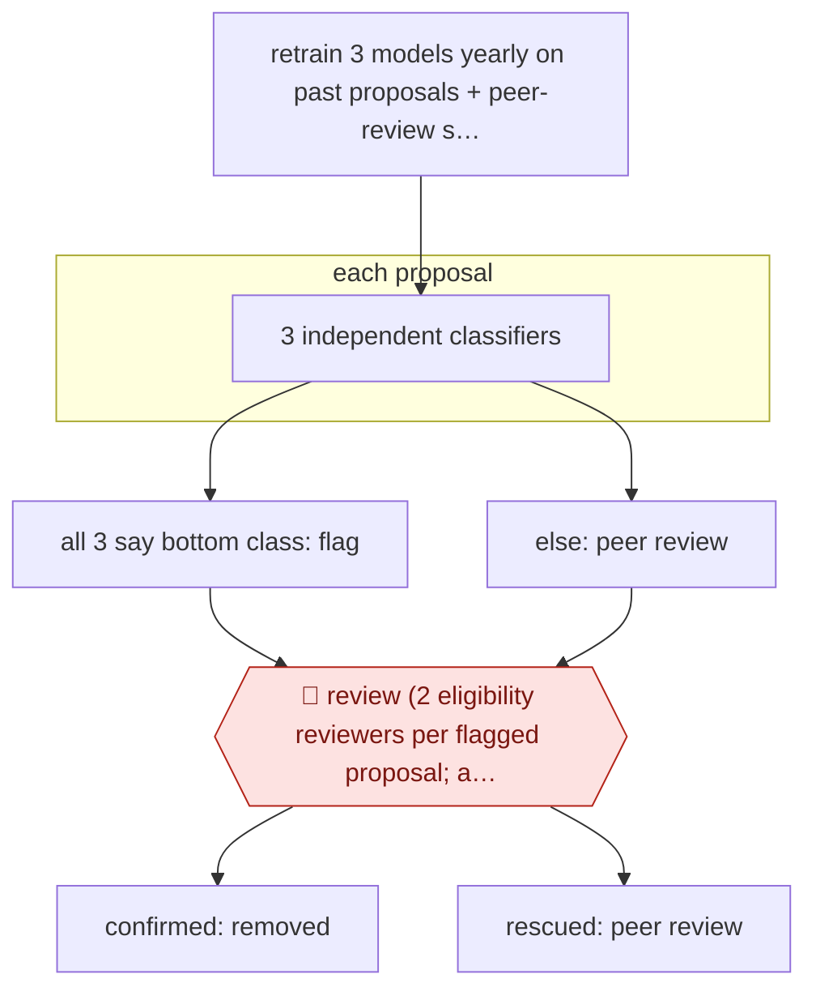

# Funder-side prescreen

`PRO › RES › GRANT` · sampled · evidence A · **draft: needs a reference example** ([how to add one](../../../../../CONTRIBUTING.md#1-add-an-example-run))

**Shape:** `retrain 3 models yearly on past proposals + peer-review scores → each proposal: 3 independent classifiers → all 3 say bottom class: flag | else: peer review → 🛑 review (2 eligibility reviewers per flagged proposal; any reasonable doubt: rescue) → confirmed: removed | rescued: peer review`
**Variants:** `biolinkbert-bioelectra-ensemble`

<!-- shape diagram: generated by scripts/build_diagrams.py from `shape`; don't edit -->

<!-- end shape diagram -->

## Background

A foundation that funds research runs a call for proposals, and every proposal that gets through the first check must be read and scored by expert peer reviewers, whose time is limited. Before that step, staff can remove proposals that are clearly not ready, but reading hundreds of full proposals for this is slow, and a wrong removal shuts a good project out of the call for good. Here three language-model classifiers, trained on the foundation's own past proposals and their peer-review scores, each say independently whether a new proposal belongs in the lowest-scoring class. Only a proposal that all three place there is flagged, and two human eligibility reviewers then look at it. A person has to make the removal decision because it affects an applicant's chance of funding and the funder must be able to justify it, and the reviewers rescue a proposal on any reasonable doubt.

**Terms:**
- **Peer review**: assessment of a proposal by independent experts in the field, who give it a score.
- **Classifier**: a trained model that sorts each input into one of a fixed set of classes, here score classes.
- **Bottom class**: the lowest-scoring group of past proposals; a proposal placed there resembles those that peer reviewers rated lowest.
- **Eligibility reviewer**: a member of the foundation's staff who decides whether a flagged proposal should be removed before peer review.
- **Rescue**: returning a flagged proposal to normal peer review.
- **Hidden parallel trial**: running the screen on a call without acting on it, so its flags can be compared with what happens anyway.
- **NLP**: natural language processing, computer methods for reading text.

## Build it with an agent

**Form:** `platform`. The three classifiers are trained models, fitted each year to the foundation's own proposals and scores, and a general agent does not replace them. A general agent can run everything around them as a `service`.

**You need:** the trained classifiers and the foundation's past proposals with their peer-review scores, held where the agent can run a scoring script and nowhere else; the incoming proposals as files; a review queue in which two named staff members each record a decision per flagged proposal; a record of which proposals were removed and rescued. Proposals are confidential: use only a setup your organisation has approved for them, and send none to an outside service.

| Step | Built as |
|---|---|
| retrain 3 models yearly on past proposals + peer-review scores | The platform: model training on the foundation's data, run outside the agent. The agent can run the training script and log the output. |
| each proposal: 3 independent classifiers | The platform: a scoring script that runs each proposal through the three models separately and writes three class labels per proposal to a file. |
| all 3 say bottom class: flag \| else: peer review | A skill, or a script it calls, compares the three labels. Flag only if all three say the bottom class; everything else is written to the peer-review list. |
| 🛑 review (2 eligibility reviewers per flagged proposal; any reasonable doubt: rescue) | See Checkpoints. |
| confirmed: removed \| rescued: peer review | A person records each outcome. Rescued proposals are added to the peer-review list, and confirmed removals go on an auditable list. |

**Checkpoints:** `review`: each flagged proposal goes to the review queue with the three labels and the proposal text, and two reviewers each record keep-flagged or rescue. A run can be scheduled as a cloud scheduled task or `claude -p` job, which ends after posting the queue; the next run reads the recorded decisions. The agent has no tool that removes a proposal from the process or tells an applicant, and an outcome is recorded only when both reviewers have answered, with any doubt counting as a rescue.

**Since the sources:** The one source dates from 2024-10; it reports the first live call, HR23. Newer accounts show how contested the practice is. In 2026-09 [Times Higher Education](https://www.timeshighereducation.com/news/grant-proposals-rejected-ai-triage-be-reassessed) reported that a UK cybersecurity research network, CRANE, had used AI triage on 179 proposals so that almost half were rejected without a human reading them, and then promised to re-review all of them after criticism that it had not been transparent. A search in 2026-11 also showed a 2025 conference abstract and a 2026-02 preprint on automated proposal screening, which were not opened. This build keeps the source's design, in which a person confirms every removal; whether to tell applicants about the step is a decision for the funder. A general agent could be asked to score proposals itself, but the source does not report that, so this build does not propose it.

*A design based on this entry's steps and the tool documentation as of 2026-11, not a reported run.*

## Steps

*As reported by the sources.*

1. Each year the foundation retrains three biomedical NLP classifiers (BioLinkBERT, BioELECTRA, BioLinkBERT+Adapter) on full texts of past proposals labelled with peer-review score classes [[1]](#sources).
2. The system runs each new proposal through all three models on their own. It flags the proposal only if all three put it in the bottom class [[1]](#sources).
3. The system sends proposals that are not flagged to normal peer review [[1]](#sources).
4. 🛑 **Review**: two human eligibility reviewers examine every flagged proposal. If either has reasonable doubt, the proposal is rescued and goes back to peer review [[1]](#sources).
5. Confirmed proposals leave the process. The first year ran as a hidden parallel trial (HR22) before going live in HR23 [[1]](#sources).

**Output:** A reduced pool of proposals sent to expert peer review, with an auditable list of AI-flagged, human-confirmed removals.
**Failure modes → guards:** False negatives exclude good science for good: in the HR22 trial two wrongly flagged proposals were funded in the traditional track → require all three models to agree, two-reviewer rescue on doubt, and a hidden parallel trial before going live [[1]](#sources).
**How it differs:** Closest is AWF-0045 Critique-first grant draft (GRANT), which helps an applicant PI write a proposal. This one runs on the funder's side and triages incoming proposals. Autonomy is sampled: people review only the flagged set. Deliverable, operator and checkpoints all differ.

## Public runs

Coverage as of 2026-11-06: **Strong**: a first-hand, detailed run that matches most of the shape. Collected and re-checked in [Second collection pass](../../../../../research/2026-11-second-pass.md).

- [Carbonell Cortés et al., Data & Policy](https://www.cambridge.org/core/product/D17CC86C884D4F9E3A6DD9ABF3F4605E/core-reader) (2024-10-23). CaixaResearch Health call HR23 run live; human reviewers rescued over a third of flags. "the model suggested screening out 98 proposals out of the 493 that were submitted". *First-hand: yes; confidence: high.*

## Sources

1. Carbonell Cortés et al., AI-assisted prescreening of biomedical research proposals: ethical considerations and the pilot case of 'la Caixa' Foundation, Data & Policy 6:e49, 2024-10-23. https://www.cambridge.org/core/product/D17CC86C884D4F9E3A6DD9ABF3F4605E/core-reader
