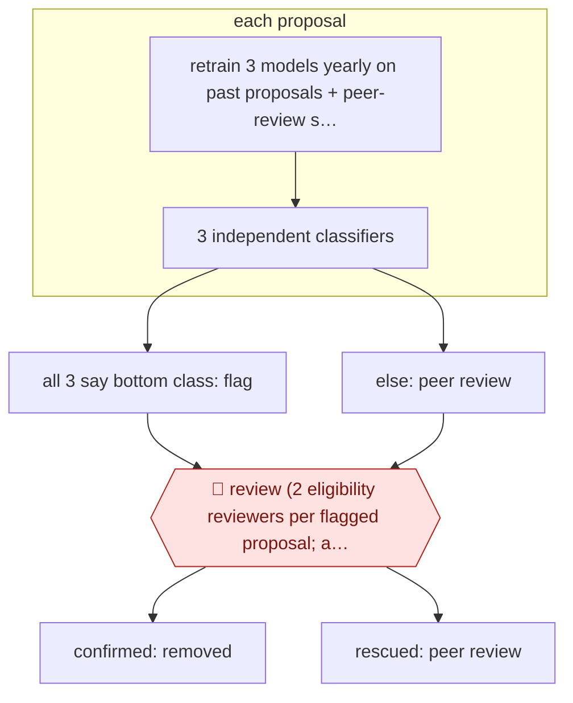

# Funder-side prescreen

`PRO › RES › GRANT` · sampled · evidence A · **draft: needs a reference example** ([how to add one](../../../../../CONTRIBUTING.md#1-add-an-example-run))

**Shape:** `retrain 3 models yearly on past proposals + peer-review scores → each proposal: 3 independent classifiers → all 3 say bottom class: flag | else: peer review → 🛑 review (2 eligibility reviewers per flagged proposal; any reasonable doubt: rescue) → confirmed: removed | rescued: peer review`
**How it differs:** Closest is AWF-0045 Critique-first grant draft (GRANT), which helps an applicant PI write a proposal. This one runs on the funder's side and triages incoming proposals. Autonomy is sampled: people review only the flagged set. Deliverable, operator and checkpoints all differ.
**Variants:** `biolinkbert-bioelectra-ensemble`

<!-- shape diagram: generated by scripts/build_diagrams.py from `shape`; don't edit -->

<!-- end shape diagram -->

## Steps
1. Each year the foundation retrains three biomedical NLP classifiers (BioLinkBERT, BioELECTRA, BioLinkBERT+Adapter) on full texts of past proposals labelled with peer-review score classes [[1]](#sources).
2. Each new proposal runs through all three models on their own. It is flagged only if all three put it in the bottom class [[1]](#sources).
3. Proposals not flagged go to normal peer review [[1]](#sources).
4. 🛑 **Review**: two human eligibility reviewers examine every flagged proposal. If either has reasonable doubt, the proposal is rescued and goes back to peer review [[1]](#sources).
5. Confirmed proposals leave the process. The first year ran as a hidden parallel trial (HR22) before going live in HR23 [[1]](#sources).

**Output:** A reduced pool of proposals sent to expert peer review, with an auditable list of AI-flagged, human-confirmed removals.
**Failure modes → guards:** False negatives exclude good science for good: in the HR22 trial two wrongly flagged proposals were funded in the traditional track → require all three models to agree, two-reviewer rescue on doubt, and a hidden parallel trial before going live [[1]](#sources).

## Public runs

Coverage as of 2026-11-06: **Strong**: a first-hand, detailed run that matches most of the shape. Collected and re-checked in [Second collection pass](../../../../../research/2026-11-second-pass.md).

- [Carbonell Cortés et al., Data & Policy](https://www.cambridge.org/core/product/D17CC86C884D4F9E3A6DD9ABF3F4605E/core-reader) (2024-10-23). CaixaResearch Health call HR23 run live; human reviewers rescued over a third of flags. "the model suggested screening out 98 proposals out of the 493 that were submitted". *First-hand: yes; confidence: high.*

## Sources

1. Carbonell Cortés et al., AI-assisted prescreening of biomedical research proposals: ethical considerations and the pilot case of 'la Caixa' Foundation, Data & Policy 6:e49, 2024-10-23. https://www.cambridge.org/core/product/D17CC86C884D4F9E3A6DD9ABF3F4605E/core-reader
