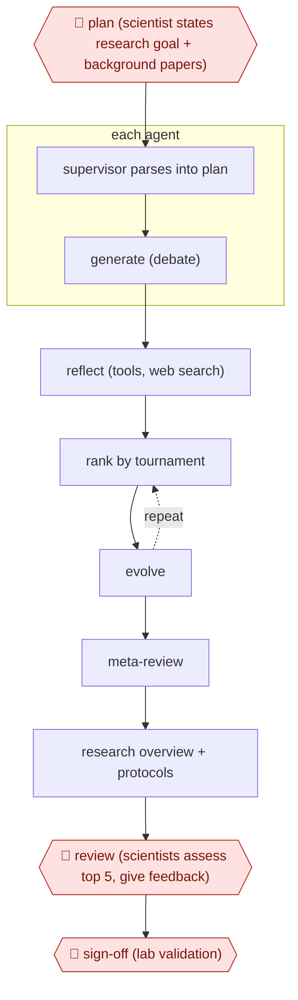

# Hypothesis tournament

`PRO › RES › LITREV` · checkpointed · evidence A · **draft: needs a reference example** ([how to add one](../../../../../CONTRIBUTING.md#1-add-an-example-run))

**Shape:** `🛑 plan (scientist states research goal + background papers) → supervisor parses into plan → each agent: generate (debate) → reflect (tools, web search) → (rank by tournament ⟲ evolve) → meta-review → research overview + protocols → 🛑 review (scientists assess top 5, give feedback) → 🛑 sign-off (lab validation)`
**How it differs:** Closest in-class is AWF-0009 Screening funnel (LITREV), which delivers a systematic review. This one delivers new ranked hypotheses from literature through an agent tournament, gated by scientist review and lab validation. The deliverable differs. Also near AWF-0034 Chemist-gated DMTA (HLT/DRUGDISC), which runs iterative make-test cycles on a fixed target rather than open hypothesis generation. Class fit note: ANALYSIS is the alternative home.
**Variants:** `google-ai-co-scientist-gemini2`

<!-- shape diagram: generated by scripts/build_diagrams.py from `shape`; don't edit -->

<!-- end shape diagram -->

## Steps
1. 🛑 **Plan**: the scientist states a research goal in plain language and may add seed ideas and background papers. Imperial gave only background on phage satellites and key cf-PICI papers, not its unpublished result [[1]](#sources)[[2]](#sources).
2. A Supervisor agent turns the goal into a research plan and queues work for six specialized agents: Generation, Reflection, Ranking, Evolution, Proximity and Meta-review [[1]](#sources).
3. Generation proposes hypotheses through simulated debate. Reflection critiques them using tools such as web search. Ranking runs Elo tournaments, and Evolution refines the winners, looping with more compute [[1]](#sources).
4. Output: ranked hypotheses, a research overview and experimental protocols [[1]](#sources).
5. 🛑 **Review**: scientists critically assess the five top-ranked hypotheses and can steer with natural-language feedback [[1]](#sources)[[2]](#sources).
6. 🛑 **Sign-off**: wet-lab work decides; the AML repurposing candidates were tested in vitro in cell lines [[1]](#sources).

**Output:** A ranked hypothesis set with overview and protocols that scientists use to choose experiments.
**Failure modes → guards:** Elo rankings are self-rated, not ground truth → expert assessment of the top candidates and lab validation [[1]](#sources). Over-claiming 'discovery' → the cf-PICI case rediscovered a known but unpublished result, and lab validation was still needed [[2]](#sources).

## Public runs

Coverage as of 2026-11-06: **Strong**: a first-hand, detailed run that matches most of the shape. Collected and re-checked in [Second collection pass](../../../../../research/2026-11-second-pass.md).

- [Penadés et al., AI mirrors experimental science (bioRxiv)](https://www.biorxiv.org/content/10.1101/2025.02.19.639094v1) (2025-02-19). Imperial lab posed its unpublished question; top-ranked hypothesis matched its lab result. "cf-PICIs hijack diverse phage tails to expand their host range" (top-ranked hypothesis; scientists assessed the top five). *First-hand: yes; confidence: high.*
- [Google Research, AI co-scientist](https://research.google/blog/accelerating-scientific-breakthroughs-with-an-ai-co-scientist/) (2025-02-19). AML repurposing candidates validated in vitro; liver fibrosis targets tested in organoids. "p-values for all suggested drugs are <0.01". *First-hand: yes; confidence: med.*

## Sources

1. Gottweis & Natarajan, Google Research, Accelerating scientific breakthroughs with an AI co-scientist, 2025-02-19. https://research.google/blog/accelerating-scientific-breakthroughs-with-an-ai-co-scientist/
2. Penadés, Gottweis et al., AI mirrors experimental science to uncover a novel mechanism of gene transfer crucial to bacterial evolution, bioRxiv, 2025-02-19. https://www.biorxiv.org/content/10.1101/2025.02.19.639094v1
