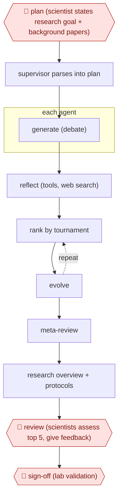

# Hypothesis tournament

`PRO › RES › LITREV` · checkpointed · evidence A · **draft: needs a reference example** ([how to add one](../../../../../CONTRIBUTING.md#1-add-an-example-run))

**Shape:** `🛑 plan (scientist states research goal + background papers) → supervisor parses into plan → each agent: generate (debate) → reflect (tools, web search) → (rank by tournament ⟲ evolve) → meta-review → research overview + protocols → 🛑 review (scientists assess top 5, give feedback) → 🛑 sign-off (lab validation)`
**Variants:** `google-ai-co-scientist-gemini2`

<!-- shape diagram: generated by scripts/build_diagrams.py from `shape`; don't edit -->

<!-- end shape diagram -->

## Background

Before a research group commits months of lab work, someone has to decide what to test. That means reading a very large and fast-growing literature, often outside the group's own field, and turning it into hypotheses: explanations that an experiment could prove wrong. By hand this is slow, and people tend to stay with the ideas they already hold. Here the agent drafts many hypotheses, critiques them against the literature, ranks them against each other, improves the best, and writes up the leaders with suggested experiments. The scientists set the goal, judge the highest-ranked hypotheses and steer, because the ranking is the system's own opinion and not evidence. Only experiments in the lab can settle whether a hypothesis is true.

**Terms:**
- **Hypothesis**: a proposed explanation specific enough to be tested by an experiment.
- **Elo tournament**: ranking by comparing hypotheses in pairs. Each win or loss moves a rating, as chess ratings do, so the best end up on top.
- **Simulated debate**: the model argues for and against a hypothesis in turn, to find its weak points.
- **Wet lab / in vitro**: experiments on cells or samples in a laboratory, as opposed to computer analysis; in vitro means in cells in a dish.
- **Drug repurposing**: testing an existing drug against a different disease. **AML** is acute myeloid leukaemia, a blood cancer; an **organoid** is a small lab-grown tissue model.
- **cf-PICI**: a kind of small mobile genetic element in bacteria that depends on a virus (a phage) to spread, used in the main public run.

## Build it with an agent

**Form:** `skill`. One scientist or group works on one research goal at a time and stays in the conversation to set the goal and judge the results, so a skill is enough. It sends the many comparisons to subagents.

**You need:** the research goal in plain language and any background papers as files; a literature-search connector so the critique step can look claims up; reference files in the skill describing each role (generate, reflect, rank, evolve, meta-review). Give the agent no unpublished data unless your organisation has approved the setup, and note that in the Imperial case the system saw only published information.

| Step | Built as |
|---|---|
| 🛑 plan (scientist states research goal + background papers) → supervisor parses into plan | The skill reads the goal and papers and writes `plan.md`: the questions, the criteria hypotheses will be judged on, and how many rounds to run. |
| each agent: generate (debate) → reflect (tools, web search) | Subagents write hypotheses, each also arguing against its own; a second set critiques them using the literature connector and records the citations. |
| (rank by tournament ⟲ evolve) | A dynamic workflow runs the pairwise comparisons in parallel as one subagent per pair, and the skill keeps the Elo ratings in a file. The best hypotheses are rewritten by a subagent and re-enter the next round. |
| meta-review → research overview + protocols | The main conversation reads the ranking and critiques, then writes the research overview and an experimental protocol for each top hypothesis. |
| 🛑 review (scientists assess top 5, give feedback) | See Checkpoints. |
| 🛑 sign-off (lab validation) | See Checkpoints. |

**Checkpoints:** `plan`: the skill writes `plan.md` and stops until the scientist approves it. `review`: the skill ends by presenting the five top-ranked hypotheses with the critiques and citations behind them and asks for feedback; a scientist may add instructions and rerun the rounds. `sign-off`: the skill ends the run there and has no tool to order or run experiments, so lab validation takes place outside the agent.

**Since the sources:** Sources date from 2025-02 to 2025-09, and the public runs run to 2026-05. Sources 2 and 3 (the bioRxiv preprint and the Cell paper) could not be opened in this session. The sources describe Google's own multi-agent system, built on Gemini 2.0, with six named agents and a supervisor. This build has a general agent play those roles with written prompts and has not been compared with that system. The sources' "more compute, better output" loop corresponds only to how many rounds the plan allows. The two Imperial runs show that the output depended on what the scientists supplied, and that an unpublished result stayed hidden from the system.

*A design based on this entry's steps and the tool documentation as of 2026-11, not a reported run.*

## Steps

*As reported by the sources.*

1. 🛑 **Plan**: the scientist states a research goal in plain language and may add seed ideas and background papers. Imperial gave only background on phage satellites and key cf-PICI papers, not its unpublished result [[1]](#sources)[[2]](#sources).
2. A Supervisor agent turns the goal into a research plan and queues work for six specialized agents: Generation, Reflection, Ranking, Evolution, Proximity and Meta-review [[1]](#sources).
3. Generation proposes hypotheses through simulated debate. Reflection critiques them using tools such as web search. Ranking runs Elo tournaments, and Evolution refines the winners, looping with more compute [[1]](#sources).
4. The system outputs ranked hypotheses, a research overview and experimental protocols [[1]](#sources).
5. 🛑 **Review**: scientists critically assess the five top-ranked hypotheses and can steer with natural-language feedback [[1]](#sources)[[2]](#sources).
6. 🛑 **Sign-off**: the scientists' wet-lab work decides; the AML repurposing candidates were tested in vitro in cell lines [[1]](#sources).

**Output:** A ranked hypothesis set with overview and protocols that scientists use to choose experiments.
**Failure modes → guards:** Elo rankings are self-rated, not ground truth → expert assessment of the top candidates and lab validation [[1]](#sources). Over-claiming 'discovery' → the cf-PICI case rediscovered a known but unpublished result, and lab validation was still needed [[2]](#sources).

**Recent practice (2026):**
- Plan step: in the Imperial cf-PICI run the research goal was a single input document of published information only, so the system could not see the lab's unpublished result (Cell 2025-09-09). [[3]](#sources)
**How it differs:** Closest in-class is AWF-0009 Screening funnel (LITREV), which delivers a systematic review. This one delivers new ranked hypotheses from literature through an agent tournament, gated by scientist review and lab validation. The deliverable differs. Also near AWF-0034 Chemist-gated DMTA (HLT/DRUGDISC), which runs iterative make-test cycles on a fixed target rather than open hypothesis generation. Class fit note: ANALYSIS is the alternative home.

## Public runs

Coverage as of 2026-11-06: **Strong**: a first-hand, detailed run that matches most of the shape. Collected and re-checked in [Second collection pass](../../../../../research/2026-11-second-pass.md). More runs added in [Third collection pass](../../../../../research/2026-11-third-pass.md).

- [Penadés et al., AI mirrors experimental science (bioRxiv)](https://www.biorxiv.org/content/10.1101/2025.02.19.639094v1) (2025-02-19). Imperial lab posed its unpublished question; top-ranked hypothesis matched its lab result. "cf-PICIs hijack diverse phage tails to expand their host range" (top-ranked hypothesis; scientists assessed the top five). *First-hand: yes; confidence: high.*
- [Google Research, AI co-scientist](https://research.google/blog/accelerating-scientific-breakthroughs-with-an-ai-co-scientist/) (2025-02-19). AML repurposing candidates validated in vitro; liver fibrosis targets tested in organoids. "p-values for all suggested drugs are <0.01". *First-hand: yes; confidence: med.*
- [Penadés, Gottweis et al., Cell](https://www.cell.com/cell/fulltext/S0092-8674%2825%2900973-0) (2025-09-09). Imperial lab gave co-scientist one input document; its top hypothesis matched their unpublished, experimentally confirmed mechanism. "The AI co-scientist generated five ranked hypotheses" (top Elo score 1,777). *First-hand: yes; confidence: high.*
- [Google DeepMind, Co-Scientist: A multi-agent AI partner](https://deepmind.google/blog/co-scientist-a-multi-agent-ai-partner-to-accelerate-research/) (2026-05-19). Drug-repurposing candidates for fibrosis tested in the lab; results in Advanced Science. "successfully blocked 91% of a scarring-linked response in lab tests". *First-hand: vendor; confidence: med.*

## Sources

1. Gottweis & Natarajan, Google Research, Accelerating scientific breakthroughs with an AI co-scientist, 2025-02-19. https://research.google/blog/accelerating-scientific-breakthroughs-with-an-ai-co-scientist/
2. Penadés, Gottweis et al., AI mirrors experimental science to uncover a novel mechanism of gene transfer crucial to bacterial evolution, bioRxiv, 2025-02-19. https://www.biorxiv.org/content/10.1101/2025.02.19.639094v1
3. Penadés J.R., Gottweis J. et al., AI mirrors experimental science to uncover a mechanism of gene transfer crucial to bacterial evolution, Cell 188(23), published online 2025-09-09. https://www.cell.com/cell/fulltext/S0092-8674%2825%2900973-0
