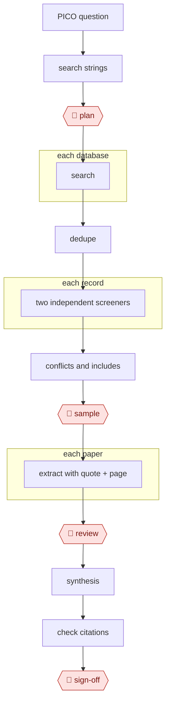

# Screening funnel

`PRO › RES › LITREV` · checkpointed · evidence A · **draft: needs a reference example** ([how to add one](../../../../../CONTRIBUTING.md#1-add-an-example-run))

**Shape:** `PICO question → search strings → 🛑 plan → each database: search → dedupe → each record: two independent screeners → conflicts and includes → 🛑 sample → each paper: extract with quote + page → 🛑 review → synthesis → check citations → 🛑 sign-off`

<!-- shape diagram: generated by scripts/build_diagrams.py from `shape`; don't edit -->

<!-- end shape diagram -->

## Background

A systematic review answers a health question by finding every study that bears on it and combining their results by a method that is written down in advance. The question is framed as PICO: the patients studied (population), the treatment (intervention), what it is compared with, and the outcome measured. Reviewers search several literature databases with search strings, remove duplicate records, and screen thousands of titles and abstracts, with two people deciding on each record independently. They then read the full texts, extract the numbers, combine them and write the paper. By hand this takes months, and missing a study that should have been included skews the result. Here the agent runs the searches, does the two independent screenings, extracts data with the exact quote and page for each value, and checks references. People approve the plan, check the screening against a set they screened themselves, verify the numbers that feed the analysis, and sign off, because the authors answer for the review and journals require them to disclose any AI use.

**Terms:**
- **PICO**: the four parts of a clinical question: population, intervention, comparison, outcome.
- **Search string (Boolean, MeSH)**: a database query that combines keywords with AND, OR and NOT; MeSH terms are the standard subject headings used to index medical papers.
- **Protocol registration (PROSPERO, OSF)**: publishing the review's plan before starting, so the methods cannot be quietly changed afterwards.
- **PRISMA flow diagram**: the standard chart of how many records were found, removed and kept at each stage.
- **Sensitivity**: the share of truly eligible studies that a screener keeps. **Cohen's κ** measures how far two screeners agree beyond chance.
- **Meta-analysis**: a statistical combination of results from several studies. A **risk-of-bias table** rates how reliable each study's methods are.
- **Schema**: the fixed list of fields to extract from each paper.
- **ICMJE**: the International Committee of Medical Journal Editors, whose rules many medical journals follow.

## Build it with an agent

**Form:** `project`. A review team works through thousands of records over weeks, so a skill is not enough: the two screeners must not see each other's decisions, screening at scale must not start before the sample check passes, and every extracted value must carry its quote. These need custom subagents and scripts that enforce them, with state kept in files.

**You need:** access to the literature databases the protocol names (the sources use PubMed, Scopus, OpenAlex and Semantic Scholar through their APIs); a folder of full-text PDFs the team is entitled to use; a PDF-to-text script; a human-screened sample of records to calibrate against; a fixed extraction schema; a way to resolve DOIs (the sources use Crossref). The agent has no submission or registration account.

| Step | Built as |
|---|---|
| PICO question → search strings → 🛑 plan | The skill drafts the Boolean and MeSH strings and `protocol.md`, then stops. A librarian or the lead researcher approves it and registers the protocol. |
| each database: search → dedupe | One script per database writes the records to a table; a deduplication script merges them and writes the counts for the PRISMA diagram. |
| each record: two independent screeners → conflicts and includes | A dynamic workflow gives each record to two subagents with different instructions, neither seeing the other. Each returns include or exclude with a reason, and is told to include when unsure. A script lists conflicts for people to resolve. |
| 🛑 sample | See Checkpoints. |
| each paper: extract with quote + page | A subagent fills the schema for each paper. A script, or a hook on writes to the extraction file, rejects any row whose value has no quote or page. |
| 🛑 review | See Checkpoints. |
| synthesis | Scripts produce the risk-of-bias table and the meta-analysis; the main conversation drafts the narrative from them. |
| check citations | A script resolves every reference by DOI; the skill flags claims with no supporting reference. |
| 🛑 sign-off | See Checkpoints. |

**Checkpoints:** `plan`: the skill stops after writing the protocol. `sample`: the skill stops after screening a sample and reports sensitivity and Cohen's κ against the human-screened set; the workflow script refuses to screen the rest unless a `calibration-approved` file exists, which only a person creates. `review`: the skill stops with the extraction table and the quote for each value, and people check every number that feeds the meta-analysis before synthesis begins. `sign-off`: the agent has no tool to submit or register anything, and the authors take responsibility and disclose the AI use.

**Since the sources:** Sources date from 2024 to 2026-06; ICMJE guidance is undated. The medRxiv preprints (sources 9 and the two public runs) and the JMIR paper could not be opened in this session, so the figures in Steps and Public runs are as recorded in the entry and not re-read. The sources name specific screening and extraction tools (Elicit, ASReview, Rayyan AI, GROBID, Zotero); this build does the work with subagents and scripts, and any of those tools can take over a step. The public runs report a locked model ensemble and a human-verified extraction, not a build like this one.

*A design based on this entry's steps and the tool documentation as of 2026-11, not a reported run.*

## Steps

*As reported by the sources.*

1. The agent drafts Boolean and MeSH search strings. 🛑 **Plan**: a librarian or PI approves, then the protocol is registered (PROSPERO, OSF).
2. The agent searches, deduplicates and logs counts for the PRISMA flow diagram.
3. Two independent LLM screeners each screen every record, giving a reason per decision. **Tune for sensitivity, not accuracy.** A missed eligible study biases the result, and published sensitivity varies widely: a pooled 0.73 in one meta-analysis versus ~96% for dual-model ensembles in recent preprints [[9]](#sources). 🛑 **Sample**: calibrate against a human-screened set (sensitivity, Cohen's κ) before trusting the screeners at scale. Humans resolve all conflicts.
4. The agent screens full texts in the same pattern, with closer human involvement.
5. The agent extracts the data, and every field quotes its source span and page. 🛑 **Review**: humans verify 100% of the numbers that feed the meta-analysis.
6. The agent writes the synthesis and draft: risk-of-bias table, meta-analysis script, narrative.
7. The agent resolves every reference and flags unsupported claims.
8. 🛑 **Sign-off**: authors take responsibility and disclose AI use. Under ICMJE, chatbots can't be authors and use must be disclosed [[8]](#sources).

**Output:** a PRISMA diagram, extraction dataset, draft manuscript, and an audit log of AI decisions.

## Public runs

Coverage as of 2026-11-06: **Strong**: a first-hand, detailed run that matches most of the shape. From [Where are the real runs?](../../../../../research/2026-11-real-runs.md); every number was re-checked against its page.

- [Fagerberg et al., Socialstyrelsen, medRxiv](https://www.medrxiv.org/content/10.64898/2026.06.02.26354724v1.full) (2026-06). A locked LLM ensemble screens for 24 guideline reviews; two blinded methodologists audit a prespecified sample. "screened 74,679 records"; "415 to 34 person-days"; of 600 audited exclusions "none was confirmed as a final false negative". *First-hand: yes; confidence: high.*
- [Gartlehner et al., RTI and partners, medRxiv](https://www.medrxiv.org/node/963738) (2025-03-21). LLM first-pass extraction in six live reviews, verified by people, against human-only extraction. "9,341 data elements, extracted from 63 studies"; "precision of 98.9%"; "41 minutes per study". *First-hand: yes; confidence: high.*

## Sources

8. ICMJE AI guidance (summary). https://utsouthwestern.libguides.com/artificial-intelligence/ai-publishing-icmje
9. LLM screening evidence: JMIR (2024) https://www.jmir.org/2024//e52758 · Dual-model ensemble preprint (medRxiv, November 2025) https://www.medrxiv.org/content/10.1101/2025.11.03.25339455.full.pdf · Cochrane-based benchmark preprint (2026) https://www.medrxiv.org/content/10.64898/2026.06.02.26354724v1.full.pdf
