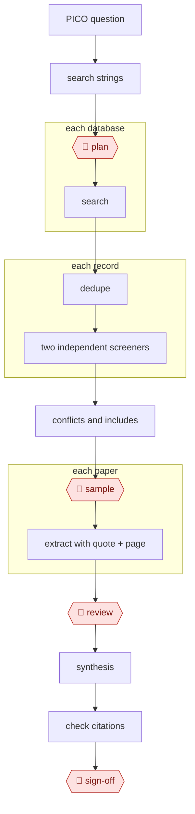

# Screening funnel

`PRO › RES › LITREV` · checkpointed · evidence A · **draft: needs a reference example** ([how to add one](../../../../../CONTRIBUTING.md#1-add-an-example-run))

**Shape:** `PICO question → search strings → 🛑 plan → each database: search → dedupe → each record: two independent screeners → conflicts and includes → 🛑 sample → each paper: extract with quote + page → 🛑 review → synthesis → check citations → 🛑 sign-off`

<!-- shape diagram: generated by scripts/build_diagrams.py from `shape`; don't edit -->

<!-- end shape diagram -->

| Role | Tools |
|---|---|
| Search strategist | LLM + PubMed, Scopus, OpenAlex, and Semantic Scholar APIs |
| Screeners ×2 (independent) | Elicit, ASReview, Rayyan AI, or a custom classifier |
| Extractor | PDF parser (e.g. GROBID) → LLM into a fixed schema, quoting the source span |
| Verifier | Crossref DOI resolution + Zotero |

## Steps
1. Draft Boolean and MeSH search strings. 🛑 **Plan**: a librarian or PI approves, then the protocol is registered (PROSPERO, OSF).
2. Search, deduplicate, and log counts for the PRISMA flow diagram.
3. Two independent LLM screeners, each giving a reason per decision. **Tune for sensitivity, not accuracy.** A missed eligible study biases the result, and published sensitivity varies widely: a pooled 0.73 in one meta-analysis versus ~96% for dual-model ensembles in recent preprints [[9]](#sources). 🛑 **Sample**: calibrate against a human-screened set (sensitivity, Cohen's κ) before trusting the screeners at scale. Humans resolve all conflicts.
4. Full-text screening follows the same pattern with closer human involvement.
5. Extraction: every field quotes its source span and page. 🛑 **Review**: humans verify 100% of the numbers that feed the meta-analysis.
6. Synthesis and draft: risk-of-bias table, meta-analysis script, narrative.
7. Resolve every reference and flag unsupported claims.
8. 🛑 **Sign-off**: authors take responsibility and disclose AI use. Under ICMJE, chatbots can't be authors and use must be disclosed [[8]](#sources).

**Output:** a PRISMA diagram, extraction dataset, draft manuscript, and an audit log of AI decisions.

## Public runs

Coverage as of 2026-11-06: **Strong**: a first-hand, detailed run that matches most of the shape. From [Where are the real runs?](../../../../../research/2026-11-real-runs.md); every number was re-checked against its page.

- [Fagerberg et al., Socialstyrelsen, medRxiv](https://www.medrxiv.org/content/10.64898/2026.06.02.26354724v1.full) (2026-06). A locked LLM ensemble screens for 24 guideline reviews; two blinded methodologists audit a prespecified sample. "screened 74,679 records"; "415 to 34 person-days"; of 600 audited exclusions "none was confirmed as a final false negative". *First-hand: yes; confidence: high.*
- [Gartlehner et al., RTI and partners, medRxiv](https://www.medrxiv.org/node/963738) (2025-03-21). LLM first-pass extraction in six live reviews, verified by people, against human-only extraction. "9,341 data elements, extracted from 63 studies"; "precision of 98.9%"; "41 minutes per study". *First-hand: yes; confidence: high.*

## Sources

8. ICMJE AI guidance (summary). https://utsouthwestern.libguides.com/artificial-intelligence/ai-publishing-icmje
9. LLM screening evidence: JMIR (2024) https://www.jmir.org/2024//e52758 · Dual-model ensemble preprint (medRxiv, November 2025) https://www.medrxiv.org/content/10.1101/2025.11.03.25339455.full.pdf · Cochrane-based benchmark preprint (2026) https://www.medrxiv.org/content/10.64898/2026.06.02.26354724v1.full.pdf
