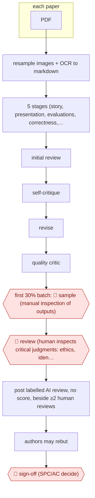

# Added AI review

`PRO › RES › PEER` · sampled · evidence A · **draft: needs a reference example** ([how to add one](../../../../../CONTRIBUTING.md#1-add-an-example-run))

**Shape:** `each paper: PDF → resample images + OCR to markdown → 5 stages (story, presentation, evaluations, correctness, significance) → initial review → self-critique → revise → quality critic → first 30% batch: 🛑 sample (manual inspection of outputs) → 🛑 review (human inspects critical judgments: ethics, identity leaks, missing structure) → post labelled AI review, no score, beside ≥2 human reviews → authors may rebut → 🛑 sign-off (SPC/AC decide)`
**How it differs:** AWF-0046 Review-of-review feedback sends private feedback to a human reviewer about their review. AWF-0106 Submission intake screen does integrity checks before peer review. Here the AI writes a full review that the authors and the decision-makers see. The deliverable is a review of the paper itself, with scale-up sampling and pre-post inspection checkpoints.
**Variants:** `aaai-26-review-system`

<!-- shape diagram: generated by scripts/build_diagrams.py from `shape`; don't edit -->

<!-- end shape diagram -->

## Steps
1. Each submission that enters full review: resample all images to 250 DPI and convert the PDF to markdown with olmOCR. Later stages get both the PDF and the markdown [[1]](#sources).
2. Five core review stages assess the story, presentation, evaluations, correctness and significance. Their findings are compiled into an initial review in a fixed format [[1]](#sources).
3. A self-critique stage checks for unsupported claims, missing details and inconsistencies with the paper. A final stage revises the review to address them [[1]](#sources).
4. A quality-checking critic scores the final review. 🛑 **Sample**: an initial batch of 30% of papers ran through the core stages and the outputs were inspected manually before the rest were processed [[1]](#sources).
5. 🛑 **Review**: a human inspects the critical judgments for ethical concerns, revealed author identities or missing structural elements. A few papers were reprocessed after manual PDF conversion. Logs and checkpoints from every stage are kept for audit [[1]](#sources).
6. Post one clearly labelled AI review with no score or recommendation in Phase 1, alongside at least two human reviews. No human reviewer is replaced [[1]](#sources).
7. 🛑 **Sign-off**: SPCs and ACs read the AI and human reviews when deciding promotion to Phase 2. Authors can rebut the AI review, and final decisions stay with humans [[1]](#sources).

**Output:** One labelled AI review per paper, posted in the review system for authors, reviewers, SPCs and ACs, and used as extra input to human decisions.
**Failure modes → guards:** Misreads equations and tables, overemphasises minor issues, overly long → self-critique stage plus human decision-makers. Survey: respondents saw AI reviews 'more likely to overemphasize minor issues' [1]. Exceptional graphics formats break conversion → manual PDF conversion and reprocessing [1]. Identity or ethics leaks → human inspection before posting [1].

## Public runs

Coverage as of 2026-11-13: **Strong**: a first-hand, detailed run that matches most of the shape. Collected and re-checked in [Third collection pass](../../../../../research/2026-11-third-pass.md).

- [Biswas et al., AAAI-26 AI Review Pilot](https://arxiv.org/html/2604.13940) (2026-04-15). Every AAAI-26 main-track full-review paper got one AI review; 5,834 survey responses. "generate reviews for all 22,977 full-review papers in less than a day". *First-hand: yes; confidence: high.*

## Sources

1. Biswas J. et al., AI-Assisted Peer Review at Scale: The AAAI-26 AI Review Pilot, arXiv 2604.13940, 2026-04-15. https://arxiv.org/html/2604.13940
2. AAAI, Report: AAAI-2026 AI-Assisted Peer Review Pilot Program, 2026-01. https://aaai.org/wp-content/uploads/2026/01/The-AAAI-2026-AI-Assisted-Peer-Review-Pilot-Program.pdf
